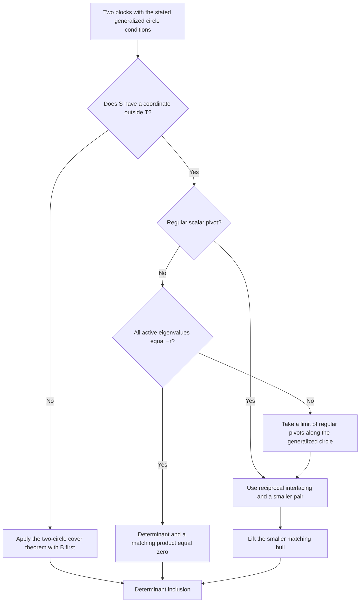

# Overlapping circle blocks

Let $A$ and $B$ be complex normal matrices in a common orthonormal basis.
Let $S$ and $T$ be sets of coordinate labels with $S \cup T$ equal to the full
label set. The matrix $A$ has a square block on $S$ and scalar blocks on
each coordinate outside $S$. The matrix $B$ has a square block on $T$
and scalar blocks on each coordinate outside $T$.

A generalized circle is a circle, a point circle, or an affine line. Assume
the spectrum of the $A$ block on $S$ and the negatives of the entries of $B$
on $S \setminus T$ lie on one generalized circle. Assume the negative spectrum
of the $B$ block on $T$ and the entries of $A$ on $T \setminus S$ lie on a
second generalized circle. The two generalized circles can be equal.

Let $(a_i)$ and $(b_i)$ list the eigenvalues of $A$ and $B$, with
multiplicity. Then $\det(A+B)$ lies in the real convex hull of the products
$\prod_i(a_{\sigma(i)}+b_i)$ over all permutations $\sigma$. The order and
the size of $S \cap T$ are unrestricted. In the Lean statement, the
labels in $S \setminus T$ come first. The unitary matrix that gives
the eigenbasis of $B$ fixes these coordinate vectors.
[Overlapping circle blocks](../Lean/MOC/OverlappingCircleBlocks.lean#L83)

Take $j\in S\setminus T$ and write $r$ for the entry of $B$ at $j$.
Add $r$ to each diagonal entry of the block of $A$ on $S$. The pivot is
regular if $A_{jj}+r\ne0$ and the shifted block is invertible. The
spectrum of the inverse lies on an affine line. Delete row and column
$j$ of this inverse. The eigenvalues of the resulting principal
submatrix interlace those of the inverse along the line. The inverse
of this submatrix gives the shifted Schur complement. Subtract the shift
to get a smaller active block. Its spectrum and the negatives of the
remaining scalar entries of $B$ on $S\setminus T$ lie on the same
generalized circle.
[Weak interlacing](../Lean/MOC/WeakHermitianCompressionInterlacing.lean#L13) · [Local pivot](../Lean/MOC/LocalCircleSchurPivot.lean#L58)

For a regular pivot, the pivot factor multiplies the determinant of the
smaller pair. The same factor maps its matching hull into the parent
matching hull. Each matching keeps the partners of the untouched block.
For a singular pivot, move $-r$ on the generalized circle and take a
limit of regular pivots. If all eigenvalues of the active block equal
$-r$, the pivot row is zero in $A+B$. A matching that pairs the entry
$r$ with an eigenvalue $-r$ gives a zero product.
[Matching hull lift](../Lean/MOC/LocalCircleSchurLift.lean#L125) · [Singular pivots](../Lean/MOC/LocalCircleSchurPivot.lean#L110)

When $S$ is contained in $T$, the active block of $B$ is the full matrix.
Its spectrum and the negatives of the entries of $A$ outside $S$ lie on
one generalized circle. The remaining entries of the negative spectrum of
$A$ lie on the other generalized circle. Apply the two-circle cover
theorem with the matrices in that order. [Two-circle cover](../Lean/MOC/TwoCircleCover.lean#L10)

## Example

Let $S=\{1,2,3\}$ and $T=\{2,3,4\}$. Write $\mathrm{i}$ for the imaginary
unit. Give the $A$ block the spectrum $1,2,4$ and give the $B$ block the
spectrum $\mathrm{i},2\mathrm{i},4\mathrm{i}$. Give $A$ the entry
$3\mathrm{i}$ outside $S$ and give $B$ the entry $3$ outside $T$.
The two generalized circles are the real and imaginary axes. Each full
spectrum contains three collinear points and a fourth point off their line.

## Forest of bridges between spectral blocks

Partition the row labels and column labels into paired blocks of the
same sizes. Start with a unitary change of eigenbasis that is block
diagonal in this partition. In each block specify at most four row
labels. Require one generalized circle to contain all column
eigenvalues in the block and the negatives of all row eigenvalues
outside the specified labels in that block. The circles can differ
between blocks.

A bridge applies a unitary matrix of order two and determinant one
to two of the specified rows from different blocks. Regard each
bridge as an edge between its two blocks. Take distinct edges of a
forest, which is a graph with no cycles. Apply the bridges in any
order. The resulting change of eigenbasis satisfies the determinant
inclusion for every pair of spectra with the stated circle conditions.
The number and sizes of the blocks are arbitrary.
[Bridge operation](../Lean/MOC/OneBridge.lean#L16) · [Forest theorem](../Lean/MOC/FourOutlierForestBridges.lean#L76)

Remove the last bridge in the chosen order. In the forest, its edge
separates its ends into different components. The other bridges
preserve this partition, so the matrix before the last bridge is
block diagonal across the partition. The bridge identity gives a
convex combination of two determinants of this earlier matrix. One
term uses the original spectra. The other term interchanges the two
row eigenvalues at the bridge. The interchange changes only the
specified labels, so the circle conditions still hold. Apply
induction to both terms.
[Bridge determinant identity](../Lean/MOC/OneBridge.lean#L227) · [Inclusion from both terms](../Lean/MOC/OneBridge.lean#L251)

When no bridges remain, exchange the pairs of spectra in each block.
One generalized circle contains the whole first spectrum and all
but at most four labels of the negated second spectrum. The theorem
for four omitted labels gives the inclusion in each block. Combine
the block inclusions by multiplying their convex combinations.
[Inclusion with four omitted labels](../Lean/MOC/HermitianByNormalFourProof.lean#L82) · [Block composition](../Lean/MOC/ExtendedCases.lean#L78)

## Lean check status

| Lean scope | Lean Checked? |
| --- | --- |
| The 9 source modules linked in this map | Partial (4/9) |

[Status definitions](README.md#lean-check-status). Paper arguments retain their stated scope.
