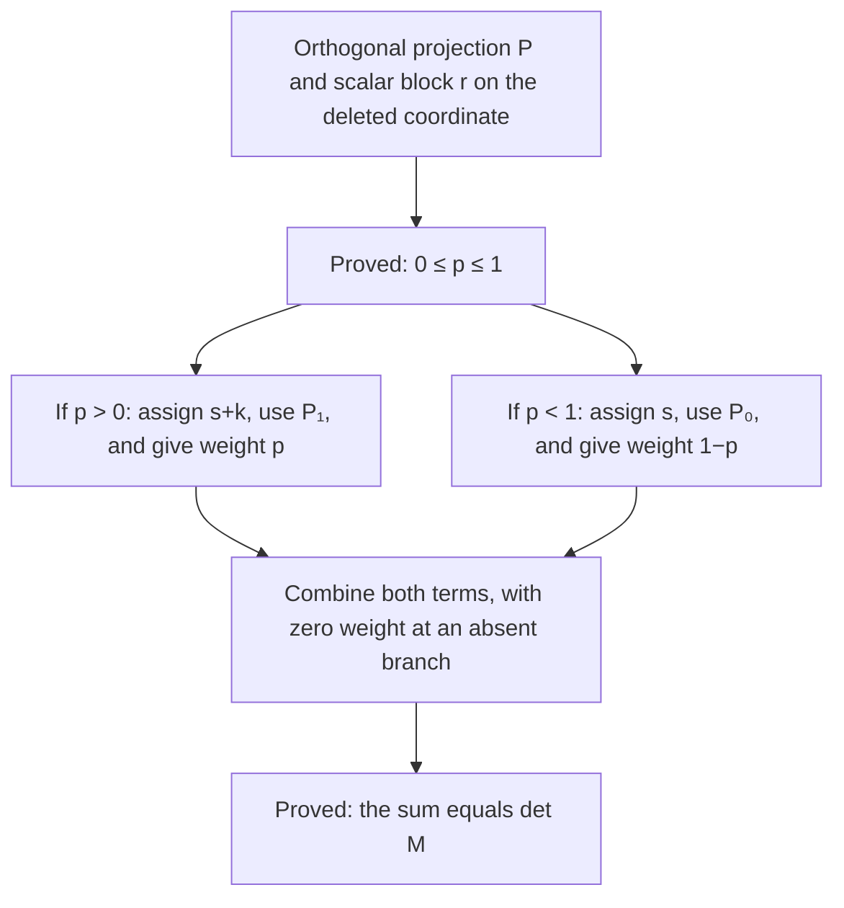

# Projection leaf deletion

The Marcus–de Oliveira conjecture compares the determinant of a sum
of two normal matrices with the products of sums of matched
eigenvalues. To reduce this comparison to smaller matrices, delete a
coordinate on which one matrix acts by a scalar. The other matrix
can mix that coordinate with the remaining coordinates.
[Conjecture and proof tree](../README.md)

## Determinant reduction

Take any finite set of remaining coordinates. Let the first matrix
have the form $sI+kP$. Here $I$ is the identity matrix, $s$ and $k$
are arbitrary complex scalars, and $P$ is an orthogonal projection.
Thus $P^2=P$ and $P^*=P$, where the star denotes conjugate transpose.
Write

$$
P=\begin{pmatrix}p&q^*\\q&J\end{pmatrix},
qquad
M=sI+kP+\begin{pmatrix}r&0\\0&B\end{pmatrix}.
$$

The deleted coordinate is first. Its diagonal entry $p$ in $P$ is
real. The column $q$ gives its entries in the remaining coordinates,
and $J$ is the compression of $P$ to those coordinates. The opposite
scalar is $r\in\mathbb C$. The remaining square matrix $B$ can be any
complex matrix.

For $p>0$ define $P_1=J-qq^*/p$. For $p<1$ define
$P_0=J+qq^*/(1-p)$. A branch with weight zero can use $J$. The
determinant satisfies

$$
\det M
=p(s+k+r)\det(sI+kP_1+B)
+(1-p)(s+r)\det(sI+kP_0+B).
$$

The two scalar factors are the eigenvalue sums for the deleted
coordinate. The coefficients $p$ and $1-p$ are nonnegative and have
sum one. They depend only on $P$. The positive-weight branches
retain orthogonal projections.
Their ranks are the rank of $P$ minus one for $P_1$, and the rank of
$P$ for $P_0$. At $p=0$ and $p=1$, the column $q$ is zero.
[Determinant reduction](../Lean/MOC/ProjectionLeafPivot.lean#L110) ·
[Weight bounds](../Lean/MOC/ProjectionConditioning.lean#L68) ·
[Selection projection](../Lean/MOC/ProjectionConditioning.lean#L154) ·
[Rejection projection](../Lean/MOC/ProjectionConditioning.lean#L176) ·
[Selection rank](../Lean/MOC/ProjectionConditioning.lean#L266) ·
[Rejection rank](../Lean/MOC/ProjectionConditioning.lean#L280) ·
[Endpoints](../Lean/MOC/ProjectionConditioning.lean#L81)

The determinant proof uses addition in the first row and the
affine dependence of a determinant on a rank-one update. It permits
singular matrices in every block.
[Bordered determinant formula](../Lean/MOC/ProjectionLeafPivot.lean#L45) ·
[Rank-one update](../Lean/MOC/Pencil.lean#L15)

The correction can change the entry with row $i$ and column $j$ only
when both entries of $q$ at $i$ and $j$ are nonzero. Thus a partition
block that contains the deleted coordinate can keep its remaining
coordinates as one block after the update.
[Entry formula](../Lean/MOC/ProjectionConditioning.lean#L199)

The two projection updates have a probability interpretation. On a
finite set of coordinates, a determinantal probability measure for
an orthogonal projection has one conditional subspace for inclusion
of a coordinate and one for exclusion. The matrix proof here uses
the projection equations directly.
[Lyons, Proposition 6.3](https://rdlyons.pages.iu.edu/pdf/bases.pdf#page=18)
