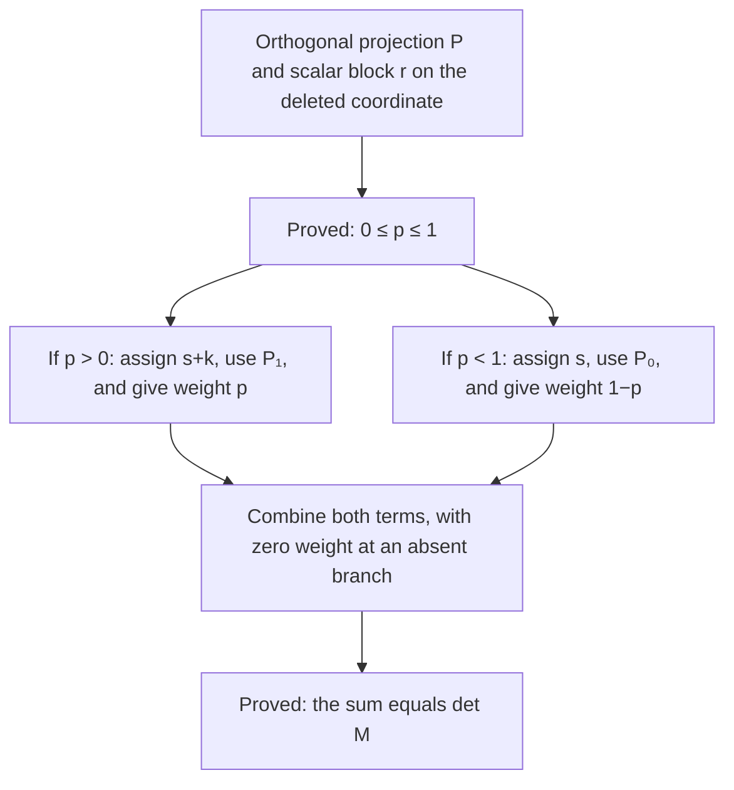
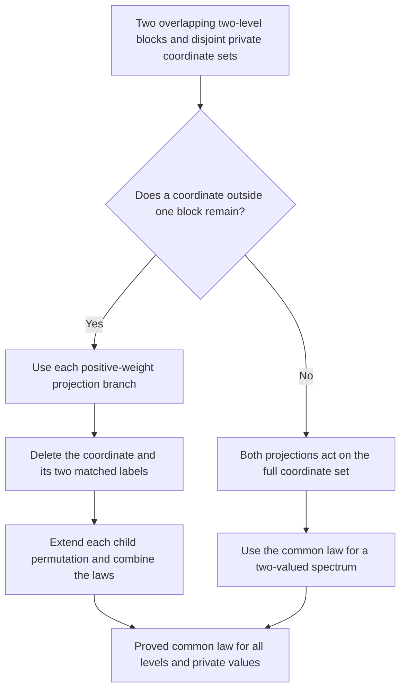

# Projection leaf deletion

The Marcus–de Oliveira conjecture compares the determinant of a sum
of two normal matrices with the products of sums of matched
eigenvalues. To reduce this comparison to smaller matrices, delete a
coordinate on which one matrix acts by a scalar. The other matrix
can mix that coordinate with the remaining coordinates.
[Conjecture and proof tree](../README.md)

## Determinant reduction

Take any finite set of remaining coordinates. Let the first matrix
have the form $sI+kP$. Here $I$ is the identity matrix, $s$ and $k$
are arbitrary complex scalars, and $P$ is an orthogonal projection.
Thus $P^2=P$ and $P^*=P$, where the star denotes conjugate transpose.
Write

$$
P=\begin{pmatrix}p&q^*\\q&J\end{pmatrix},
qquad
M=sI+kP+\begin{pmatrix}r&0\\0&B\end{pmatrix}.
$$

The deleted coordinate is first. Its diagonal entry $p$ in $P$ is
real. The column $q$ gives its entries in the remaining coordinates,
and $J$ is the compression of $P$ to those coordinates. The opposite
scalar is $r\in\mathbb C$. The remaining square matrix $B$ can be any
complex matrix.

For $p>0$ define $P_1=J-qq^*/p$. For $p<1$ define
$P_0=J+qq^*/(1-p)$. A branch with weight zero can use $J$. The
determinant satisfies

$$
\det M
=p(s+k+r)\det(sI+kP_1+B)
+(1-p)(s+r)\det(sI+kP_0+B).
$$

The first term pairs $r$ with the level $s+k$. The second term pairs
$r$ with the level $s$. The weights $p$ and $1-p$ are nonnegative.
They sum to one and depend only on $P$. Each positive-weight branch
gives an orthogonal projection. If $p>0$, the rank of $P_1$ is one
less than the rank of $P$. If $p<1$, the rank of $P_0$ is the rank
of $P$. At $p=0$ or $p=1$, the column $q$ is zero.
[Determinant reduction](../Lean/MOC/ProjectionLeafPivot.lean#L110) ·
[Weight bounds](../Lean/MOC/ProjectionConditioning.lean#L68) ·
[Selection projection](../Lean/MOC/ProjectionConditioning.lean#L154) ·
[Rejection projection](../Lean/MOC/ProjectionConditioning.lean#L176) ·
[Selection rank](../Lean/MOC/ProjectionConditioning.lean#L266) ·
[Rejection rank](../Lean/MOC/ProjectionConditioning.lean#L280) ·
[Endpoints](../Lean/MOC/ProjectionConditioning.lean#L81)

The determinant proof uses addition in the first row and the
affine dependence of a determinant on a rank-one update. It permits
singular matrices in every block.
[Bordered determinant formula](../Lean/MOC/ProjectionLeafPivot.lean#L45) ·
[Rank-one update](../Lean/MOC/Pencil.lean#L15)

If an entry of $q$ is zero, the correction is zero in its row and
column. Thus the correction preserves any block partition of $P$
after deletion of the selected coordinate.
[Entry formula](../Lean/MOC/ProjectionConditioning.lean#L199)

The updates give the conditional projections for inclusion or exclusion
of a coordinate in a finite determinantal probability measure. The
determinant reduction above follows directly from the projection equations.
[Lyons, Proposition 6.3](https://rdlyons.pages.iu.edu/pdf/bases.pdf#page=18)

## Two overlapping projection blocks

Partition the coordinate set into $X$, $H$, and $Y$. The first
summand has a two-level normal block on $X\cup H$ and is diagonal
on $Y$. The second summand is diagonal on $X$ and has a two-level
normal block on $H\cup Y$. Each two-level block has the form $sI+kP$,
with its own orthogonal projection $P$ and complex scalars $s$ and $k$.
The levels of that block are $s$ and $s+k$. All three coordinate sets
can have any dimension.

Fix the two projections and the spectral labels. For each block, give
the level $s+k$ a number of labels equal to the rank of the projection.
Give the level $s$ one label for each remaining dimension of the block.
Assign a scalar label to each diagonal coordinate outside the block.
One probability law on permutations gives the determinant of the sum
for every choice of the four level parameters and the scalar entries.
The determinant lies in the matching hull for any ordering of the
eigenvalues with multiplicity.
[Spectral labels](../Lean/MOC/ProjectionBlockSpectralLabels.lean#L39) ·
[Common law](../Lean/MOC/OverlappingProjectionBlocks.lean#L636) ·
[Determinant inclusion](../Lean/MOC/OverlappingProjectionBlocks.lean#L671)

If one summand has a scalar block at a coordinate, apply projection
deletion to the other summand. The correction stays inside its
projection block. The ranks of the smaller projections give the new
level multiplicities. A branch of positive weight has a label for the
chosen level. Extend each smaller permutation by pairing that label
with the scalar label. Each deletion decreases the order by one.
When both blocks act on the full coordinate set, use the common law
for one spectrum with at most two values.
[Determinant step](../Lean/MOC/OverlappingProjectionBlocks.lean#L446) ·
[Induction](../Lean/MOC/OverlappingProjectionBlocks.lean#L608) ·
[Base common law](../Lean/MOC/TwoValues.lean#L285)
