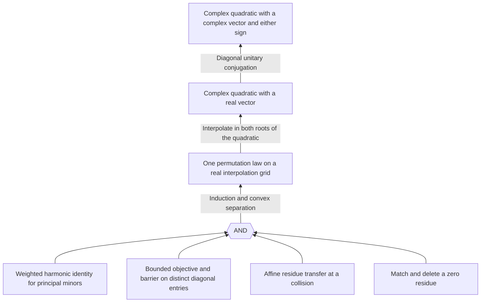

# Quadratic images of Hermitian rank-one perturbations

[Proof map index](README.md) · [Marcus–de Oliveira conjecture](../README.md)

Let $A,E$ be complex normal matrices of order $n$. Let $b,a$ list
their eigenvalues with multiplicity. For each permutation $\sigma$
of the $n$ labels, form the matching product
$P_\sigma=\prod_j(b_{\sigma(j)}+a_j)$. The Marcus–de Oliveira
inclusion places $\det(A+E)$ in the real convex hull of these products.

## Proved cases

Let $d,v$ be real lists of length $n$ and let $D=\mathrm{diag}(d)$
be the diagonal matrix with entries $d_j$. Set $H=D+vv^{\mathsf T}$,
where $v^{\mathsf T}$ is the transpose of the column vector $v$.
Take any monic quadratic $q(x)=x^2+cx+e$ with $c,e\in\mathbb C$.
Interpret $q(H)=H^2+cH+eI$ over $\mathbb C$, with identity $I$.
The inclusion holds for $A=q(H)$ and every complex diagonal matrix
$E=\mathrm{diag}(a)$. If $h$ lists the roots of the characteristic
polynomial of $H$ with multiplicity, take $b_j=q(h_j)$.
This holds in every order, including $n=0$. Repeated diagonal entries,
repeated eigenvalues, zero vector entries, and repeated roots of
$q$ are allowed.
[Real vector theorem](../Lean/MOC/QuadraticRankOneInclusion.lean#L276)

Any unitary diagonalization of the Hermitian matrix $H$ also
diagonalizes $q(H)$. Thus $q(H)$ is normal and has eigenvalue list
$(q(h_j))_j$. The columns of $q(H)-q(D)$ lie in the span of $v$ and
$Dv$. Therefore $q(H)$ differs from the complex diagonal matrix
$q(D)$ by rank at most two.
[Normality, eigenvalue list, and rank](../Lean/MOC/QuadraticHermitianRankOneInclusion.lean#L129)

The inclusion also holds for $H=D+sww^*$ with any complex column
vector $w$ and any real $s$ with $s^2=1$. Here $w^*$ is the conjugate
transpose. The matrix $H$ is Hermitian. Take $b$ to be any list of the
characteristic roots of $q(H)$ with multiplicity. Take the
diagonal unitary matrix $P$ with entry $w_j/|w_j|$ when $w_j\ne0$
and entry one when $w_j=0$. Let $v_j=|w_j|$ and
$H_0=\mathrm{diag}(sd)+vv^{\mathsf T}$. Then $H=sPH_0P^*$ and
$q(H)=P(H_0^2+csH_0+eI)P^*$. Conjugation by $P$ fixes $E$.
The real vector theorem applies with the linear coefficient $cs$.
[Signed complex vector theorem](../Lean/MOC/QuadraticHermitianRankOneInclusion.lean#L178)

## Proof route

1. Fix the real characteristic roots $h_j$ of $H$. When the diagonal
   entries $d_i$ are distinct, the characteristic polynomial determines
   the residue at $d_i$. Its value is
   $r_i=-\prod_j(d_i-h_j)/\prod_{j\ne i}(d_i-d_j)$. For the matrix
   $D+vv^{\mathsf T}$ this value is $v_i^2$. Vary the diagonal entries
   in the open region where they are distinct and all residues are
   positive. The roots $h_j$ stay fixed.
   [Residue formula](../Lean/MOC/SecularResidueCalculus.lean#L20) · [Characteristic polynomial identity](../Lean/MOC/SecularChamberGeometry.lean#L62)
2. Choose distinct real $t,u$ strictly above every $h_j$. For each
   principal minor of $(H-tI)(H-uI)$, sum its pure second derivatives
   in the diagonal entries, with weights $r_i$. The sum is zero.
   Expanding the determinant after adding $E$ gives the same identity
   for its real linear projections. Each objective has an upper bound
   in the open region. An exponential barrier bounds the diagonal
   entries on the relevant level sets. The maximum principle then
   bounds each objective by its boundary values.
   [Principal minor identity](../Lean/MOC/SecularQuadraticPrincipalMinor.lean#L201) · [Determinant objective](../Lean/MOC/SecularQuadraticRealRootInclusion.lean#L95) · [Maximum principle](../Lean/MOC/SecularChamberGeometry.lean#L211)
3. At a finite boundary limit, two diagonal entries coincide or a residue is zero.
   If two entries coincide, transfer residue between them with fixed
   sum. The characteristic polynomial stays fixed. The determinant
   varies affinely, with a zero residue at each endpoint. At a zero
   residue, $d_i$ is a characteristic root and the determinant has the
   factor $q(d_i)+a_i$. Match $q(d_i)$ to $a_i$ and delete that pair.
   The remaining determinant has the same form in order $n-1$. The
   argument starts at order zero.
   [Fixed characteristic polynomial](../Lean/MOC/SecularBoundaryResidueTransfer.lean#L71) · [Transfer segment](../Lean/MOC/SecularBoundaryResidueTransfer.lean#L121) · [Deletion of the determinant factor](../Lean/MOC/SecularChamberBoundary.lean#L102)
4. Fix $E$. The boundary transfers use the same weights for every
   quadratic in a finite family. Apply the maximum principle to any
   real linear combination of its determinant values. Convex separation
   gives one permutation law for the whole family when each quadratic
   has two distinct real roots above the spectral list. Make a product
   grid from two disjoint sets of $n+1$ such roots. The determinant and
   each matching product have degree at most $n$ in each root separately. Interpolate
   in both roots to obtain the desired convex combination at the two
   complex roots of $q$. The evaluation permits coincident roots.
   [Common law for a finite family](../Lean/MOC/SecularQuadraticCommonWeights.lean#L124) · [Interpolation](../Lean/MOC/QuadraticRankOneInclusion.lean#L142) · [Equality with the matrix determinant](../Lean/MOC/QuadraticRankOneInclusion.lean#L241)

The unrestricted diagonal-plus-rank-two case remains open. It asks for
the inclusion for every normal $A=D+R$, with any complex diagonal $D$
and any matrix $R$ of rank at most two, and every complex diagonal $E$.
