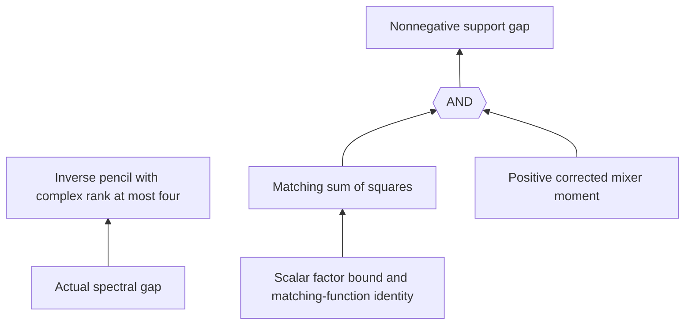

# General proof routes

[Proof map index](README.md) · [Conjecture](../README.md) · [All-order routes](all-orders-proof-map.md) · [Order four](order-four-proof-map.md)

The Marcus–de Oliveira conjecture (MOC) asks if the determinant of
the sum of two complex normal matrices belongs to the convex hull of
their eigenvalue matching products.
A directional bound compares the real projection of the determinant
with the largest projection of a matching product. A contact is a
permutation that attains that largest projection.

## Proof routes

| Subject | Step in Lean | Remaining implication or scope limit | Lean Checked? |
| --- | --- | --- | --- |
| Contact geometry | A strict violation can be transferred to one with at least $2n-1$ contacts in order $n$. The contact differences have a lower bound on the dimension of their span. [Contact threshold](../Lean/MOC/AffineGapCover.lean#L85) · [Difference rank](../Lean/MOC/ContactDifferenceRank.lean#L42) | Exclude every witness at the threshold. The rank estimate applies to the span of the specified differences. | Yes |
| Spectral realization in order four | A violation reduces to the canonical mixed-ray section in the terminal-witness route. The directional bound holds for all unitary mixers when the canonical gap has normalized height from zero through one half. A complex spectral profile satisfies the real and imaginary lift equations. [Canonical reduction](../Lean/MOC/FourTerminalCoverage.lean#L398) · [Height interval](../Lean/MOC/FourCanonicalHeightSquares.lean#L767) · [Lift equations](../Lean/MOC/FourMatchingHessianKernel.lean#L128) | Apply a spectral exclusion or a sign certificate at the remaining heights. | No |
| Reciprocal overlap | Opposite shifts give a common minor law when the sum of the two nonzero spectral counts is at most $n+2$. The scalar comparison at overlap three reduces to square orders through 33. [Common law](../Lean/MOC/RankTwoOverlap.lean#L709) · [Finite reduction](../Lean/MOC/FiniteFrameLabels.lean#L528) | Prove the scalar inclusion for arbitrary pairs of frames at overlap three. [Overlap discussion](all-orders-proof-map.md#finite-overlap-compression) | Yes |
| Stationarity and induction | At a unitary maximum, each complex signed score marginal is the support score times the squared entry modulus. The two-phase determinant test applies when each base determinant for the inner phase is nonzero. [Marginal](../Lean/MOC/StationaryPivot.lean#L329) · [Two-phase test](../Lean/MOC/RankTwoPhaseEscape.lean#L138) | For a strict terminal maximum, derive ascent, a proper reducing block, or a normal sum from the actual spectra and the smaller-order bounds. | Partial (1/2) |
| Certificates for one objective | A law for nested subset images gives nonnegative evaluation of a nonnegative flag score. One order-five spectral example has an exact disjoint-pair support certificate. [Flag score](../Lean/MOC/FullFlagLaw.lean#L291) · [Order-five bound](../Lean/MOC/OrderFiveDisjointPairSupport.lean#L289) | Find a certificate that covers the remaining support gaps. | Yes |
| Assignment-score variance | For nonnegative weights of total mass one, an interval with no score gives a lower variance bound, and an interval containing all scores gives an upper bound. Rank-one costs have a signed covariance formula and an integer lattice bound. [Variance bounds](../Lean/MOC/ThresholdVariance.lean#L156) · [Rank-one variance](../Lean/MOC/RankOneVariance.lean#L78) · [Lattice bound](../Lean/MOC/RankOneLattice.lean#L19) | Prove the nearest-score lower bound for the signed variance of every actual rank-one assignment. A positive law for richer joint statistics needs further conditions. | Yes |
| One free eigenvalue | A planar slice tests for a single law for one free eigenvalue. The law follows from the smaller-order inclusion when the supported partners have at most two distinct values. [Slice](../Lean/MOC/FreeEigenvalueSlopeSlice.lean#L205) · [Two supported values](../Lean/MOC/GroupedEigenvalueMoments.lean#L88) | Prove the slice condition for an arbitrary number of groups. | Yes |
| Wall inequality in order four | A bound on reciprocal leaf weights gives a matching sum of squares. The amplitude inequality includes zero amplitudes and assumes a positive corrected moment at the given mixer. Lean gives such a moment for every real orthogonal mixer and gives nonnegative evaluation of matching sums of squares for every complex unitary mixer. [Square certificate](../Lean/MOC/FourMatchingCompensation.lean#L94) · [Amplitude bound](../Lean/MOC/FourMatchingCompensation.lean#L173) · [Orthogonal correction](../Lean/MOC/FourOrthogonalMatchingMomentTransport.lean#L12) · [Unitary evaluation](../Lean/MOC/FourMatchingPhysicalPositivity.lean#L201) | Identify the spectral gaps to which the wall coefficient budget applies. | No |
| Projective changes and limits | A common fractional linear map of the signed spectral points preserves the test if its determinant is nonzero and it has no pole on either list. A four-point swap relation gives a cross-ratio test. [Transport](../Lean/MOC/ProjectiveTransport.lean#L61) · [Swap relation](../Lean/MOC/ContactCrossRatios.lean#L16) | For a proposed boundary argument, prove the spectral and remainder conditions on its chosen stratum. | Yes |
| Zero rectangles and modulus | Color multiplicities test for a nonzero matching. With one unit of slack at every color, every allowed edge extends. A column degree gives a lower bound on the number of nonzero matchings. [Existence](../Lean/MOC/UnequalColorHall.lean#L102) · [Extension](../Lean/MOC/UnequalColorHall.lean#L127) · [Count](../Lean/MOC/UnequalColorHall.lean#L162) | A factorial lower bound or a stronger modulus comparison requires an additional argument. | Yes |
| Indicator span and Fourier tests | A sign-aligned entrywise phase test proves nonnegativity of the signed masses of the score groups. An order-five Fourier mixer has a strictly positive minor law. [Sign alignment](../Lean/MOC/UnitaryPhaseCuts.lean#L164) · [Fourier law](../Lean/MOC/FourierProfiles.lean#L308) | Find compatible signs for the score groups of a general spectral objective. The all-order dimension formula for the indicator span is outside these lemmas. | Yes |
| Brackets and phase derivatives | A normalized spectral maximizer obeys cofactor equations even when a cross sum is zero. The formal Gram determinant gives a fourth-order sign test when the first Gram coefficient vanishes. [Cofactor equations](../Lean/MOC/SpectralMultiplierRigidity.lean#L118) · [Gram test](../Lean/MOC/PhaseGramJet.lean#L191) | Combine the phase and spectral multiplier equations on a common strict witness. | Partial (1/2) |
| Exact search and positive neighborhoods | Density and scaling reduce unrestricted inclusion to Gaussian integer spectra and Gaussian rational mixers. In dimension six the mixer ball gives a common law for three pairs of eigenspaces. [Exact test](../Lean/MOC/GaussianCayley.lean#L361) · [Mixer ball](six-dimensional-mixer-ball-proof-map.md) | Extend the local law to every mixer in dimension six, or prove coverage of a larger region by certified neighborhoods. | Yes |
| Stability and coefficients | Every first-list entry with positive imaginary part and every second-list entry with nonnegative imaginary part force a nonzero determinant. [Spectral nonvanishing](../Lean/MOC/SpectralDeterminantStability.lean#L37) | Spectral nonvanishing alone supplies no directional hull inequality. | No |
| Swaps and cycles | Each transposition segment is attained. A closed transposition walk that avoids a point and has nonzero winding about it forces attainment of that point. [Segment formula](../Lean/MOC/TranspositionWinding.lean#L262) · [Winding implication](../Lean/MOC/TranspositionWinding.lean#L681) | A global description of the determinant range requires a further argument. [Graph interpretation](transposition-winding-proof-map.md) | No |

## Spectral realization and matching squares

- **Inverse-profile route in any order.** For order $n\ge 2$, the
  spectral polynomial in $(n-1)^2$ inverse coordinates depends on
  at most $(n-2)^2$ complex linear coordinates. Thus it has an
  invariance space of dimension at least $2n-3$. In every positive
  order, evaluations on matrices with zero row and column sums
  determine any complex function on permutations up to an additive
  constant.
  [Invariance space](../Lean/MOC/SpectralProfileDeterminant.lean#L362) ·
  [Balanced evaluation](../Lean/MOC/BalancedMatchingProbes.lean#L203) ·
  [Profile recovery](spectral-profile-determinant-proof-map.md#recover-the-profile-from-balanced-matrices)
- **Determinant factors and matching squares.** A central feature
  with weight $b$ and leaf weights $d_i>0$ gives a square certificate
  when $\sum_i e_i^2/d_i\le b$, where $e_i$ are the couplings.
  For a specified family of order-four matching functions with
  seven contacts, nonpositivity of the stated factor and positivity
  of its two leaf weights imply this budget. The factor identity
  for the inverse pencil remains open in Lean for this family.
  Lean identifies the factors for the separate two-factor families.
  [Square completion](../Lean/MOC/FourMatchingCompensation.lean#L16) ·
  [Seven-contact certificate](../Lean/MOC/FourMatchingCompensation.lean#L252) ·
  [Two-factor families](spectral-profile-determinant-proof-map.md#order-four-inverse-pencil-certificates) ·
  [Other contact certificates](order-four-mixed-ray-cancellation-proof-map.md#canonical-contact-certificates)
- **Spectral multiplicities.** One spectrum with two values, or with
  three values including a singleton, has a common law for all
  partners when the eigenspaces are fixed. The three pairs in
  dimension six have the local mixer-ball result.
  [Singleton and two-value laws](three-spectral-values-with-one-singleton-proof-map.md) ·
  [Mixer ball](six-dimensional-mixer-ball-proof-map.md)

[Lean check status](README.md#lean-check-status): **Partial (21/31)** for the 31 linked source modules.
