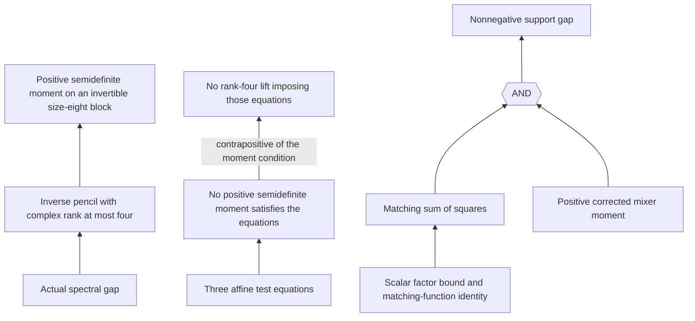

# Research attempts for unrestricted MOC

[Proof map index](README.md) · [Conjecture](../README.md) · [All-order routes](all-orders-proof-map.md) · [Order four](order-four-proof-map.md)

The Marcus–de Oliveira conjecture (MOC) asks if the determinant of
the sum of two complex normal matrices belongs to the convex hull of
their eigenvalue matching products. This map follows the numbered
directions in the local research plan and the later replay bundles.
A directional bound compares the real projection of the determinant
with the largest projection of a matching product. A contact is a
permutation that attains that largest projection.

## Research plan

Lean checked both statements about upper half-plane entries in direction
14, including the exact order-two counterexample for independent entries.
[Spectral nonvanishing](../Lean/MOC/SpectralDeterminantStability.lean#L37) ·
[Independent entries](../Lean/MOC/SpectralDeterminantStability.lean#L60)

| Direction | Step in Lean | Remaining implication or scope limit |
| --- | --- | --- |
| 1. Contact geometry | A strict violation can be transferred to one with at least $2n-1$ contacts in order $n$. The contact differences have a lower bound on the dimension of their span. [Contact threshold](../Lean/MOC/AffineGapCover.lean#L85) · [Difference rank](../Lean/MOC/ContactDifferenceRank.lean#L42) | Exclude every witness at the threshold. The numerical rank census is a separate finite calculation. |
| 2. Spectral realization in order four | A violation yields a witness in the canonical mixed-ray section. A complex spectral profile satisfies the real and imaginary lift equations. [Canonical reduction](../Lean/MOC/FourTerminalCoverage.lean#L387) · [Lift equations](../Lean/MOC/FourMatchingHessianKernel.lean#L125) | Apply a spectral exclusion or a sign certificate to every remaining contact family. |
| 3. Reciprocal overlap | Opposite shifts give a common minor law when the sum of the two nonzero spectral counts is at most $n+2$. The scalar comparison at overlap three reduces to square orders through 33. [Common law](../Lean/MOC/RankTwoOverlap.lean#L709) · [Finite reduction](../Lean/MOC/FiniteFrameLabels.lean#L528) | Prove the scalar inclusion for arbitrary pairs of frames at overlap three. The stronger common law for all minors has an exact obstruction. [Overlap discussion](all-orders-proof-map.md#finite-overlap-compression) |
| 4. Stationarity and induction | At a unitary maximum, each complex signed score marginal is the support score times the squared entry modulus. The two-phase determinant test applies when each base determinant for the inner phase is nonzero. [Marginal](../Lean/MOC/StationaryPivot.lean#L329) · [Two-phase test](../Lean/MOC/RankTwoPhaseEscape.lean#L136) | For a strict terminal maximum, derive ascent, a proper reducing block, or a normal sum from the actual spectra and the smaller-order bounds. |
| 5. Certificates for one objective | A law for nested subset images gives nonnegative evaluation of a nonnegative flag score. One order-five spectral fixture has an exact disjoint-pair support certificate. [Flag score](../Lean/MOC/FullFlagLaw.lean#L291) · [Order-five fixture](../Lean/MOC/OrderFiveDisjointPairSupport.lean#L291) | Find an appropriate certificate for every actual support gap. |
| 6. Assignment-score variance | For nonnegative weights of total mass one, an interval with no score gives a lower variance bound, and an interval containing all scores gives an upper bound. Rank-one costs have a signed covariance formula and an integer lattice bound. [Variance bounds](../Lean/MOC/ThresholdVariance.lean#L156) · [Rank-one variance](../Lean/MOC/RankOneVariance.lean#L78) · [Lattice bound](../Lean/MOC/RankOneLattice.lean#L19) | Prove the nearest-score lower bound for the signed variance of every actual rank-one assignment. A positive law for richer joint statistics needs further conditions. |
| 7. One free eigenvalue | A planar slice tests for a single law for one free eigenvalue. The law follows from the smaller-order inclusion when the supported partners have at most two distinct values. [Slice](../Lean/MOC/FreeEigenvalueSlopeSlice.lean#L205) · [Two supported values](../Lean/MOC/GroupedEigenvalueMoments.lean#L88) | Prove the slice condition for an arbitrary number of groups. |
| 8. Wall inequality in order four | A bound on reciprocal leaf weights gives a matching sum of squares. A positive corrected moment then gives the amplitude inequality, including zero amplitudes. [Square certificate](../Lean/MOC/FourMatchingCompensation.lean#L94) · [Amplitude bound](../Lean/MOC/FourMatchingCompensation.lean#L168) | Construct the corrected moment for each mixer and identify the spectral gaps to which the coefficient budget applies. |
| 9. Projective changes and limits | A common fractional linear map of the signed spectral points preserves the test if its determinant is nonzero and it has no pole on either list. A four-point swap relation gives a cross-ratio test. [Transport](../Lean/MOC/ProjectiveTransport.lean#L61) · [Swap relation](../Lean/MOC/ContactCrossRatios.lean#L16) | For a proposed boundary argument, prove the spectral and remainder conditions on its chosen stratum. |
| 10. Zero rectangles and modulus | Color multiplicities test for a nonzero matching. With one unit of slack at every color, every allowed edge extends. A column degree gives a lower bound on the number of nonzero matchings. [Existence](../Lean/MOC/UnequalColorHall.lean#L102) · [Extension](../Lean/MOC/UnequalColorHall.lean#L127) · [Count](../Lean/MOC/UnequalColorHall.lean#L162) | The factorial count and the strengthened modulus comparison in the plan need separate Lean proofs. |
| 11. Indicator span and Fourier tests | A sign-aligned entrywise phase test proves nonnegativity of the signed masses of the score groups. An order-five Fourier mixer has a strictly positive minor law. [Sign alignment](../Lean/MOC/UnitaryPhaseCuts.lean#L164) · [Fourier law](../Lean/MOC/FourierProfiles.lean#L308) | Find compatible signs for the score groups of a general spectral objective. The all-order dimension formula for the indicator span is outside these lemmas. |
| 12. Brackets and phase derivatives | A normalized spectral maximizer obeys cofactor equations even when a cross sum is zero. The formal Gram determinant gives a fourth-order sign test when the first Gram coefficient vanishes. [Cofactor equations](../Lean/MOC/SpectralMultiplierRigidity.lean#L118) · [Gram test](../Lean/MOC/PhaseGramJet.lean#L191) | Combine the phase and spectral multiplier equations on a common strict witness. |
| 13. Exact search and positive neighborhoods | Density and scaling reduce unrestricted inclusion to Gaussian integer spectra and Gaussian rational mixers. In dimension six the mixer ball gives a common law for three pairs of eigenspaces. [Exact test](../Lean/MOC/GaussianCayley.lean#L306) · [Mixer ball](six-dimensional-mixer-ball-proof-map.md) | Extend the local law to every mixer in dimension six, or prove coverage of a larger region by certified neighborhoods. |
| 14. Stability and coefficients | Every first-list entry with positive imaginary part and every second-list entry with nonnegative imaginary part force a nonzero determinant. Independent entry variables give an order-two counterexample to the corresponding nonvanishing claim. [Spectral nonvanishing](../Lean/MOC/SpectralDeterminantStability.lean#L37) · [Independent entries](../Lean/MOC/SpectralDeterminantStability.lean#L60) | Spectral nonvanishing alone supplies no directional hull inequality. |
| 15. Swaps and cycles | Each transposition segment is attained. A closed transposition walk that avoids a point and has nonzero winding about it forces attainment of that point. [Segment formula](../Lean/MOC/TranspositionWinding.lean#L241) · [Winding implication](../Lean/MOC/TranspositionWinding.lean#L614) | The finite ray-escape example for the drawn segment graph remains an exact arithmetic check. [Graph interpretation](transposition-winding-proof-map.md) |

## Further steps from the replay bundles

The local files `Plan.md`, `Stream.txt`, and `rank-two-phase-proof.md`
describe the arguments. The three local bundles hold the exact
arithmetic, numerical screening, and earlier Lean drafts. The public
statements below give the hypotheses for the steps in the main library.

- **Inverse-profile route in any order.** For order $nge2$, the
  spectral polynomial in $(n-1)^2$ inverse coordinates depends on
  at most $(n-2)^2$ complex linear coordinates. Thus it has an
  invariance space of dimension at least $2n-3$. A singular
  matrix with just two contributing permutations measures the
  difference of their profile values. The claim that all balanced
  probes determine an indicator-span profile up to constants
  still needs the full cycle argument.
  [Invariance space](../Lean/MOC/SpectralProfileDeterminant.lean#L362) ·
  [Two-matching probe](../Lean/MOC/SpectralProfileDeterminant.lean#L40)
- **Rank lift and affine moment planes in order four.** An invertible
  principal block of size eight with a complex rank-four lift gives
  a positive semidefinite moment matrix for the quadratic inverse
  equation. Four separate contradictions use three test vectors
  each. Their hypotheses are the three scalar affine evaluations.
  The proof that each original rational pencil imposes those
  evaluations remains in the exact arithmetic replay.
  [Moment condition](../Lean/MOC/InversePencilMoments.lean#L51) ·
  [Plane for rays 7, 13, 18, 27, 30, 31](../Lean/MOC/InversePencilMoments.lean#L141) ·
  [Plane for rays 7, 13, 18, 27, 31](../Lean/MOC/InversePencilMoments.lean#L123) ·
  [Plane for rays 7, 13, 20, 27, 31](../Lean/MOC/InversePencilMoments.lean#L105) ·
  [Plane for rays 13, 17, 18, 23, 27, 30](../Lean/MOC/InversePencilMoments.lean#L87)
- **Determinant factors and matching squares.** A central feature
  with weight $b$ and leaf weights $d_i>0$ gives a square certificate
  when $sum_i e_i^2/d_ile b$, where $e_i$ are the couplings.
  One seven-contact factor gives this budget for ordinary ray
  indices 7, 13, 18, 20, 27 and 30. The theorem takes the
  nonpositive factor value as a premise. The determinant
  identification and a common dispatch for the full finite ledger
  remain open in Lean. Separate two-factor families already have
  their pencil identification.
  [Square completion](../Lean/MOC/FourMatchingCompensation.lean#L16) ·
  [Seven-contact certificate](../Lean/MOC/FourMatchingCompensation.lean#L247) ·
  [Two-factor families](spectral-profile-determinant-proof-map.md#order-four-inverse-pencil-certificates) ·
  [Other contact certificates](order-four-mixed-ray-cancellation-proof-map.md#canonical-contact-certificates)
- **Spectral multiplicities.** One spectrum with two values, or with
  three values including a singleton, has a common law for all
  partners when the eigenspaces are fixed. The three pairs in
  dimension six have the local mixer-ball result.
  [Singleton and two-value laws](three-spectral-values-with-one-singleton-proof-map.md) ·
  [Mixer ball](six-dimensional-mixer-ball-proof-map.md)
- **Tests that fail for stronger claims.** The stationary reflection
  control, the order-four minor-law obstructions, and the
  characteristic-polynomial obstruction concern stronger statements.
  A nonnegative cubic in an order-three assignment score has signed
  expectation $-4/9$. It excludes a positive law matching the first
  three signed moments of that score.
  The two-phase ascent example from the local phase note has a
  nonsingular determinant. Its all-order construction remains a
  paper argument. The Lean test for two phase circles applies to
  actual determinant coefficients on the nonsingular chart.
  [Reflection control](order-four-proof-map.md#other-exact-obstructions) ·
  [Third-moment obstruction](../Lean/MOC/AssignmentScoreThirdMoment.lean#L27) ·
  [Minor-law obstruction](order-four-circle-or-line-common-weights-proof-map.md) ·
  [Characteristic-polynomial obstruction](all-orders-proof-map.md#counterexample-to-the-common-characteristic-polynomial-law) ·
  [Two-phase criterion](../Lean/MOC/RankTwoPhaseEscape.lean#L136)

The new scripts have source and exact arithmetic checks. Lean
kernel verification is pending. Unrestricted MOC remains open.
