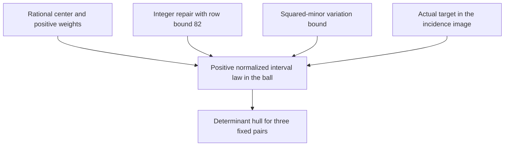

# Six-dimensional mixer ball for three pairs

[Proof map index](README.md) · [Marcus–de Oliveira conjecture](../README.md)

Let $U_0$ be the specified rational unitary matrix of order six.
Let $U$ be a unitary matrix of order six. The source theorem assumes
that the Euclidean operator norm of $U-U_0$ is at most
$1/23083105288$. Let $a$ be any complex list of length six and let
$b=(b_1,b_1,b_2,b_2,b_0,b_0)$ for complex values $b_0,b_1,b_2$.
These three values may coincide. The determinant of
$\mathrm{diag}(a)+U\mathrm{diag}(b)U^*$ belongs to the real convex
hull of $\prod_j(a_{\sigma(j)}+b_j)$ over all permutations $\sigma$.
[Matrix entries](../Lean/MOC/SixDimensionalMixerBall.lean#L551) · [Lean statement](../Lean/MOC/SixDimensionalMixerBall.lean#L1499)

The finite certificate has an independent exact rational check. The
Lean source awaits a build check.
[Rational certificate](https://github.com/ascendnoosphere/MOC/blob/14cf959d/data/certificates/categorical/category_coupling_local_certificate.json)

| Step | Claim | Source |
| --- | --- | --- |
| Center | The integer numerator divided by $8389$ is unitary. All 90 center weights are at least $3/70375321$. They give the required 50 squared-minor coordinates. | [Center unitarity](../Lean/MOC/SixDimensionalMixerBall.lean#L581) · [Weight bound](../Lean/MOC/SixDimensionalMixerBall.lean#L624) · [Center coordinates](../Lean/MOC/SixDimensionalMixerBall.lean#L727) |
| Repair | Selected coordinates determine every vector in the interval incidence image. The inverse on the selected coordinates has maximum absolute row sum at most $82$. | [Recovery](../Lean/MOC/SixDimensionalMixerBall.lean#L769) · [Row bound](../Lean/MOC/SixDimensionalMixerBall.lean#L614) |
| Compatibility | Group the real signed matching weights by the images of the first two and first four columns. This gives the actual target as a linear combination of interval columns. | [Signed target proof](../Lean/MOC/SixDimensionalMixerBall.lean#L915) |
| Variation | Changing one minor column at a time and using the determinant norm bound gives a target change of at most twelve times the change in operator norm. | [Variation proof](../Lean/MOC/SixDimensionalMixerBall.lean#L1472) |
| Evaluation | The interval law agrees on four subset monomials for each placement. A common linear substitution then gives the paired matching products for distinct values. The two-value theorem covers repeated values. | [Determinant evaluation](../Lean/MOC/SixDimensionalMixerBall.lean#L1228) |

For a subset of rows of size two, the target uses the squared minor
from the first two columns. At size three, it uses the sum of the
squared minors obtained by including either of the next two columns.
At size four, it uses the squared minor from the first four columns.
An interval consists of a set of two rows contained in a set of four
rows. Its two middle sets have three rows. The incidence column for
this interval has a one at the coordinate for each of these four
sets and zero at all other coordinates. The 90 intervals give a
matrix with 50 rows and 90 columns.
