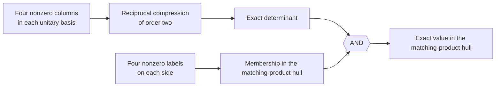

# Six-dimensional rank-two overlap example

[Proof map index](README.md) · [Conjecture and proof tree](../README.md#proof-tree) · [All-order proof map](all-orders-proof-map.md)

Take the complex normal matrices $A,B$ of order six defined in the
source. The first eigenvalue list is $(1,2,3,i,0,0)$. The second is
$(4,7,-1+i,2-i,0,0)$. Each matrix has rank four. The sum of their
ranks is eight, which equals the order plus two. The rank-sum theorem
therefore places $\det(A+B)$ in the real convex hull of the eigenvalue
matching products. Kernel verification of the example source is
pending.
[First matrix](../Lean/MOC/RankTwoOverlapExample.lean#L42) · [Second matrix](../Lean/MOC/RankTwoOverlapExample.lean#L45) · [Spectra](../Lean/MOC/RankTwoOverlapExample.lean#L134) · [Ranks](../Lean/MOC/RankTwoOverlapExample.lean#L127) · [Inclusion](../Lean/MOC/RankTwoOverlapExample.lean#L316)

Take the first four columns of each unitary basis matrix. These
columns form two orthonormal frames $X,Y$. Their column spaces
intersect in the plane spanned by the first two standard basis
vectors. Write $X^*$ for the conjugate transpose of $X$. The matrix
$XX^*+YY^*$ has determinant $5184/4225$. Dividing this determinant
by four gives the mass $1296/4225$ on the matchings that pair every
zero with a nonzero entry. The identity matching product is zero.
[Intersection of column spaces](../Lean/MOC/RankTwoOverlapExample.lean#L198) ·
[Gram determinant](../Lean/MOC/RankTwoOverlapExample.lean#L262) ·
[Covering mass](../Lean/MOC/RankTwoOverlapExample.lean#L269) ·
[Zero product](../Lean/MOC/RankTwoOverlapExample.lean#L324)

Compress the diagonal matrices of reciprocal nonzero spectral values
to the common plane through the two frames. The sum of the two
compressed matrices has determinant $4537/20160-2729i/7560$.
Multiply by the covering mass and by the product $-504-168i$ of all
eight nonzero spectral values. The result is

$$
\det(A+B)=\frac{-225594+186786i}{4225}.
$$

The proof uses an upper triangular factorization for $XX^*+YY^*$
and exact rational arithmetic for the two compressed matrices.
[Reciprocal compression](../Lean/MOC/RankTwoOverlapExample.lean#L274) ·
[Exact determinant](../Lean/MOC/RankTwoOverlapExample.lean#L292) ·
[Hull membership](../Lean/MOC/RankTwoOverlapExample.lean#L331)

## Lean check status

| Lean scope | Lean Checked? |
| --- | --- |
| The 1 source module linked in this map | No |

[Status definitions](README.md#lean-check-status). Paper arguments retain their stated scope.
