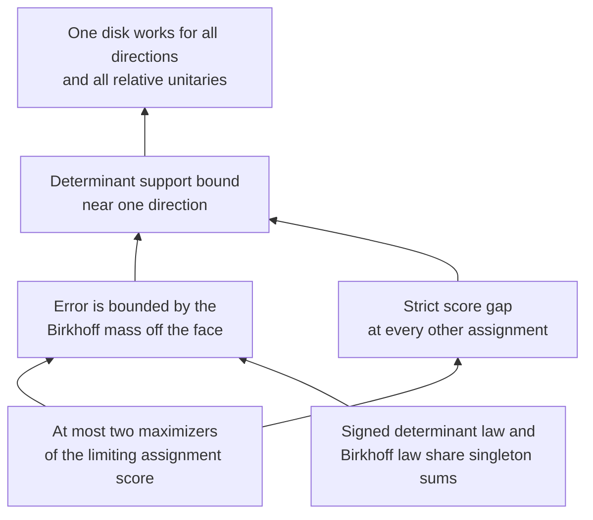

# Small spectral perturbations

[Proof map index](README.md) · [Marcus–de Oliveira conjecture and proof tree](../README.md#proof-tree)

Let $a$ and $b$ be two complex eigenvalue lists indexed by the same finite
set. Suppose the entries of each list are pairwise distinct. Keep the
first list $a$ fixed. There is a dense open set of centers $z\in\mathbb C$.
For each such $z$, there is a radius $r>0$ such that the conjecture
holds for $a$ and $(z+t b_j)_j$ for every complex $|t|<r$ and every
unitary mixer. The second list can contain zero before the transformation.
At $t\ne0$, translation, rotation, and uniform scaling preserve its
shape. The radius may depend on the lists and the center.
[Translated and scaled spectra](../Lean/MOC/ReciprocalSpectralPerturbation.lean#L233)

Apply the dense pole result below with weights $b_j$ and poles $-a_i$.
Replacing each permutation by its inverse gives

$$
\sum_j\frac{b_{p(j)}}{z+a_j}
=\sum_j\frac{b_j}{z+a_{p^{-1}(j)}}.
$$

Thus the assignment values of $(a+z,b)$ are distinct, and no three
lie on one real affine line. This is the general position condition.
Apply the perturbation theorem to $a+z$ and $tb$. Transferring the
scalar $z$ between the two summands keeps their sum and every matching
product unchanged. This gives the result with the original first list
and the second list $z+tb$.
[Inverse permutation identity](../Lean/MOC/ReciprocalSpectralPerturbation.lean#L210) · [Scalar transfer](../Lean/MOC/Core.lean#L158)

For example, take $a=(2+i,2i,-2+2i,2-2i)$ and
$b=(1,1-2i,-1-i,-2)$. At the center $z=5+i$, multiply the 24 assignment
values by their common denominator $\prod_j(z+a_j)=138+1266i$.
For each triple of resulting Gaussian integers $u,v,w$, compute
$|\mathrm{Im}((u-v)\overline{(u-w)})|$. The minimum over all 2024
triples is 48. Thus this center meets the general position condition.
The calculation does not give a numerical scale radius.

## Small scales for a fixed assignment direction

Assume every $a_i$ is nonzero. For each permutation $\sigma$, define
the assignment value $s_\sigma=\sum_j a_{\sigma(j)}^{-1}b_j$. Assume the
values are distinct and no three lie on one real affine line in
$\mathbb C$. The result gives a radius $r>0$ such that the determinant of
$\mathrm{diag}(a)+tU\mathrm{diag}(b)U^*$ lies in its matching hull for
every unitary matrix $U$ and every complex parameter $t$ with $|t|<r$.
This is a case of the conjecture in every finite order.
[Lean hypotheses](../Lean/MOC/SmallSpectralPerturbation.lean#L568) · [Lean result](../Lean/MOC/SmallSpectralPerturbation.lean#L757)

The maximizing assignments are the ones with largest real projection.
Call their union of matching edges the allowed set. Measure the mass of
the Birkhoff law on all other assignments. If there is one maximizing
assignment, use it twice in the two-assignment estimate.

For each other assignment, at least one edge lies outside the allowed
set. In the involutive case, at least two do. In the remaining case,
two columns share just one allowed row. Orthogonality bounds the product
of the two maximizing weights by a constant times the mass off the
face. There is then one maximizing assignment such that all its other
edges have small squared modulus. Every different matching differs in
at least two columns. The product of two small entries bounds its
signed coefficient. Equality of the singleton sums gives the same
order of error on the maximizing assignments.
[Individual signed coefficient bound](../Lean/MOC/SmallSpectralPerturbation.lean#L171) · [Total variation bound](../Lean/MOC/SmallSpectralPerturbation.lean#L364)

The assignment score gives a strict gap away from the maximizing
assignments. For a small change of the scores, the gap pays for the
signed-law error. The first coefficient of each normalized matching
polynomial is the reciprocal assignment sum. Its continuity gives
a neighborhood of each unit support direction. Compactness of the
unit circle gives one disk for all directions.
[Support stability](../Lean/MOC/SmallSpectralPerturbation.lean#L493) · [Uniform disk](../Lean/MOC/SmallSpectralPerturbation.lean#L659)

The source theorem is in sections 1–8 of the local
`variational_notes.txt`. The finite-law proof above gives the same
existential radius by a different argument. Exact arithmetic checked
the law estimates on 16 matrix and assignment pairs. It also checked
the note's order-four example. Its 24 assignment sums are distinct.
All 2024 orientations of triples are nonzero. The minimum absolute
orientation is 315. The source note gives an explicit radius. The Lean
result above proves existence of a radius.

## Fractional linear maps with a prescribed center

Fix any two finite lists $a,b$ of the same length. Assume the entries in
each list are pairwise distinct. Keep $a$ fixed. Choose any complex
center $c$ such that $a_i+c\ne 0$ for every $i$. Only finitely many
centers are excluded. There is a dense open set $S\subseteq\mathbb C$
of poles, disjoint from the entries of $b$. For each $z\in S$ there is
a radius $r>0$. For every complex $t$ with $|t|<r$ and every unitary
matrix $U$, the conjecture holds for $a$ and the second list

$$
\left(c+\frac{t}{z-b_j}\right)_j.
$$

The radius can depend on both lists, the center, and the pole. The same
radius works for all mixers. At $t=0$ the second list is constant.
For $t\ne 0$, the map $f(w)=c+t/(z-w)$ preserves the cross-ratio of
every four distinct entries. Its difference formula is
$f(u)-f(v)=t(u-v)/((z-u)(z-v))$. All extra factors cancel in the
cross-ratio. If all $a_i$ are nonzero, one may take $c=0$.
[Fixed first list and arbitrary admissible center](../Lean/MOC/ReciprocalSpectralPerturbation.lean#L190) · [Zero center](../Lean/MOC/ReciprocalSpectralPerturbation.lean#L173)

To see why the pole can be chosen in any open disk, put
$x_i=1/(a_i+c)$ and $F_p(z)=\sum_j x_{p(j)}/(z-b_j)$ for each
permutation $p$. The residue at $b_j$ is $x_{p(j)}$, so two distinct
permutations give different rational functions. If three assignments
were collinear throughout an open disk, the ratio
$(F_p-F_q)/(F_p-F_s)$ would be real wherever its denominator is
nonzero. The open mapping theorem makes this ratio a real constant
there. The polynomial identity then forces the same real proportionality
between the differences of the residue vectors.
[Real quotient of complex polynomials](../Lean/MOC/PolynomialRealQuotient.lean#L15)

The residue vectors are permutations of one vector, so they lie on
one Euclidean sphere. A real line meets that sphere in at most two
points. Thus each forbidden coincidence or collinearity has empty
interior. After clearing denominators, its complement is open.
The finite intersection of these dense open sets supplies $S$. At each
pole in $S$, the small spectral perturbation theorem applies.
This proves density for the pole parameter with both original lists
fixed.
[Permutation vectors on a sphere](../Lean/MOC/AssignmentSphere.lean#L21) · [Dense open set of poles](../Lean/MOC/ReciprocalSpectralPerturbation.lean#L121)

For every fixed list of distinct weights $x_i$, the partner lists
$b\in\mathbb C^n$ that give assignment sums in general position also
form an open dense set in the full space of lists. If the original
first spectrum $a$ is simple and invertible, take $x_i=1/a_i$.
[Open dense set of partner lists](../Lean/MOC/GenericExteriorShift.lean#L97) · [Exterior shift proof map](free-eigenvalue-and-exterior-shifts-proof-map.md#generic-assignment-sums)
