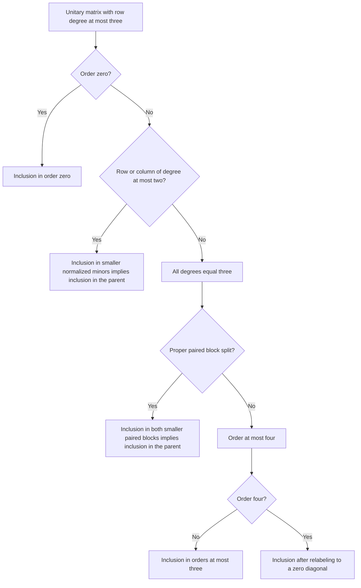
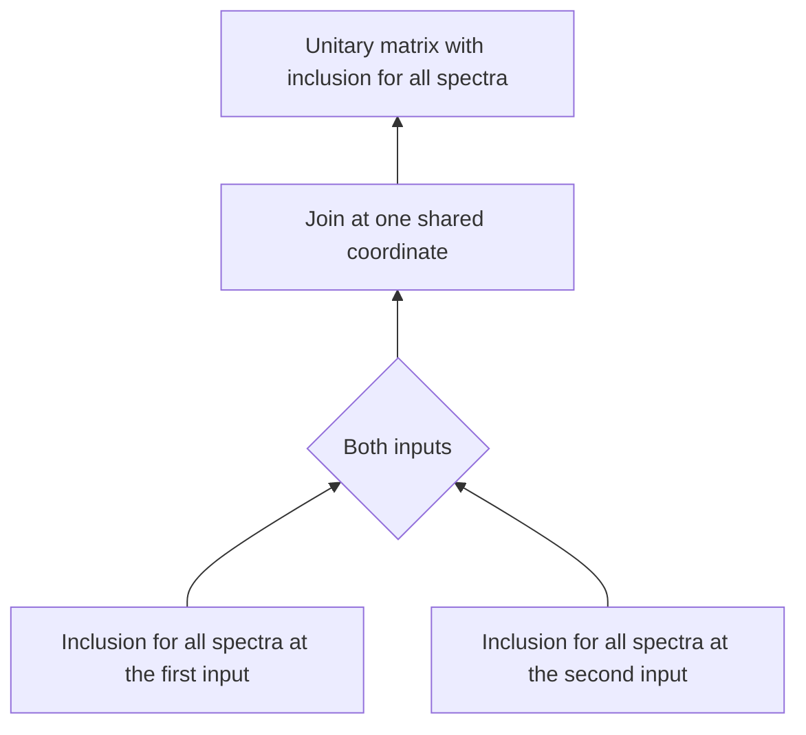

# Sparse unitary proof map

[Proof map index](README.md) · [README overview](../README.md) · [All-order routes](all-orders-proof-map.md)

Let $n$ be the matrix order. Let $a$ and $b$ list the complex eigenvalues,
with multiplicity. Let $U$ be the unitary change of eigenbasis. Write
$U^*$ for its conjugate transpose. Let $S_n$ be the permutations of the
$n$ labels. Write $\mathrm{diag}(a)$ for the diagonal matrix with list
$a$. Write $\mathrm{conv}_{\mathbb R}$ for the real convex hull.
The inclusion to prove is

$$
\det\bigl(\mathrm{diag}(a)+U\,\mathrm{diag}(b)\,U^*\bigr)
\in
\mathrm{conv}_{\mathbb R}\left\{\prod_{j=1}^n(a_{\sigma(j)}+b_j):\ \sigma\in S_n\right\}.
$$

The inclusion holds in every finite order if every row has at most three
nonzero entries. It also holds if every column has at most three nonzero
entries. The degree of a row or column is its number of nonzero entries.
Lean calls the inclusion `Holds`. The column degrees of $U$ are the row
degrees of $U^*$.
[Inclusion](../Lean/MOC/Core.lean#L21) · [Both bounds](../Lean/MOC/SparseUnitary.lean#L13) · [Row bound](../Lean/MOC/SparseUnitary.lean#L27) · [Column bound](../Lean/MOC/SparseUnitary.lean#L44)

Every violation therefore needs both a row and a column with at least four nonzero entries. In order four, each entry of this row and this column must be nonzero. This conclusion holds for every violating matrix and every choice of spectra.
[Necessary degrees](../Lean/MOC/SparseUnitary.lean#L54) · [Full row and column in order four](../Lean/MOC/SparseUnitary.lean#L66)

## Induction on the order

Use strong induction on the order. Order zero starts the induction.
If row $i$ has degree at most two, expand along that row. For each
column $p$ with $U_{ip}\ne 0$, delete row $i$ and column $p$. If there is
a second nonzero entry in row $i$, divide its column in the smaller
matrix by $U_{ip}$. This gives a smaller unitary matrix. Deletion and
scaling preserve zero entries, so the smaller matrix retains the degree
bound.
[Normalized minor](../Lean/MOC/SparseRow.lean#L19) · [Unitarity](../Lean/MOC/SparseRow.lean#L24) · [Degree preservation](../Lean/MOC/SparseDegreeInduction.lean#L39)

The expansion uses the weights $|U_{ip}|^2$, whose sum is one. The term for column $p$ is the smaller determinant times $a_i+b_p$. Each smaller matching product times this factor gives an ambient matching product, by pairing $p$ with $i$. Convexity gives the ambient inclusion. For a low-degree column, exchange the spectra and apply the same expansion to $U^*$. The normalized minors of $U^*$ retain the column bound inherited from $U^*$. Take their adjoints to obtain smaller matrices with the required row bound, then use the induction hypothesis.
[Expansion and convexity](../Lean/MOC/SparseRow.lean#L248) · [Exchange of spectra](../Lean/MOC/Core.lean#L103) · [Induction](../Lean/MOC/SparseDegreeInduction.lean#L104)

If no row or column has degree at most two, then each row has degree three and each column has degree at least three. The sum of the row degrees equals the sum of the column degrees because each sum counts every nonzero entry once. The row sum is $3n$, so each column must also have degree three. The case with only the column bound follows by exchanging the spectra and taking the adjoint.
[Double count](../Lean/MOC/SupportDegreeBalance.lean#L10) · [Exact degrees](../Lean/MOC/SupportDegreeBalance.lean#L28)

When all degrees equal three, first test for a proper paired block split. Separate row and column permutations then give two nonempty square diagonal blocks. The blocks are unitary, have smaller order and retain the degree bound. The determinants multiply. A product of one matching product from each block is an ambient matching product, so the products of the two convex combinations lie in the ambient convex hull.
[Paired block definition](../Lean/MOC/Claim.lean#L37) · [Sparse block reduction](../Lean/MOC/SparsePairedBlocks.lean#L27) · [Product of convex-hull inclusions](../Lean/MOC/Blocks.lean#L32)

## Why exact degree three gives a small block

Orthogonality prevents two distinct rows from sharing exactly one nonzero position. If they shared only one, their inner product would contain one nonzero summand. The same argument applies to columns.
[Row orthogonality](../Lean/MOC/SparseUnitarySupport.lean#L33) · [Column orthogonality](../Lean/MOC/SparseUnitarySupport.lean#L55)

Fix a row $i$. Let $S$ be its three supported columns and let $R$ be the set of rows that meet $S$. Each column in $S$ has three nonzero entries, so there are nine nonzero positions in $R\times S$. Row $i$ accounts for three. Each other row in $R$ accounts for at least two. Thus $3\le |R|\le 4$. If $|R|=3$, all the positions in $R\times S$ are nonzero. The three rows have used all their nonzero entries, so their column neighborhood is $S$.
[Count of rows that meet $S$](../Lean/MOC/SparseUnitarySupport.lean#L63)

If $|R|=4$, each of the other three rows can meet at most one column outside $S$. Each such outside column that meets $R$ shares a row with some column in $S$. Column orthogonality forces a second shared row, which also lies in $R$. Two outside columns would therefore need four distinct rows other than $i$. Only three are available, so the column neighborhood of $R$ has at most four elements.
[Bound on the column neighborhood](../Lean/MOC/CubicSupportCut.lean#L11)

Without a proper paired block split, a nonempty proper row set has strictly more column neighbors than rows. Each row and column has squared norm one. The rows in the set contribute all their squared mass to its column neighbors. The column capacities therefore add up to at least the number of rows. If the counts are equal, the rows use all the capacity. The remaining rows then vanish on those columns, which gives a paired block split. In both neighborhood cases above, $R$ has at most $|R|$ column neighbors. Thus $R$ is the full row set and $n\le 4$.
[Strict expansion](../Lean/MOC/SupportBlocks.lean#L109) · [Order bound](../Lean/MOC/CubicSupportCut.lean#L100)

## The cases of order at most four

The inclusion holds for all unitary matrices of orders zero through three. At order four, exact degree three gives one zero in each row and one zero in each column. These zeros form a permutation. Relabel the columns to put the zeros on the diagonal, and apply the zero-diagonal unitary theorem. Relabeling also permutes the second spectrum and preserves the ambient matching hull.
[Small orders](../Lean/MOC/Small.lean#L68) · [Zero matching](../Lean/MOC/SparsePairedBlocks.lean#L66) · [Zero-diagonal unitary theorem](../Lean/MOC/OrderFourZeroDiagonalUnitary.lean#L196) · [Relabeling invariance](../Lean/MOC/Small.lean#L41)

## Total number of nonzero entries

Suppose $U$ has order $n$ and at most $n+8$ nonzero entries. The
inclusion holds for all pairs of spectra. For a row of degree at
most two, each normalized minor removes at least its nonzero pivot.
The order also drops by one, so the smaller matrix satisfies the
same bound.
[Count by matrix positions](../Lean/MOC/SparseSupportCardinality.lean#L12) · [Deletion](../Lean/MOC/SupportCardinalityDeletion.lean#L19)

Now suppose $n\ge 4$ and each row has at least three nonzero entries.
If one row has four or more, there are at least $3n+1>n+8$ nonzero
entries. Thus each row has degree three, and the row bound proves the
claim. At order four, the total bound is twelve in a matrix with
sixteen positions. Four zeros in any positions therefore suffice.
[All orders](../Lean/MOC/SparseSupportCardinality.lean#L58) · [Order four](../Lean/MOC/SparseSupportCardinality.lean#L74)

## One probability law for all spectra

Fix $U$. Under any of the three bounds above, there are real numbers
$w_\sigma\ge 0$ with $\sum_{\sigma\in S_n}w_\sigma=1$ such that, for
every pair of complex spectra $a,b$,

$$
\det\bigl(\mathrm{diag}(a)+U\,\mathrm{diag}(b)\,U^*\bigr)
=\sum_{\sigma\in S_n}w_\sigma\prod_{j=1}^n(a_{\sigma(j)}+b_j).
$$

[Definition](../Lean/MOC/UniversalMatchingWeights.lean#L13) · [Row bound](../Lean/MOC/SparseUnitaryUniversalWeights.lean#L69) · [Column bound](../Lean/MOC/SparseUnitaryUniversalWeights.lean#L84) · [Total count](../Lean/MOC/SparseUnitaryUniversalWeights.lean#L121)

The induction constructs the law. In orders at most three, one
permutation law represents the matrix of squared entry magnitudes.
Its singleton probabilities suffice for every pair of spectra. At a
row with at most two nonzero entries, choose column $p$ with probability
$|U_{ip}|^2$. Extend a permutation from its normalized minor by pairing
$p$ with $i$. For two diagonal blocks, choose their permutations
independently. These choices use only the entries of $U$. In the
remaining order-four case, the real parts of the signed determinant
weights are nonnegative.
[Small orders](../Lean/MOC/UniversalMatchingWeights.lean#L133) · [Row deletion](../Lean/MOC/SparseRowUniversalWeights.lean#L11) · [Independent blocks](../Lean/MOC/PairedBlockUniversalWeights.lean#L37) · [Order four](../Lean/MOC/SparseUnitaryUniversalWeights.lean#L17)

## Three zeros in order four

The following real orthogonal matrix has exactly three zero entries.
Its thirteen nonzero entries exceed the order-four bound by one.

$$
U=\frac{1}{\sqrt{21}}
\begin{pmatrix}
0&4&-1&2\\
-1&0&4&2\\
4&-1&0&2\\
2&2&2&-3
\end{pmatrix}.
$$

[Matrix](../Lean/MOC/OrderFourThreeZeroMinorObstruction.lean#L19) · [Unitarity](../Lean/MOC/OrderFourThreeZeroMinorObstruction.lean#L36) · [Zero positions](../Lean/MOC/OrderFourThreeZeroMinorObstruction.lean#L40)

Suppose one law works for all spectra. For sets of labels $I,J$ of
equal size, choose spectra with entries zero and one to isolate
the event $\sigma(J)=I$. Its probability must be the squared absolute
value of the minor with rows $I$ and columns $J$. The three diagonal
zeros therefore imply that the first three labels have zero probability
of being fixed.
[Spectral test](../Lean/MOC/SubsetMarkerTest.lean#L43) · [Minor probabilities](../Lean/MOC/SubsetMarkerTest.lean#L28)

Number the labels from one through four. On permutations of positive
probability, $\sigma(\{3,4\})=\{1,3\}$ implies
$\sigma(\{1,3\})=\{1,2\}$. The two minors prescribe probabilities
$4/441$ and $1/441$, respectively. The first event cannot have the
larger probability. This refutes one law for all spectra. The
determinant inclusion allows the weights to depend on the two spectra.
[Contradictory probabilities](../Lean/MOC/OrderFourThreeZeroMinorObstruction.lean#L65) · [Failure of a common law](../Lean/MOC/OrderFourThreeZeroMinorObstruction.lean#L112)

## Exact threshold in each order

Fix an order $n\ge 4$ and a nonnegative integer $t$. Every unitary of
order $n$ with at most $t$ nonzero entries has a common probability law
for all complex spectra if and only if $t\le n+8$.
[Exact threshold](../Lean/MOC/SparseSupportThreshold.lean#L106)

For the upper bound, put the preceding order-four matrix and the
identity matrix of order $n-4$ on the diagonal. This unitary has
$13+(n-4)=n+9$ nonzero entries. A common law would give probability
zero to every permutation that sends a label across the two blocks,
because each such matrix entry is zero. The restriction to the first
block would give a law for the order-four example. Its two minor
probabilities contradict that conclusion.
[Construction](../Lean/MOC/SparseSupportThreshold.lean#L72) · [Restriction of a law to a block](../Lean/MOC/UniversalWeightsBlockRestriction.lean#L15)

The determinant inclusion with weights that can depend on the spectra
remains open for all unitary matrices with at most four nonzero entries
per row in every order.

## Recursive joins at one shared coordinate

Take two unitary matrices $V$ and $W$ of positive orders $r$ and $s$.
Select one coordinate of $V$ and one coordinate of $W$. Identify the
selected coordinates as one shared coordinate. Extend each matrix by
the identity on the coordinates that belong only to the other matrix.
Multiply the two extended matrices with the extension of $V$ on the
left. The result is a unitary matrix of order $r+s-1$. If the
determinant inclusion holds for every pair of spectra at each input
matrix, it holds for every pair of spectra at the result.
[Join operation](../Lean/MOC/UnitaryBlockTree.lean#L29) · [Unitarity](../Lean/MOC/UnitaryBlockTree.lean#L37) · [Inclusion from both inputs](../Lean/MOC/UnitaryBlockTree.lean#L52)

Start with any of these unitary matrices.

- An identity matrix of any order, or any unitary matrix of order at most three. [Small orders](../Lean/MOC/Small.lean#L68)
- An order-four unitary matrix with all entries of modulus $1/2$, or an order-four unitary matrix with zero diagonal. [Constant modulus](../Lean/MOC/OrderFourComplexHadamard.lean#L272) · [Zero diagonal](../Lean/MOC/OrderFourZeroDiagonalUnitary.lean#L196)
- A Kronecker product of two unitary matrices of order two. [Kronecker product inclusion](../Lean/MOC/TwoByTwoTensorPermutationLaw.lean#L446)
- A unitary matrix in the open operator-norm ball of the specified positive radius about the order-five Fourier matrix. [Fourier neighborhood](../Lean/MOC/FiveFourierNeighborhood.lean#L68) · [Positive radius](../Lean/MOC/UnitaryBlockTree.lean#L83)

Perform any finite sequence of the joins. The choice of shared
coordinate can change at each join. Every matrix in this class
satisfies the inclusion for all complex spectra. The proof applies
the join theorem at each step and the stated inclusion at each
starting matrix.
[Class definition](../Lean/MOC/UnitaryBlockTree.lean#L90) · [All-order theorem](../Lean/MOC/UnitaryBlockTree.lean#L121)

## Staircase of zero rectangles

Let $U$ be a unitary matrix of positive order $n$. Number rows and
columns from zero. Choose a finite list of nonnegative integers with
sum $n-1$. Each integer is at most two. For every initial part of the
list, let $k$ be its sum. Require $U_{ij}=0$ whenever $i>k$ and
$j<k$. Then the determinant inclusion holds for every pair of complex
spectra.
[Staircase theorem](../Lean/MOC/StaircaseZeroCorners.lean#L91)

Use the first integer as the first cut. The zero rectangle below
this cut gives two factors with one shared coordinate. The first
factor has order at most three. The second factor retains all the
zero rectangles for the remaining integers. Induct on the list and
apply the shared coordinate theorem to both factors.
[Factorization at one cut](../Lean/MOC/SinglePortZeroCorner.lean#L112) · [Zeros in the second factor](../Lean/MOC/StaircaseZeroCorners.lean#L56) · [Staircase theorem](../Lean/MOC/StaircaseZeroCorners.lean#L91)

For the list $(2,2)$, the condition is a zero rectangle in the last
two rows and first two columns of a matrix of order five. Separate
row and column relabeling permits any such rectangle. If each
integer is one, the condition is $U_{ij}=0$ whenever $i>j+1$. This
is the upper Hessenberg condition.
[Order-five zero rectangle](../Lean/MOC/SinglePortZeroCorner.lean#L242) · [Upper Hessenberg case](../Lean/MOC/SparseRow.lean#L275)
