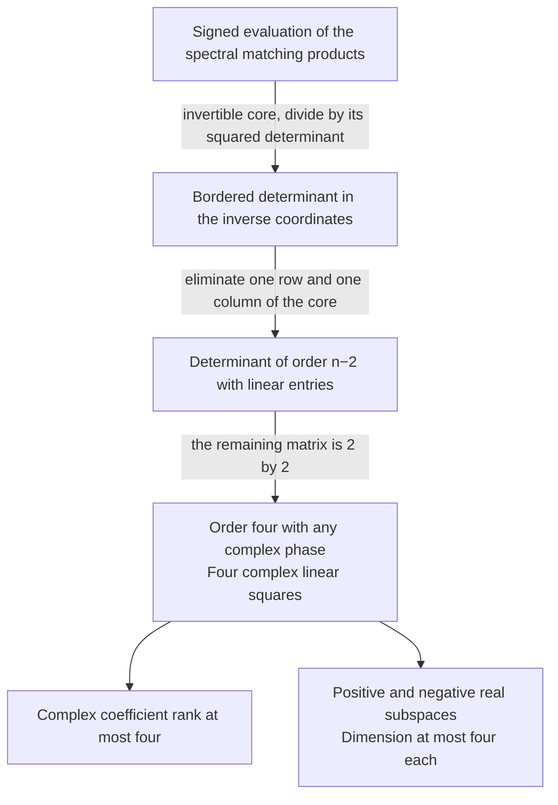

# Spectral profile determinant

[Proof map index](README.md) · [Main conjecture](../README.md) · [Order four](order-four-proof-map.md)

Let $a$ and $b$ be two complex spectral lists of length $n$. Each
permutation contributes the matching product
$z_\sigma=\prod_j(a_{\sigma(j)}+b_j)$. A balanced matrix has zero row
sums and zero column sums. Let $S$ be a balanced matrix, and put
$A=\mathrm{diag}(a)$ and $B=\mathrm{diag}(b)$. The signed evaluation of
the matching profile at $S$ is $\det(AS+SB)$.
[Signed evaluation](../Lean/MOC/SpectralProfileDeterminant.lean#L26)

## Inverse coordinates in any order

Choose a basis with the constant vector as its first direction and
the zero-sum vectors in the remaining directions. Let $E$ change
coordinates from this basis to the original basis. Write
$S=E\,\mathrm{diag}(0,K)E^{-1}$, with $K$ of order $n-1$.
In this basis write $A_0$ and $B_0$ for the lower-right blocks of the
two diagonal operators. Write $u$ for the top-right block of the first
operator and $v$ for the bottom-left block of the second operator.
With $H=(K^{-1})^\mathsf{T}$, the normalized signed evaluation is

$$
\frac{\det(AS+SB)}{(\det K)^2}
=
\det\begin{pmatrix}
0 & u\\
v & H^\mathsf{T}A_0+B_0H^\mathsf{T}
\end{pmatrix}.
$$

The identity uses an invertible $K$. The determinant on the right is
defined for every $H$. A constant matching function evaluates to zero
on the balanced embedding. [Inverse-coordinate identity](../Lean/MOC/SpectralProfileDeterminant.lean#L158) · [Constant matching functions](../Lean/MOC/SpectralProfileDeterminant.lean#L174)

The smaller determinant follows by pivoting on one nonzero entry in
each border. The remaining matrix has entries linear in $H$. If
either border is zero, the original determinant is zero. No assumption
on the multiplicities of $a$ and $b$ is needed.
[Smaller determinant](../Lean/MOC/SpectralProfileDeterminant.lean#L347)

For each order $n\ge2$, the smaller linear matrix has at most
$(n-2)^2$ independent complex entries. Its kernel has dimension at
least $2n-3$. Adding any matrix from that kernel to $H$ preserves
the inverse-coordinate determinant. A singular matrix with exactly
two contributing permutations also tests the difference between the
two profile values.
[Invariance space](../Lean/MOC/SpectralProfileDeterminant.lean#L362) · [Two-matching probe](../Lean/MOC/SpectralProfileDeterminant.lean#L40)

## Rank and inertia in order four

The tetrahedral basis has first column $(1,1,1,1)^\mathsf{T}/2$.
It gives a polynomial in the nine entries of $H$. Multiply this
polynomial by any complex number $\eta$. The result is a sum of four
squares of complex linear functions. The complex symmetric coefficient
matrix therefore has rank at most four.
[Tetrahedral basis](../Lean/MOC/SpectralProfileDeterminant.lean#L529) ·
[Signed evaluation in this basis](../Lean/MOC/SpectralProfileDeterminant.lean#L557) ·
[Complex square factorization](../Lean/MOC/SpectralProfileDeterminant.lean#L394) ·
[Rank bound for a representing matrix](../Lean/MOC/SpectralProfileDeterminant.lean#L496) ·
[Rank-four coefficient matrix](../Lean/MOC/SpectralProfileDeterminant.lean#L576)

The real part of the square of $p+iq$ is $p^2-q^2$ for real $p,q$.
On a subspace where the real form is strictly positive on every
nonzero vector, the four positive linear functions give an injective
map into $\mathbb R^4$. The same argument with the opposite sign
bounds the strictly negative dimension. This includes singular cores
and repeated eigenvalues. For a support cost of the form
$h-\mathrm{Re}(\eta z_\sigma)$, the constant $h$ contributes zero.
[Positive dimension](../Lean/MOC/SpectralProfileDeterminant.lean#L437) ·
[Negative dimension](../Lean/MOC/SpectralProfileDeterminant.lean#L455)

## Order-four inverse pencil certificates

The nine-by-nine inverse pencil is a linear combination of 34 integer
matrices, one for each ordinary ray. It represents 32 times the
quadratic form in the tetrahedral coordinates. A gap from actual
spectra gives a singular real pencil $X$ and admits an imaginary pencil
$Y$ in the same span with $\mathrm{rank}_{\mathbb C}(X+iY)\le4$.
If $X$ has rank eight, $Y$ kills its kernel. On an invertible
eight-dimensional principal block the corresponding matrices satisfy
$YX^{-1}Y=-X$. All five-by-five lifted minors vanish at every rank.
These are necessary spectral conditions.
[Pencil identification](../Lean/MOC/FourInversePencil.lean#L166) · [Singularity](../Lean/MOC/FourInversePencil.lean#L285) · [Imaginary lift](../Lean/MOC/FourInversePencil.lean#L361) · [Rank-eight criterion](../Lean/MOC/FourInversePencilRankLift.lean#L190) · [Minor criterion](../Lean/MOC/FourInversePencilRankLift.lean#L110)

Write the compressed imaginary part as $Y=\sum_i x_i B_i$, where
the $B_i$ are real matrices and the $x_i$ are real coefficients.
Replace each $x_i x_j$ in $YX^{-1}Y$ with an entry of a moment matrix.
An actual rank-four lift gives a positive semidefinite solution to
these linear equations. Three test vectors refute each of four
proposed affine solution planes, once the corresponding scalar
evaluations are known.
[Moment condition](../Lean/MOC/InversePencilMoments.lean#L51) · [Four conditional exclusions](research-attempts-proof-map.md#further-steps-from-the-replay-bundles)

For the canonical cost supported on ordinary rays 7, 13, 18, 28 and
31, and for its extension by ray 30, the factored determinant has two
possible zero factors at positive coefficients on the first five
rays. Each factor gives a square decomposition of the full cost.
The extended ray has a nonnegative coefficient. Actual spectra
discharge pencil singularity. A corrected mixer moment then gives
nonnegative support evaluation. The universal correction is a
separate open premise of the Lean route.
[Factorization](../Lean/MOC/FourInversePencilCertificates.lean#L186) · [Spectral square certificate](../Lean/MOC/FourInversePencilCertificates.lean#L493) · [Support implication](../Lean/MOC/FourInversePencilCertificates.lean#L481)

Exact Python checks reproduced all 34 pencil matrices, the two
determinant branches, and the square identities on all 24 permutations.
The new Lean source awaits verification.
