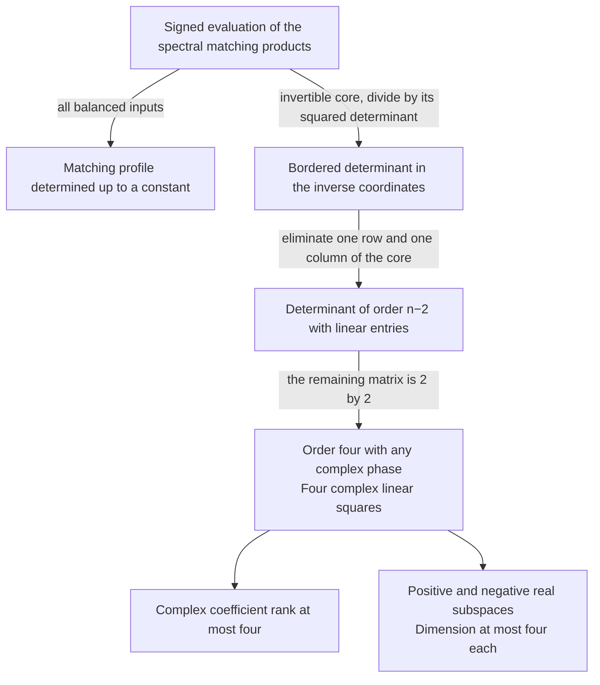

# Spectral profile determinant

[Proof map index](README.md) · [Main conjecture](../README.md) · [Order four](order-four-proof-map.md)

Let $a$ and $b$ be two complex spectral lists of length $n$. Each
permutation contributes the matching product
$z_\sigma=\prod_j(a_{\sigma(j)}+b_j)$. A balanced matrix has zero row
sums and zero column sums. Let $S$ be a balanced matrix, and put
$A=\mathrm{diag}(a)$ and $B=\mathrm{diag}(b)$. The signed evaluation of
the matching profile at $S$ is $\det(AS+SB)$.
[Signed evaluation](../Lean/MOC/SpectralProfileDeterminant.lean#L26)

## Inverse coordinates in any order

Choose a basis with the constant vector as its first direction and
the zero-sum vectors in the remaining directions. Let $E$ change
coordinates from this basis to the original basis. Write
$S=E\,\mathrm{diag}(0,K)E^{-1}$, with $K$ of order $n-1$.
In this basis write $A_0$ and $B_0$ for the lower-right blocks of the
two diagonal operators. Write $u$ for the top-right block of the first
operator and $v$ for the bottom-left block of the second operator.
With $H=(K^{-1})^\mathsf{T}$, the normalized signed evaluation is

$$
\frac{\det(AS+SB)}{(\det K)^2}
=
\det\begin{pmatrix}
0 & u\\
v & H^\mathsf{T}A_0+B_0H^\mathsf{T}
\end{pmatrix}.
$$

The identity uses an invertible $K$. The determinant on the right is
defined for every $H$. A constant matching function evaluates to zero
on the balanced embedding. [Inverse-coordinate identity](../Lean/MOC/SpectralProfileDeterminant.lean#L158) · [Constant matching functions](../Lean/MOC/SpectralProfileDeterminant.lean#L174)

The smaller determinant follows by pivoting on one nonzero entry in
each border. The remaining matrix has entries linear in $H$. If
either border is zero, the original determinant is zero. No assumption
on the multiplicities of $a$ and $b$ is needed.
[Smaller determinant](../Lean/MOC/SpectralProfileDeterminant.lean#L347)

For each order $n\ge2$, the smaller linear matrix has at most
$(n-2)^2$ independent complex entries. Its kernel has dimension at
least $2n-3$. Adding any matrix from that kernel to $H$ preserves
the inverse-coordinate determinant. A singular matrix with exactly
two contributing permutations also tests the difference between the
two profile values.
[Invariance space](../Lean/MOC/SpectralProfileDeterminant.lean#L362) · [Two-matching probe](../Lean/MOC/SpectralProfileDeterminant.lean#L40)

## Recover the profile from balanced matrices

Let $g$ be a complex function on the permutations of a nonempty finite
set. The signed evaluation of $g$ at a matrix $S$ is

$$
E_g(S)=\sum_\sigma \mathrm{sgn}(\sigma)g(\sigma)
\prod_j S_{\sigma(j),j},
$$

where $\mathrm{sgn}(\sigma)$ is the sign of permutation $\sigma$.
If $E_g(S)=0$ for every balanced matrix $S$, then $g$ is constant.
Conversely, the signed evaluation of a constant function is its value
times $\det S$. A balanced matrix has the constant vector in its kernel,
so this determinant is zero. Thus balanced evaluations determine $g$
up to an additive constant.
[Balanced evaluation](../Lean/MOC/BalancedMatchingProbes.lean#L203)

Fix a label $o$ and a permutation $p$. For weights $t_i$ at each label
$i\ne o$, use a matrix with diagonal entry $t_i$ and entries $-t_i$ at
$(i,o)$ and $(o,i)$. The entry at $(o,o)$ is $\sum_{i\ne o}t_i$.
All other entries are zero. Move row $i$ to row $p(i)$.
The new matrix is balanced. Only $p$ and the permutations obtained
by swapping the images under $p$ of $o$ and one other label contribute.
Write $p(o\ i)$ for such a swap. The signed evaluation is

$$
\mathrm{sgn}(p)\Bigl(\prod_{i\ne o} t_i\Bigr)
\sum_{i\ne o} t_i\bigl(g(p)-g(p(o\ i))\bigr).
$$

Set all weights to one. Then set one weight to two. Divide each signed
evaluation by the sign of $p$ and its product of weights. The difference
of the two results gives the change in $g$ under the selected swap.
Transpositions generate all permutations, so these comparisons
determine $g$ up to its value at the identity.

## Rank and inertia in order four

The tetrahedral basis has first column $(1,1,1,1)^\mathsf{T}/2$.
It gives a polynomial in the nine entries of $H$. Multiply this
polynomial by any complex number $\eta$. The result is a sum of four
squares of complex linear functions. The complex symmetric coefficient
matrix therefore has rank at most four.
[Tetrahedral basis](../Lean/MOC/SpectralProfileDeterminant.lean#L529) ·
[Signed evaluation in this basis](../Lean/MOC/SpectralProfileDeterminant.lean#L557) ·
[Complex square factorization](../Lean/MOC/SpectralProfileDeterminant.lean#L394) ·
[Rank bound for a representing matrix](../Lean/MOC/SpectralProfileDeterminant.lean#L496) ·
[Rank-four coefficient matrix](../Lean/MOC/SpectralProfileDeterminant.lean#L576)

The real part of the square of $p+iq$ is $p^2-q^2$ for real $p,q$.
On a subspace where the real form is strictly positive on every
nonzero vector, the four positive linear functions give an injective
map into $\mathbb R^4$. The same argument with the opposite sign
bounds the strictly negative dimension. Both bounds hold for every
$H$ and allow repeated eigenvalues. For a support cost of the form
$h-\mathrm{Re}(\eta z_\sigma)$, the constant $h$ contributes zero.
[Positive dimension](../Lean/MOC/SpectralProfileDeterminant.lean#L437) ·
[Negative dimension](../Lean/MOC/SpectralProfileDeterminant.lean#L455)

## Order-four inverse pencil certificates

The order-four matching cost functions include 34 functions called
ordinary rays. Each ordinary ray has one nine-by-nine integer matrix.
A linear combination of these matrices gives the inverse pencil for
the same linear combination of rays. The pencil represents 32 times
the quadratic form in the tetrahedral coordinates. If the cost is
$h-\mathrm{Re}(\eta z_\sigma)$ for a real height $h$ and complex direction
$\eta$, its real pencil $X$ is singular. There is a real pencil $Y$ in
the same span for which $\mathrm{rank}_{\mathbb C}(X+iY)\le4$.
If $X$ has rank eight, $Y$ kills its kernel. On an invertible
eight-dimensional principal block the corresponding matrices satisfy
$YX^{-1}Y=-X$. All five-by-five lifted minors vanish at every rank.
These are necessary spectral conditions.
[Ordinary rays](../Lean/MOC/FourSupportCostProfiles.lean#L134) · [Pencil identification](../Lean/MOC/FourInversePencil.lean#L166) · [Ordinary span](../Lean/MOC/FourMatchingIndicatorBasis.lean#L80) · [Singularity](../Lean/MOC/FourInversePencil.lean#L285) · [Imaginary lift](../Lean/MOC/FourInversePencil.lean#L361) · [Common kernel](../Lean/MOC/FourInversePencilRankLift.lean#L80) · [Rank-eight identity](../Lean/MOC/FourInversePencilRankLift.lean#L198) · [Minor identity](../Lean/MOC/FourInversePencilRankLift.lean#L117)

Write the compressed imaginary part as $Y=\sum_i x_i B_i$, where
the $B_i$ are real matrices and the $x_i$ are real coefficients.
Replace each $x_i x_j$ in $YX^{-1}Y$ with an entry of a moment matrix.
An actual rank-four lift gives a positive semidefinite solution to
these linear equations. For each of four proposed affine solution
planes, the three specified scalar evaluations rule out positive
semidefiniteness of the moment matrix. The calculation that derives the
scalar evaluations from each pencil remains outside Lean.
[Moment condition](../Lean/MOC/InversePencilMoments.lean#L51) · [First exclusion](../Lean/MOC/InversePencilMoments.lean#L87) · [Second exclusion](../Lean/MOC/InversePencilMoments.lean#L105) · [Third exclusion](../Lean/MOC/InversePencilMoments.lean#L123) · [Fourth exclusion](../Lean/MOC/InversePencilMoments.lean#L141)

For the canonical cost supported on ordinary rays 7, 13, 18, 28 and
31, and for its extension by ray 30, the factored determinant has two
possible zero factors. The first five coefficients must be positive,
and the coefficient of ray 30 must be nonnegative. A cost from the
matching products makes the pencil singular. Each zero factor gives
a sum of matching squares for that cost. The general order-four
sum-of-squares theorem then gives the support bound at every
unitary mixer.
[Factorization](../Lean/MOC/FourInversePencilCertificates.lean#L187) · [Cost in the matching space](../Lean/MOC/FourInversePencilCertificates.lean#L302) · [Spectral square certificate](../Lean/MOC/FourInversePencilCertificates.lean#L419) · [Support bound](../Lean/MOC/FourMatchingPhysicalPositivity.lean#L227)

The Lean source for the inverse pencil, the moment conditions, and the
two-factor square certificate awaits a build check.

## Lean check status

| Lean scope | Lean Checked? |
| --- | --- |
| The 9 source modules linked in this map | Partial (3/9) |
| [FourInversePencil.lean](../Lean/MOC/FourInversePencil.lean#L166) | No |
| [FourInversePencilCertificates.lean](../Lean/MOC/FourInversePencilCertificates.lean#L187) | No |
| [FourMatchingIndicatorBasis.lean](../Lean/MOC/FourMatchingIndicatorBasis.lean#L80) | No |
| [FourMatchingPhysicalPositivity.lean](../Lean/MOC/FourMatchingPhysicalPositivity.lean#L227) | No |
| [FourSupportCostProfiles.lean](../Lean/MOC/FourSupportCostProfiles.lean#L134) | No |
| [InversePencilMoments.lean](../Lean/MOC/InversePencilMoments.lean#L51) | No |

[Status definitions](README.md#lean-check-status). Paper arguments retain their stated scope.
