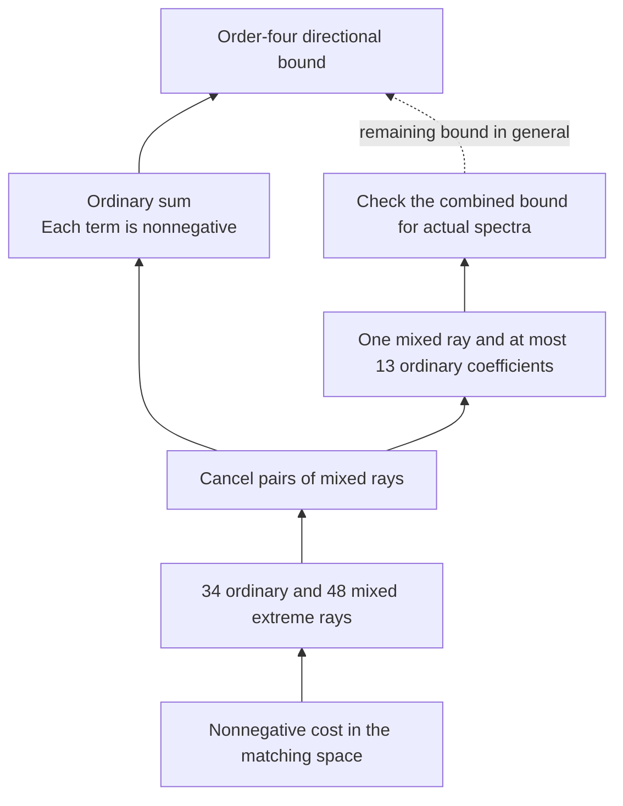
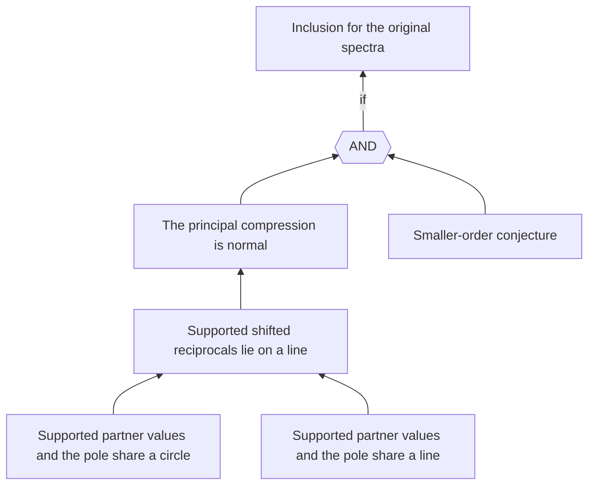

# Spectral and support proof map

[Proof map index](README.md) · [Conjecture](../README.md#proof-tree) · [All-order routes](all-orders-proof-map.md) · [Order four](order-four-proof-map.md) · [Order five](order-five-proof-map.md)

The Marcus–de Oliveira conjecture places the determinant of the sum
of two normal matrices in the real convex hull of their eigenvalue
matching products. The new Lean sources give restricted cases,
algebraic reductions, and certificate tests. They await Lean
compilation. The tables state the premises for each result.

## Order-four support costs

A support direction turns each complex matching product into a real
number. Subtract the smallest of those numbers to obtain a
nonnegative cost on permutations. The classification applies to the
nonnegative costs in the span of the ordinary minor indicators.

| Result | Scope | Sources |
| --- | --- | --- |
| Cone and cancellation | The ten exact cone cuts give 82 extreme rays. Relabeling and cancellation reduce every nonnegative expansion to an ordinary sum or one mixed ray with at most 13 ordinary coefficients. | [Cone classification](../Lean/MOC/FourSupportConeClassification.lean#L508) · [Cancellation](../Lean/MOC/FourMixedRayCancellation.lean#L511) · [Cone map](order-four-support-cost-cone-proof-map.md) · [Cancellation map](order-four-mixed-ray-cancellation-proof-map.md) |
| Real lift | On a compatible chart with a rank-two moment map and a two-dimensional Hessian kernel, a complex critical lift exists exactly when the affine line of symmetric two by two matrices contains a positive semidefinite matrix. A real midpoint of two complex critical profiles gives a particular moment solution. Eight nonzero bracket vectors give finite spectral labels after a common shear. The general moment rank bound and the bracket representation of every nonzero critical profile remain to be formalized. | [Line test](../Lean/MOC/FourSupportCostRealLift.lean#L151) · [Finite labels](../Lean/MOC/FourSupportCostRealLift.lean#L437) · [Real-lift map](order-four-real-spectral-lift-proof-map.md) |
| Spectral determinant and inertia | For order $n\ge2$, the transformed spectral profile has an expression as a determinant of size $n-2$. In order four the quadratic has complex rank at most four. The real quadratic has at most four strictly positive and four strictly negative directions. The formulas include repeated spectra and zero borders. | [Determinant](../Lean/MOC/SpectralProfileDeterminant.lean#L308) · [Inertia](../Lean/MOC/SpectralProfileDeterminant.lean#L372) · [Profile map](spectral-profile-determinant-proof-map.md) |
| Matching squares | The real auxiliary partial-transpose condition at the triple $(0,1,-1)$ is equivalent to sums of squares in the 14-dimensional matching-function space. The general complex normalization requires a distinct transport step. | [Lean statement](../Lean/MOC/RealMatchingSquares.lean#L441) · [Squares map](order-four-real-matching-squares-proof-map.md) |
| Normal Klein-four contacts | For actual order-four spectral support costs, the four Klein-four contacts give a real matching sum of squares. The spectral rank bound excludes a strictly negative five-dimensional prism compression. The proof permits repeated eigenvalues, extra contacts, and vanishing budgets. | [Lean statement](../Lean/MOC/FourKleinSpectralSquares.lean#L259) · [Klein-four map](order-four-klein-four-matching-squares-proof-map.md) |
| Five-parameter contact family | A real spectral lift is impossible if the fourth weight is zero. At negative signed height an equal-weight lift is also impossible. For unequal first weights, a determinant factorization forces a positive second difference. Nonpositivity for actual spectra would exclude that branch. The positive signed-height support bound also remains open in Lean. | [Zero-weight boundary](../Lean/MOC/FourContact0710SpectralLift.lean#L157) · [Equal weights](../Lean/MOC/FourContact0710EqualWeights.lean#L126) · [Hessian test](../Lean/MOC/FourContact0710HessianPencil.lean#L273) · [Contact map](order-four-five-parameter-contact-proof-map.md) |
| Symmetric six-contact family | The spectral equations force the determinant of a nine by nine pencil to vanish. An exact coefficient test then forces one of three bounds. In each bound, one compensator times the sum of the other two is at least the square of the mixed coefficient. This proves the support inequality with all seven ordinary coefficients free. | [Lean support inequality](../Lean/MOC/FourSymmetricSixContactCertificate.lean#L384) · [Six-contact map](order-four-symmetric-six-contact-proof-map.md) |
| One cross-collision | If two opposing eigenvalues sum to zero, the support bound holds in every direction for every order-four unitary. The nonnegative function on permutations also has an ordinary certificate at its supporting level. | [Lean bound](../Lean/MOC/FourOppositePairSupport.lean#L355) · [Cross-collision map](order-four-opposite-eigenvalues-proof-map.md) |
| Weighted-minor center | One fixed pair of complex spectra satisfies all nine hull edge bounds for every unitary. One edge has no ordinary certificate. | [Hull inclusion](../Lean/MOC/FourWeightedMinorCenter.lean#L473) · [Obstruction](../Lean/MOC/FourWeightedMinorCenter.lean#L506) · [Center map](order-four-weighted-minor-center-proof-map.md) |

## Spectra, mixers, and attainable values

| Case | Scope | Sources |
| --- | --- | --- |
| Three values and a singleton | Fix the mixer and the label partition with third part of size one. One probability law works for all complex values of the three parts and for every opposing spectrum. | [Lean law](../Lean/MOC/ThreeValues.lean#L51) · [Singleton map](three-spectral-values-with-one-singleton-proof-map.md) |
| Small spectral parameter | Under reciprocal assignment general position, a positive radius works for all relative unitaries and every complex parameter within the radius. | [Lean bound](../Lean/MOC/SmallSpectralPerturbation.lean#L753) · [Perturbation map](small-spectral-perturbation-proof-map.md) |
| Tensor mixer | For the tensor product of two complex unitary matrices of order two, one law works for every pair of spectra and matches all squared minors. | [Lean law](../Lean/MOC/TwoByTwoTensorPermutationLaw.lean#L428) · [Tensor map](two-by-two-tensor-mixer-proof-map.md) |
| Six-dimensional mixer ball | A particular rational real orthogonal matrix has a closed operator-norm ball of radius $1/23083105288$. The inclusion holds for an arbitrary first spectrum and three fixed spectral pairs on the other side. The three values can coincide. | [Lean bound](../Lean/MOC/SixDimensionalMixerBall.lean#L1499) · [Mixer map](six-dimensional-mixer-ball-proof-map.md) |
| Order-four parameter family | For $(t+i,-t+i,1,2+i)$ and $(-1+i,-2-2i,2-i,1+2i)$, the 89 exact parameter cells give the inclusion for every real $t$ and every mixer. Closedness covers the cell boundaries. | [All real parameters](../Lean/MOC/FourRealParameterCells.lean#L1288) · [Parameter map](order-four-real-parameter-spectra-proof-map.md) |
| Transposition winding | Join consecutive matching products when the matchings differ by a transposition. A closed walk that avoids a point and has nonzero winding about it certifies that some unitary gives that determinant value. The spectrum can have repeated entries. | [Lean theorem](../Lean/MOC/TranspositionWinding.lean#L600) · [Winding map](transposition-winding-proof-map.md) |
| Gaussian spectra and Haar mixer | Independent Gaussian entries give the matching triangle probability and the lower tail of the identity matching product. The exponential failure bound uses the determinant second moment and its measurability. The Haar derivation of that moment remains open in Lean. | [Gaussian lower tail](../Lean/MOC/GaussianHaarContainment.lean#L1066) · [Failure bound](../Lean/MOC/GaussianHaarContainment.lean#L1131) · [Probability map](gaussian-spectra-and-haar-mixers-proof-map.md) |
| Shifted rank sum | For fixed zero labels and relative unitary, one law works on all allowed values if the total support is at most $n+2$. The explicit order-six example gives determinant $(-225594+186786i)/4225$. | [Lean law](../Lean/MOC/RankTwoOverlap.lean#L708) · [Exact example](six-dimensional-rank-two-overlap-proof-map.md) |

## PDF coverage

The two spectral catalogues have separate scope and remain in the
archive. The table records the coverage of the other PDFs. The files
remain available while the required proof coverage is incomplete.

| PDF | Formalization scope and remaining work |
| --- | --- |
| Cases.pdf | The equal-second-coefficient test and the simultaneous equal-first-and-second-coefficient test are exact in each order. The larger spin and symplectic neighborhoods, the exact spectral neighborhoods, and the free complex pencil need their complete proofs. [Coefficient normalization map](equal-spectral-coefficients-proof-map.md) |
| Conics.pdf | Lean source gives the individual ellipse representation criterion in both directions, its sharp all-quadruple cutoff, and the fixed conic tests in orders four and five. [Conic map](conic-spectral-reductions-proof-map.md) |
| MOC-proof-report.pdf and MOC-proof-report__2.pdf | The PDFs have identical extracted text. The support-cone classification and cancellation now have Lean sources. The full nine-edge uniform neighborhood and all of the stated contact accounting need coverage. |
| MOC_free_eigenvalue_and_exterior_bound.pdf | Lean sources give uniform interlacing and the quantitative exterior determinant inclusion in every order under the triangle gap bound. The full joint coefficient certificate and its neighborhood still need the facet replay. [Free eigenvalue map](free-eigenvalue-and-exterior-shifts-proof-map.md) |
| MOC_progress.pdf | The two-frame construction, rank-sum law, and circle-or-line reductions have Lean sources. The binary-cubic mixer reduces to a real chart with an exact obstruction to common compound weights. The all-spectra scalar bound and spectral neighborhood need more proof. [Binary-cubic map](order-four-symmetric-cube-mixer-proof-map.md) |
| MOC_proofs_and_reductions.pdf | Common minor weights, the three-value singleton case, uniform interlacing, and the circle-or-line pole implication have Lean sources. The source also gives the dense convex-position obstruction, a nonnormal deletion example, and two padding obstructions. The full multiplicity deletion and all the listed fixed-order certificates still need coverage. [Deletion and padding](#deletion-and-padding-tests) |
| circle-or-line.pdf | Lean source gives both directions of the circle-or-line criterion, the two-free-entry counterexample, and the principal-minor maximum for Hermitian and real symmetric orbits. [Common-weight map](order-four-circle-or-line-common-weights-proof-map.md) |
| two-edge-matchings.pdf | Lean source covers the two-frame law, fixed-support rank-sum theorem, and exact example. [Rank-sum map](all-orders-proof-map.md#common-weights-at-small-shifted-rank-sum) · [Example map](six-dimensional-rank-two-overlap-proof-map.md) |

### Deletion and padding tests

Choose a row $p$ of the relative unitary $U$. Suppose the conjecture
holds in the preceding order. The inclusion follows if the values
$b_j$ for which $U_{pj}\ne0$ lie on a circle or line through $-a_p$.
Take reciprocals of $b_j+a_p$. These reciprocals lie on a line on
the row support. Their principal compression is normal. Interlacing
lifts its matching products to the original hull. Moving the pole
along the circle or line and taking a limit allows repeated values.
[Line reduction](../Lean/MOC/CircleLinePoleReduction.lean#L98) · [Circle reduction](../Lean/MOC/CircleLinePoleReduction.lean#L127) · [Normal compression inclusion](../Lean/MOC/SupportedCompressionReduction.lean#L140)

The row test connects to the smaller-order conjecture as follows.

At a regular pole, if every entry of the chosen row is nonzero,
normality of the reciprocal compression requires the full partner
spectrum to lie on a circle or line. The convex quadrilateral
$(0,1,1+i,2i)$ fails this test. Every dense row whose pole avoids
these four values gives a nonnormal compression.
[Dense-row necessity](../Lean/MOC/CircleLinePoleReduction.lean#L185) · [Quadrilateral example](../Lean/MOC/CircleLinePoleReduction.lean#L209)

The order-three Householder mixer has diagonal entries $1/3$
and off-diagonal entries $-2/3$. Delete its last row and column.
For the two retained lists $(0,1)$, the sum of the retained
diagonal and the similarity term has determinant $4/3$.
Its matching values are zero and one.
Thus normality of the retained term is necessary for a direct
application of the lower-order conjecture.
[Exact deletion example](../Lean/MOC/DeletionAndPaddingObstructions.lean#L32)

Appending a dummy spectral label can raise the real support
even when the determinant compression is unchanged. In order two
the original real support is $-1$ and a new value has real part
at least zero. In order three the original real support is eight.
Two new injection values have a fixed real weighted mean of twelve
for every dummy label.
[Order two](../Lean/MOC/DeletionAndPaddingObstructions.lean#L74) · [Order-three square support](../Lean/MOC/DeletionAndPaddingObstructions.lean#L105) · [Order-three added support](../Lean/MOC/DeletionAndPaddingObstructions.lean#L130)
