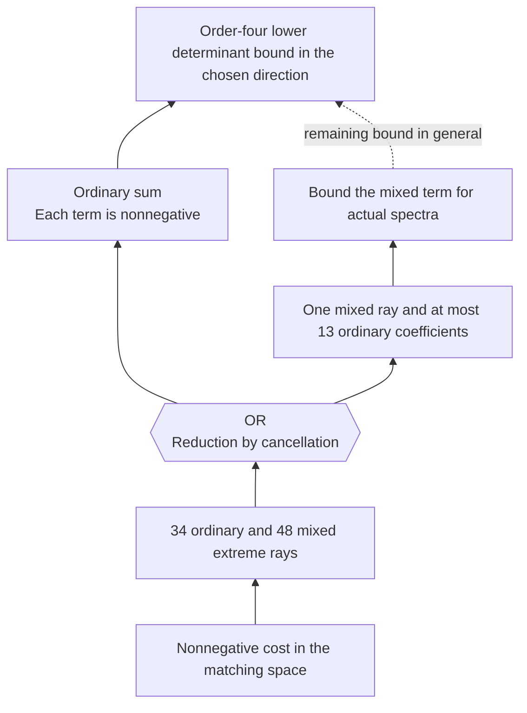
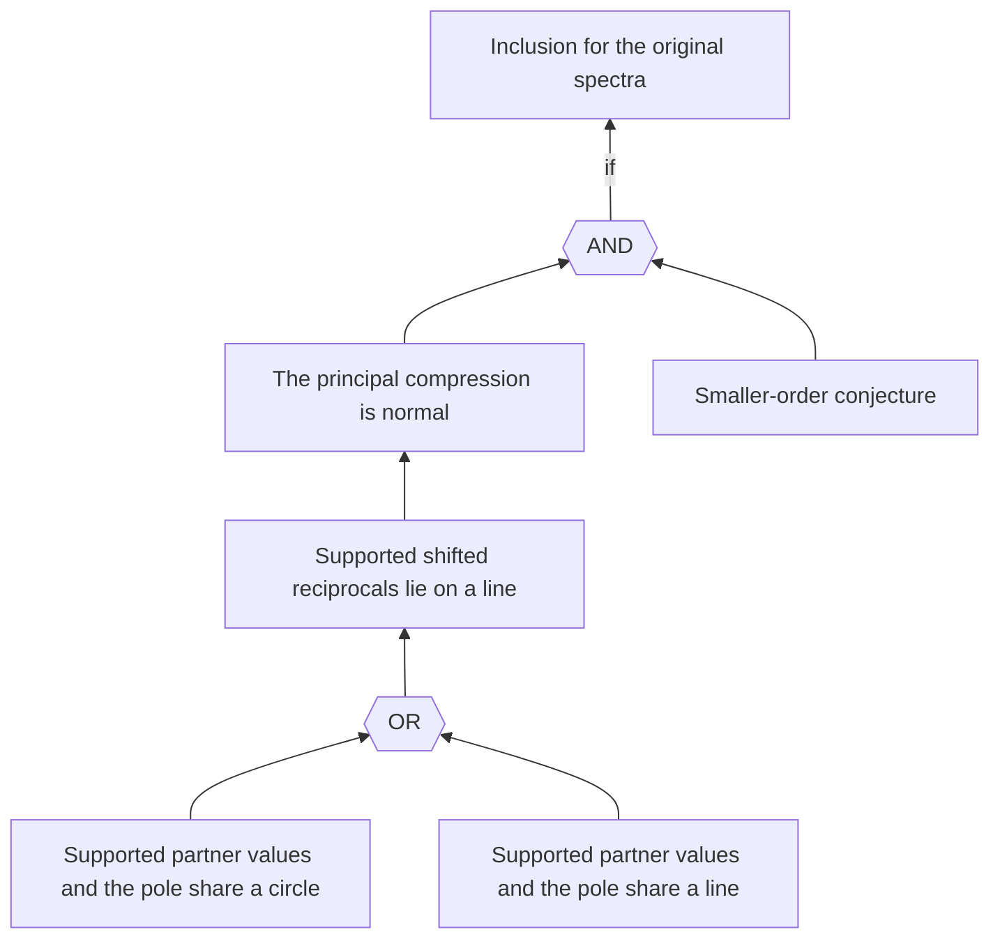

# Spectral and support proof map

[Proof map index](README.md) · [Conjecture](../README.md#proof-tree) · [All-order routes](all-orders-proof-map.md) · [Order four](order-four-proof-map.md) · [Order five](order-five-proof-map.md)

The Marcus–de Oliveira conjecture places the determinant of the sum
of two normal matrices in the real convex hull of their eigenvalue
matching products. For lists $a,b$ of length $n$ and a permutation
$\sigma$, a matching product is $\prod_j(a_{\sigma(j)}+b_j)$. The
relative unitary is the change between the two eigenbases. The tables
give the premises of the restricted cases and reductions. The general
inclusion remains open.

## Order-four support costs

For a complex direction $\eta$, project a matching product $P$ by
taking $\mathrm{Re}(\eta P)$. Subtract the smallest projection to get
a nonnegative cost on permutations. A subset-image indicator is one
if $\sigma$ sends a specified column set to a specified row set, and
zero otherwise. These indicators generate the space of costs in the
classification. An ordinary certificate is a sum of these indicators
with nonnegative coefficients. It gives a lower determinant bound
because the corresponding squared minors are nonnegative.

| Result | Scope | Sources |
| --- | --- | --- |
| Cone and cancellation | The ten exact cone cuts give 82 extreme rays. Relabeling and cancellation reduce every nonnegative expansion to an ordinary sum or one mixed ray with at most 13 ordinary coefficients. | [Cone classification](../Lean/MOC/FourSupportConeClassification.lean#L827) · [Cancellation](../Lean/MOC/FourMixedRayCancellation.lean#L515) · [Cone map](order-four-support-cost-cone-proof-map.md) · [Cancellation map](order-four-mixed-ray-cancellation-proof-map.md) |
| Real lift | Assume the matching Hessian kernel has dimension two, the moment map has rank two, and the moment equations have a solution. A complex lift with zero matching gradient exists exactly when the line of symmetric matrices of order two contains a positive semidefinite matrix. A real midpoint of two complex critical profiles gives one moment solution. Eight nonzero bracket vectors give finite spectral labels after a common shear. The general moment rank bound and the representation of every nonzero critical profile by brackets remain outside Lean. | [Line test](../Lean/MOC/FourSupportCostRealLift.lean#L152) · [Finite labels](../Lean/MOC/FourSupportCostRealLift.lean#L452) · [Real-lift map](order-four-real-spectral-lift-proof-map.md) |
| Spectral determinant and inertia | For order $n\ge2$, the transformed spectral profile is a determinant of order $n-2$. In order four, the complex quadratic form has rank at most four. There is no subspace of dimension five on which its real part is positive definite or negative definite. The formulas include repeated spectra and zero borders. | [Determinant](../Lean/MOC/SpectralProfileDeterminant.lean#L347) · [Inertia](../Lean/MOC/SpectralProfileDeterminant.lean#L437) · [Profile map](spectral-profile-determinant-proof-map.md) |
| Matching squares | The real auxiliary partial-transpose condition at the triple $(0,1,-1)$ is equivalent to sums of squares in the 14-dimensional matching-function space. The general complex normalization requires a distinct transport step. | [Lean statement](../Lean/MOC/RealMatchingSquares.lean#L484) · [Squares map](order-four-real-matching-squares-proof-map.md) |
| Klein-four contacts | Suppose the identity and the three products of disjoint transpositions all attain the largest projection of the order-four matching products. The source expresses the support gap as a sum of squares of real matching functions. The spectral rank bound excludes a strictly negative compression of dimension five. Repeated eigenvalues, extra contacts, and zero coefficients are allowed. | [Lean statement](../Lean/MOC/FourKleinSpectralSquares.lean#L259) · [Klein-four map](order-four-klein-four-matching-squares-proof-map.md) |
| Five-parameter contact family | A real spectral lift is impossible if the fourth weight is zero. At negative signed height a lift is also impossible if its first two weights are equal. At the same sign of height, unequal first weights require a positive second difference in a determinant factorization. Proving that the difference is nonpositive for actual spectra would exclude the unequal case. The positive signed-height support bound remains open in Lean. | [Zero-weight boundary](../Lean/MOC/FourContact0710SpectralLift.lean#L158) · [Equal weights](../Lean/MOC/FourContact0710EqualWeights.lean#L126) · [Hessian test](../Lean/MOC/FourContact0710HessianPencil.lean#L442) · [Contact map](order-four-five-parameter-contact-proof-map.md) |
| Symmetric six-contact family | The actual spectral gap must equal the specified sum of seven ordinary terms and one mixed term with nonnegative coefficients. In this case the spectral equations force the determinant of a matrix pencil of order nine to vanish. The coefficient certificate gives one of three bounds and hence the support inequality for every order-four unitary. Kernel verification of the coefficient certificate is pending. | [Support statement in Lean](../Lean/MOC/FourSymmetricSixContactCertificate.lean#L384) · [Six-contact map](order-four-symmetric-six-contact-proof-map.md) |
| Opposite eigenvalues | If some $a_i+b_j=0$, the support bound holds in every direction for every order-four unitary. For $a_0+b_0=0$, the source also gives an ordinary certificate for the gap from any upper bound of the projected matching products. | [Support bound](../Lean/MOC/FourOppositePairSupport.lean#L396) · [Ordinary certificate](../Lean/MOC/FourOppositePairSupport.lean#L366) · [Opposite-eigenvalue map](order-four-opposite-eigenvalues-proof-map.md) |
| Weighted-minor center | One fixed pair of complex spectra satisfies all nine hull edge bounds for every unitary. The final edge in the chosen vertex order has no ordinary certificate. | [Hull inclusion](../Lean/MOC/FourWeightedMinorCenter.lean#L471) · [Obstruction](../Lean/MOC/FourWeightedMinorCenter.lean#L504) · [Center map](order-four-weighted-minor-center-proof-map.md) |

## Spectra, mixers, and attainable values

| Case | Scope | Sources |
| --- | --- | --- |
| Normal product | Let $A,B$ be complex normal matrices of the same finite order and let $I$ be the identity. Inclusion holds if $(A-cI)(B-dI)$ is normal for some complex $c,d$. The case $c=d=0$ covers a normal product $AB$. Singular summands and repeated eigenvalues are allowed. Inclusion also holds if $A$ is invertible and $A^{-1}B$ is normal. | [Normal shifted product](../Lean/MOC/NormalProductInclusion.lean#L251) · [Normal product](../Lean/MOC/NormalProductInclusion.lean#L282) · [Normal relative product](../Lean/MOC/NormalProductInclusion.lean#L292) · [Proof map](normal-products-proof-map.md) |
| A spectrum and its negative | Take $b_j=-a_j$ for all labels and a unitary $U$. In every order, the inclusion holds if $U-D$ has rank at most two for some complex diagonal matrix $D$. In odd order it also holds if there are nonzero row factors $d_i$ with $d_iU_{ij}=d_jU_{ji}$ whenever $a_i\ne a_j$. | [Rank at most two](../Lean/MOC/NegativeCopyInclusion.lean#L116) · [Odd order](../Lean/MOC/NegativeCopyInclusion.lean#L60) |
| Two spectral values | Fix a relative unitary $U$ and a subset of column labels. Put one complex value on that subset and a second complex value on its complement. One probability law gives the determinant for all first lists and all choices of the two values. For each image of the subset, give its squared minor to one representative permutation. | [Common law](../Lean/MOC/TwoValues.lean#L285) · [Squared-minor mass](../Lean/MOC/TwoValues.lean#L154) |
| Three values and a singleton | Fix the mixer and the label partition with third part of size one. One probability law works for all complex values of the three parts and for every opposing spectrum. | [Lean law](../Lean/MOC/ThreeValues.lean#L51) · [Singleton map](three-spectral-values-with-one-singleton-proof-map.md) |
| Three values with arbitrary multiplicities | An interval mass test describes the common law. A deletion reduces the all-order case to mixers whose every row meets all three groups. The general bounds remain open. | [Three groups](three-spectral-values-with-one-singleton-proof-map.md#three-groups-of-arbitrary-size) |
| Small spectral parameter | Assume every $a_i$ is nonzero. If the sums $\sum_j b_j/a_{\sigma(j)}$ are distinct and no three are collinear over the reals, there is a radius $r>0$. Inclusion holds for $a$ and $(tb_j)_j$ for every relative unitary and every complex $t$ with $\lvert t\rvert<r$. | [Lean bound](../Lean/MOC/SmallSpectralPerturbation.lean#L757) · [Perturbation map](small-spectral-perturbation-proof-map.md) |
| Tensor mixer | For the tensor product of two complex unitary matrices of order two, one law works for every pair of spectra and matches all squared minors. | [Lean law](../Lean/MOC/TwoByTwoTensorPermutationLaw.lean#L437) · [Tensor map](two-by-two-tensor-mixer-proof-map.md) |
| Six-dimensional mixer ball | The source gives inclusion for each unitary within operator norm $1/23083105288$ of a specified rational orthogonal matrix. The first spectrum is arbitrary. The second has three prescribed pairs, with equal values allowed across pairs. Kernel verification of the ball certificate is pending. | [Statement in Lean](../Lean/MOC/SixDimensionalMixerBall.lean#L1499) · [Mixer map](six-dimensional-mixer-ball-proof-map.md) |
| Order-four parameter family | The source gives inclusion for the lists $(t+i,-t+i,1,2+i)$ and $(-1+i,-2-2i,2-i,1+2i)$ for all real $t$ and every order-four unitary. The argument uses 89 polygons and closedness at the interval endpoints. Kernel verification of the full parameter certificate is pending. | [Statement in Lean](../Lean/MOC/FourRealParameterCells.lean#L142) · [Parameter map](order-four-real-parameter-spectra-proof-map.md) |
| Transposition winding | Join consecutive matching products when the matchings differ by a transposition. If a closed walk avoids a point and has nonzero winding about it, some unitary attains that determinant value. The spectra can have repeated entries. | [Lean theorem](../Lean/MOC/TranspositionWinding.lean#L681) · [Winding map](transposition-winding-proof-map.md) |
| Gaussian spectra and Haar mixer | Independent standard complex Gaussian entries give bounds on the probability of no matching triangle block and on the lower tail of the identity matching product. The failure bound assumes almost-everywhere measurability of the squared determinant magnitude and a bound on its integral. The Haar evaluation of this integral remains a paper argument. | [Triangle block bound](../Lean/MOC/GaussianHaarContainment.lean#L635) · [Gaussian lower tail](../Lean/MOC/GaussianHaarContainment.lean#L1159) · [Conditional failure bound](../Lean/MOC/GaussianHaarContainment.lean#L1197) · [Probability map](gaussian-spectra-and-haar-mixers-proof-map.md) |
| Shifted rank sum | In order $n\ge2$, fix a relative unitary and a scalar $t$. Fix the allowed nonzero labels of the two lists after shifting by $t$ and $-t$. If the total number of allowed labels is at most $n+2$, one probability law works for all values on those labels. The scalar inclusion holds under the shifted rank-sum bound in every order. | [Common law](../Lean/MOC/RankTwoOverlap.lean#L709) · [Scalar rank bound](../Lean/MOC/RankTwoOverlap.lean#L724) · [Order-six example](six-dimensional-rank-two-overlap-proof-map.md) |

For the negative spectrum case, form the matrix with entries
$(a_i-a_j)U_{ij}$. The determinant of this matrix divided by $\det U$
gives the determinant of the sum of the two normal matrices. The
identity matching has value zero in positive order. The row factors make
the matrix skew-symmetric, so its determinant vanishes in odd order.
Subtracting a diagonal from $U$ leaves the difference matrix unchanged.
Its rank is at most twice the rank of $U-D$, which gives determinant
zero for the rank-at-most-two case in orders at least five. For
smaller orders, the proof uses inclusion through order three and the
order-four negative spectrum theorem.
[Odd-order determinant](../Lean/MOC/NegativeCopyInclusion.lean#L27) · [Rank bound and determinant](../Lean/MOC/NegativeCopyInclusion.lean#L82) · [Order-four negative spectrum](../Lean/MOC/FourNegativeCopy.lean#L147)

## Related reductions and cases

- Two coefficient normalizations give equivalent spectral tests in
  each order. The first test requires equal second elementary spectral
  coefficients. The second also requires equal spectral sums.
  [Coefficient normalization](equal-spectral-coefficients-proof-map.md)
- For a fixed unitary in order four or five, testing distinct first
  spectra on prescribed conics suffices. The other spectrum is
  arbitrary. The conic inclusion bounds remain open.
  [Conic reductions](conic-spectral-reductions-proof-map.md)
- A triangle gap condition on the assignment sums gives a uniform
  exterior shift bound. The uniform bound without a genericity
  condition remains open.
  [Free eigenvalues and exterior shifts](free-eigenvalue-and-exterior-shifts-proof-map.md)
- A phase change reduces the symmetric cube of a determinant-one
  unitary of order two to the symmetric cube of a real rotation.
  An explicit mixer refutes the common law for all squared minors.
  The scalar inclusion for all spectra has a separate paper proof.
  [Symmetric cube mixer](order-four-symmetric-cube-mixer-proof-map.md)
- Fix one list of four eigenvalues. For every normal matrix with
  this spectrum, there is one probability law for all diagonal
  partners if and only if the four values lie on a circle or line.
  [Common weights for diagonal partners](order-four-circle-or-line-common-weights-proof-map.md)

### Deletion and padding tests

Choose a row $p$ of the relative unitary $U$. Suppose the conjecture
holds in the preceding order. The inclusion follows if the values
$b_j$ for which $U_{pj}\ne0$ lie on a circle or line through $-a_p$.
First suppose $b_j+a_p\ne0$ for all $j$. The reciprocals
$1/(b_j+a_p)$ for $j$ in the row support lie on one line. In the
relative basis, compress the diagonal matrix of reciprocals by
deleting row and column $p$. This compression is normal.
Interlacing lifts its matching products to the original hull.
Move the pole along the circle or line and take a limit when it
coincides with a spectral value. Repeated values are also allowed.
[Line reduction](../Lean/MOC/CircleLinePoleReduction.lean#L98) · [Circle reduction](../Lean/MOC/CircleLinePoleReduction.lean#L127) · [Normal compression inclusion](../Lean/MOC/SupportedCompressionReduction.lean#L140)

The row test connects to the smaller-order conjecture as follows.

At a regular pole, if every entry of the chosen row is nonzero,
normality of the reciprocal compression requires the full partner
spectrum to lie on a circle or line. The convex quadrilateral
$(0,1,1+i,2i)$ fails this test. Every dense row whose pole avoids
these four values gives a nonnormal compression.
[Dense-row necessity](../Lean/MOC/CircleLinePoleReduction.lean#L185) · [Quadrilateral example](../Lean/MOC/CircleLinePoleReduction.lean#L209)

The order-three Householder mixer has diagonal entries $1/3$
and off-diagonal entries $-2/3$. Delete its last row and column.
For the two retained lists $(0,1)$, the sum of the retained
diagonal and the similarity term has determinant $4/3$.
Its matching values are zero and one.
This example refutes the direct deletion bound without normality of
the retained term.
[Exact deletion example](../Lean/MOC/DeletionAndPaddingObstructions.lean#L33)

Appending a dummy spectral label can raise the real support
even when the determinant compression is unchanged. In order two
the original real support is $-1$ and a new value has real part
at least zero. In order three the original real support is eight.
Two new injection values have a fixed real weighted mean of twelve
for every dummy label.
[Order two](../Lean/MOC/DeletionAndPaddingObstructions.lean#L75) · [Order-three square support](../Lean/MOC/DeletionAndPaddingObstructions.lean#L106) · [Order-three added support](../Lean/MOC/DeletionAndPaddingObstructions.lean#L132)
