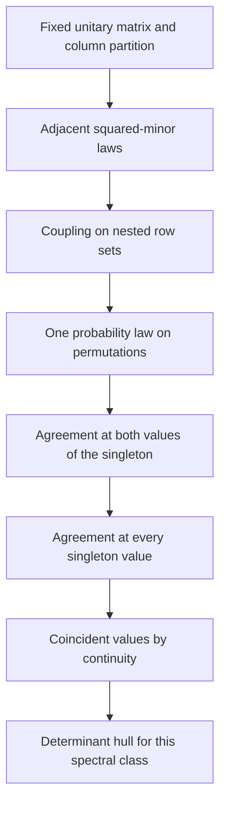

# Three spectral values with one singleton

[Proof map index](README.md) · [Conjecture and proof tree](../README.md#proof-tree)

Let $U$ be a complex unitary matrix of order $n$. Partition the
column labels into a set $J$, a single label $j$ outside $J$, and
the remaining labels. Give these three parts the values $c$, $t$,
and $d$, respectively. Write $b$ for the resulting list. The sizes
of the two nonsingleton parts are arbitrary.

The same real weights $w_\sigma$ work for every first list $a$ and
for every choice of $c,d,t$. Each weight is nonnegative and their
sum is one. The permutation $\sigma$ maps column labels to row labels.

```math
\det\left(\mathrm{diag}(a)+U\mathrm{diag}(b)U^*\right)
=\sum_\sigma w_\sigma\prod_k\left(a_{\sigma(k)}+b_k\right).
```

Coincident values and empty repeated parts are allowed. This identity
gives the determinant convex-hull bound on the stated spectral class.
[Common permutation law](../Lean/MOC/ThreeValues.lean#L51)



The squared minors for columns $J$ and $J\cup\{j\}$ are two
probability distributions on row sets. The exterior-product bound
and finite weighted Hall theorem give a coupling supported on
pairs of row sets $I\subset K$. A pair of positive mass has
$|I|=|J|$ and $|K|=|J|+1$. Choose a permutation that maps $J$ to
$I$ and $J\cup\{j\}$ to $K$. Assign the mass of each pair to its
chosen permutation. This construction uses only $U,J,j$.
[Adjacent transport](../Lean/MOC/AdjacentMinorSupport.lean#L63) ·
[Permutation law from a coupling](../Lean/MOC/NestedValues.lean#L74) ·
[Finite projection domination, Theorem 6.2](https://arxiv.org/abs/math/0204325)

For singleton value $d$, summing by the first row set gives the
determinant. For singleton value $c$, summing by the second row set
gives the determinant. Both the determinant and each matching product
are affine in the singleton value. If $c\ne d$, equality at the
two values gives equality everywhere. The same weights give equality
at $c=d$ by continuity.
[Two-value interpolation](../Lean/MOC/CommonWeights.lean#L72)
