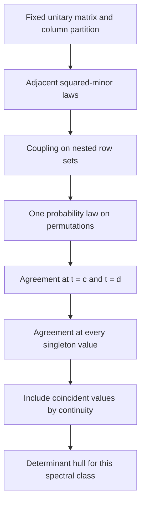
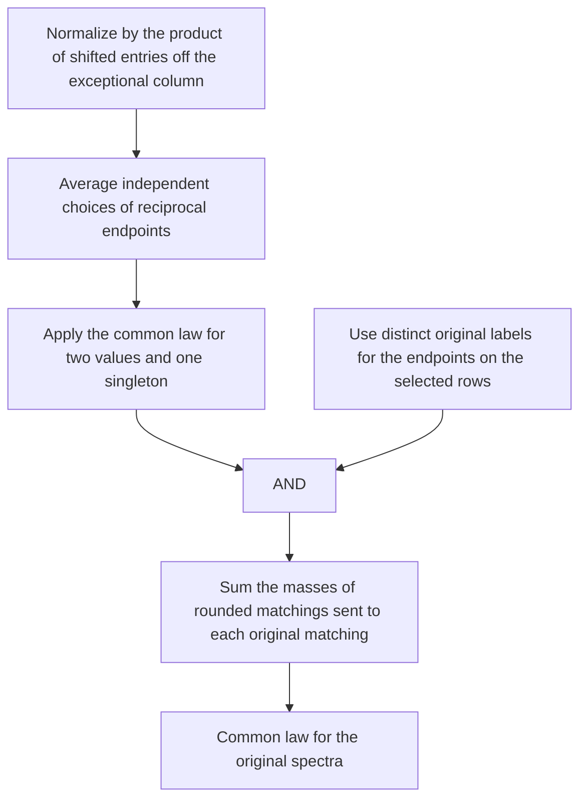

# Three spectral values with one singleton

[Proof map index](README.md) · [Conjecture and proof tree](../README.md#proof-tree)

Let $U$ be a complex unitary matrix of order $n$. Partition the
column labels into a set $J$, a single label $j$ outside $J$, and
the remaining labels. Give these three parts the values $c$, $t$,
and $d$, respectively. Write $b$ for the resulting list. The sizes
of the two other parts are arbitrary. Let $a$ be the opposing list.
Write $\mathrm{diag}(a)$ for the diagonal matrix with entries from
$a$, and let $U^*$ be the conjugate transpose of $U$.

The same real weights $w_\sigma$ work for every first list $a$ and
for every choice of $c,d,t$. Each weight is nonnegative and their
sum is one. The permutation $\sigma$ maps column labels to row labels.

```math
\det\left(\mathrm{diag}(a)+U\mathrm{diag}(b)U^*\right)
=\sum_\sigma w_\sigma\prod_k\left(a_{\sigma(k)}+b_k\right).
```

Coincident values and empty repeated parts are allowed. This identity
gives the determinant convex-hull bound on the stated spectral class.
[Common permutation law](../Lean/MOC/ThreeValues.lean#L51)



For each column set $S$, the numbers $|\det U[I,S]|^2$ over row sets
$I$ of the same size sum to one. Here $U[I,S]$ has rows $I$ and
columns $S$. Use this distribution for $S=J$ and for
$S=J\cup\{j\}$. The exterior-product inequality and the weighted
Hall theorem give a joint distribution with these two marginals.
Each pair $(I,K)$ of positive mass satisfies $I\subset K$,
$|I|=|J|$, and $|K|=|J|+1$. Choose a permutation that maps $J$ to
$I$ and $J\cup\{j\}$ to $K$. Assign the mass of each pair to its
chosen permutation. This construction uses only $U$, $J$, and $j$.
[Adjacent transport](../Lean/MOC/AdjacentMinorSupport.lean#L63) ·
[Permutation law from a coupling](../Lean/MOC/NestedValues.lean#L75) ·
[Finite projection domination, Theorem 6.2](https://arxiv.org/abs/math/0204325)

For singleton value $d$, summing by the first row set gives the
determinant. For singleton value $c$, summing by the second row set
gives the determinant. Both the determinant and each matching product
are affine in the singleton value. If $c\ne d$, equality at the
two values gives equality everywhere. The same weights give equality
at $c=d$ by continuity.
[Two-value interpolation](../Lean/MOC/CommonWeights.lean#L72)

## Three groups of arbitrary size

Let $J\subseteq K$ be sets of column labels. Give $J$, $K\setminus J$,
and the complement of $K$ three distinct values. Fix the unitary mixer
$U$. For any fixed real weights on permutations, the determinant
identity for every opposing spectrum is equivalent to the following
condition for every row set $I$. The sum of weights of permutations
$\sigma$ with $\sigma(J)\subseteq I\subseteq\sigma(K)$ equals

$$
\sum_{J\subseteq S\subseteq K,\ |S|=|I|}|\det U[I,S]|^2.
$$

Nonnegative weights with sum one give the inclusion for this spectral
partition. Existence of such weights for arbitrary groups and mixers
remains open.
[Exact weight test](../Lean/MOC/ThreeValueIntervalCoupling.lean#L171) ·
[Inclusion from positive weights](../Lean/MOC/ThreeValueIntervalCoupling.lean#L247)

A separate reduction preserves the three-value restriction. If a row
has nonzero entries in columns from at most two spectral groups,
change bases within those groups so that at most two entries in the row
are nonzero. The spectra of the smaller pairs omit one label from
each original list. Induction reduces the general three-value
inclusion to the case in which every row has a nonzero entry in each
of the three groups. This remaining case is open.
[Deletion](../Lean/MOC/SpectralSupportDeletion.lean#L101) ·
[All-order equivalence](../Lean/MOC/SpectralSupportDeletion.lean#L219)

## Rectangular compression at a pole

Partition the row labels into sets $R_0,R_1,R_\infty$. Give them the
values $\alpha,\beta,\gamma$, respectively. Take
$R=R_0\cup R_1$. Let $Y$ be the matrix of rows of $U$ with labels in
$R$. It satisfies $YY^*=I_R$, where $I_R$ is the identity on $R$.
Let $s_i=0$ on $R_0$ and $s_i=1$ on $R_1$. Write
$\mathrm{conv}_{\mathbb R}$ for the real convex hull. For fixed $U$
and this partition, the determinant inclusion for all three group
values and every opposing spectrum is equivalent to

$$
\det\bigl(\mathrm{diag}(s)+Y\mathrm{diag}(z)Y^*\bigr)
\in
\mathrm{conv}_{\mathbb R}\left\{\prod_{i\in R}(s_i+z_{e(i)})
: e\text{ is an injection from }R\text{ into the column labels}\right\}
$$

for every complex column list $z$. The theorem uses the inverse of a
permutation on the retained rows. Every injection extends to such a
permutation because the remaining row and column sets have the same
size.
[Compression](../Lean/MOC/ThreeValueProjectiveCompression.lean#L36) ·
[Orthonormal rows](../Lean/MOC/ThreeValueProjectiveCompression.lean#L51) ·
[Equivalence](../Lean/MOC/ThreeValueProjectiveCompression.lean#L265)

For pairwise distinct $\alpha,\beta,\gamma$ and an opposing list $b$
with $b_j+\gamma\ne0$ for every column $j$, set

$$
z_j=-\frac{\beta-\gamma}{\beta-\alpha}
     \frac{b_j+\alpha}{b_j+\gamma}.
$$

The map $x\mapsto \frac{\beta-\gamma}{\beta-\alpha}\frac{x-\alpha}{x-\gamma}$
takes $\alpha$ to zero and $\beta$ to one, with a pole at $\gamma$.
Apply it to the entries $-b_j$ of the signed partner list, then change
their signs to get $z$. At rows with value $\gamma$, the determinant
normalization uses a constant factor of one. This normalization
rescales the determinant and all matching products by the same
nonzero factor. Continuity covers coincident group values and
excluded partner entries in the equivalence. The rectangular
inclusion remains open.
[Normalized inclusion at regular inputs](../Lean/MOC/ThreeValueProjectiveCompression.lean#L178) ·
[All-input equivalence](../Lean/MOC/ThreeValueProjectiveCompression.lean#L265)

## Shifted reciprocals in a segment

Let $a$ and $b$ be two complex eigenvalue lists of the same finite
length. Let $U$ be the relative unitary matrix. Fix a scalar
$\alpha$, a row set $E$, and one column label $j_0$. Suppose
$a_i=\alpha$ for all $i\notin E$. For each $j\ne j_0$, require
$\alpha+b_j\ne 0$ and put $q_j=(\alpha+b_j)^{-1}$.

Take distinct nonzero complex numbers $p$ and $s$. Suppose each $q_j$,
for $j\ne j_0$, is on the closed segment from $p$ to $s$. Each
endpoint must occur at least $|E|$ times among these $q_j$. One
probability law on permutations then gives the determinant identity
for every allowed choice of $a$ and every complex value of $b_{j_0}$.
[Common law](../Lean/MOC/ReciprocalSegmentRounding.lean#L166) ·
[Determinant inclusion](../Lean/MOC/ReciprocalSegmentRounding.lean#L238)



For $j\ne j_0$, divide the matching factor by $\alpha+b_j$.
The result is $1+(a_{\sigma(j)}-\alpha)q_j$. The factor at $j_0$
is $a_{\sigma(j_0)}+b_{j_0}$. Each normalized product is affine in
each $q_j$ separately. The signed determinant identity expresses the
normalized determinant as a fixed linear combination of these
products. Thus independent endpoint choices with mean $q_j$ give
the original normalized determinant on average.
[Normalization](../Lean/MOC/ReciprocalSegmentRounding.lean#L17) ·
[Endpoint averaging](../Lean/MOC/ReciprocalSegmentRounding.lean#L69) ·
[Signed determinant identity](../Lean/MOC/Weights.lean#L58)

For each endpoint choice, apply the common law for two values and
one singleton. In each resulting matching, keep the row matched
to $j_0$. On every other row in $E$, replace the rounded label by
a distinct original label that has the required reciprocal. The
endpoint counts supply enough labels. Complete this partial
assignment to a permutation. Every other row contributes a factor
of one, so the normalized product has the same value. Summing
the assigned masses gives the common law on the original
permutations. Multiplication by the removed factors gives the
determinant identity.
[Endpoint assignment](../Lean/MOC/EndpointRematching.lean#L9) ·
[Common law for the original matchings](../Lean/MOC/ReciprocalSegmentRounding.lean#L166)

For example, take lists of length twelve and let $E$ contain five
rows. Set $\alpha=0$. The first list can have any values on those rows
and zero on the other rows. The second list can have five entries
equal to $1$, five equal to $1/2$, one equal to $2/3$, and one arbitrary
entry. The shifted reciprocals off the exceptional label are $1$,
$2$, and $3/2$. The endpoints $1$ and $2$ each occur five times.

## Lean check status

| Lean scope | Lean Checked? |
| --- | --- |
| The 10 source modules linked in this map | Partial (9/10) |
| [ReciprocalSegmentRounding.lean](../Lean/MOC/ReciprocalSegmentRounding.lean#L166) | No |

[Status definitions](README.md#lean-check-status). Paper arguments retain their stated scope.
