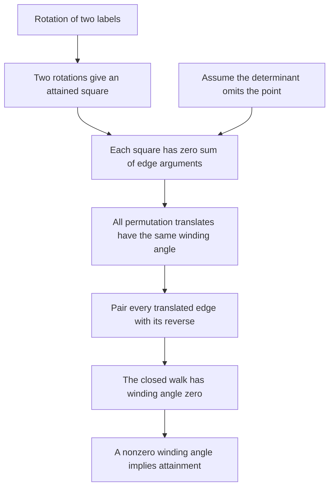

# Attained values from transposition walks

[Proof map index](README.md)

Let $a$ and $b$ be two lists of complex eigenvalues with the same finite
index set. For a permutation $p$ of this set, its matching product is
$z_p=\prod_j(a_{p(j)}+b_j)$. Write $\mathrm{diag}(a)$ for the diagonal
matrix with entries $a$ and $U^*$ for the conjugate transpose of $U$.
The attainable determinant range consists of the values
$\det(\mathrm{diag}(a)+U\mathrm{diag}(b)U^*)$ for unitary matrices $U$.
Eigenvalues in either list can repeat.

A transposition swaps two labels. A transposition walk gives a sequence
of permutations in which consecutive permutations differ by such a swap.
Draw the walk by joining consecutive matching products with straight
segments. Let $q$ be a point outside these segments. For each oriented
edge from permutation $p$ to permutation $r$, take the principal
argument of $(z_r-q)/(z_p-q)$. The winding angle is the sum of these
arguments. A full turn has angle $2\pi$. If the walk closes and the
winding angle is nonzero, some unitary matrix attains $q$.
[Lean statement](../Lean/MOC/TranspositionWinding.lean#L681)

For a transposition matrix $P$ and a parameter $0\le t\le1$, use the
unitary matrix $\sqrt{1-t}\,I+i\sqrt{t}\,P$. Here $I$ is the identity
matrix and $i^2=-1$. Every signed determinant weight outside the
identity and the transposition vanishes. One squared matrix entry gives
the transposition weight $t$. The two weighted matching products trace
the entire straight segment. At $t=1$, the factor $i$ cancels in
conjugation. [Segment identity](../Lean/MOC/TranspositionWinding.lean#L262)

Compose two rotations with independent parameters to obtain a square in
the attainable range. At one boundary, conjugation by the first
transposition relabels the second transposition. This gives the four
required edges. If the square omits $q$, its difference from $q$ has a
continuous logarithm. The proof adds principal logarithms of ratios
from a sufficiently fine subdivision of every radial segment in the
square. Their exponentials telescope. On a straight boundary edge, the
change of imaginary part is its principal change of argument. Summing
around the square cancels the four endpoint values.
[Square construction](../Lean/MOC/TranspositionWinding.lean#L380) · [Continuous logarithm](../Lean/MOC/TranspositionWinding.lean#L438) · [Angle sum](../Lean/MOC/TranspositionWinding.lean#L600)

Summing the square identities along a closed walk shows that its
winding angle is invariant under translation by a transposition.
Transpositions generate the permutation group. Averaging over the
whole group pairs all translated edges with their reversals, and the
average angle is zero. This contradicts nonzero winding if the range
omits $q$. Intersections of drawn segments add no edges to the abstract
walk. [Finite averaging proof](../Lean/MOC/TranspositionWinding.lean#L63)

The same implication holds for an integer cycle on the transposition
graph. An integer cycle assigns coefficients to the oriented edges.
At each vertex, the incoming sum must equal the outgoing sum. Multiply
each edge angle by its coefficient and sum over all edges. If this
weighted angle is nonzero, a unitary matrix attains the point.
[Cycle definition](../Lean/MOC/TranspositionWinding.lean#L699) · [Cycle attainment](../Lean/MOC/TranspositionWinding.lean#L755)

See Kovacec for the straight-segment calculation and the graph of
matching products. The square and averaging proof gives an inner bound
on attainable determinant values. [Preprint](https://www.mat.uc.pt/preprints/ps/p2611.pdf)

## Lean check status

| Lean scope | Lean Checked? |
| --- | --- |
| The 1 source module linked in this map | No |

[Status definitions](README.md#lean-check-status). Paper arguments retain their stated scope.
