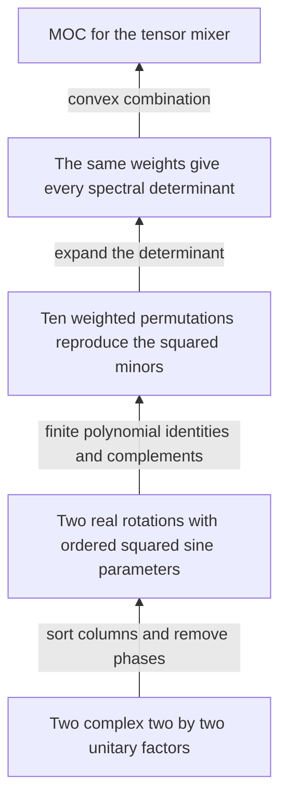

# Matching weights for a Kronecker product of two matrices of order two

[Proof map index](README.md) · [Conjecture and notation](../README.md) · [Order-four proof map](order-four-proof-map.md)

Let $A$ and $B$ be complex unitary matrices of order two. Set
$U=A\otimes B$, where $\otimes$ is the Kronecker product. Index the
rows and columns of $U$ by the four pairs of factor labels. There is
a probability law on at most ten permutations of these pairs. For
each column subset $J$ and row subset $I$ of the same size, the
probability that a permutation maps $J$ onto $I$ is $|\det U[I,J]|^2$.
Here $U[I,J]$ has rows $I$ and columns $J$. When $I$ and $J$ have
different sizes, the probability is zero.
[Minor law](../Lean/MOC/TwoByTwoTensorPermutationLaw.lean#L400)

The same law gives the determinant in the Marcus–de Oliveira
conjecture for every pair of complex spectral lists with mixer $U$.
The weights depend only on $A$ and $B$.
[Determinant identity](../Lean/MOC/TwoByTwoTensorPermutationLaw.lean#L437) · [Hull inclusion](../Lean/MOC/TwoByTwoTensorPermutationLaw.lean#L446)

Put the entry of larger modulus in the first column of the first
row of each factor. Apply a unit complex scalar to each column to
make the first row real and nonnegative. The second row is a real
perpendicular vector times a unit complex scalar. Remove this last
scalar to obtain a real rotation. For a zero entry choose its phase
to be one.
[Phase reduction](../Lean/MOC/TwoByTwoTensorPermutationLaw.lean#L286)

Let $p$ and $q$ be the squares of the sine parameters of the real
rotations. Exchange the factors if necessary to obtain
$0\le p\le q\le 1/2$. Set $x=1-2q$, $y=2(q-p)$, and $z=2p$.
These numbers are nonnegative and sum to one. Each of the ten weights
is a polynomial in $x,y,z$ with nonnegative coefficients. The ten
weights sum to one.
[Weight formulas](../Lean/MOC/TwoByTwoTensorPermutationLaw.lean#L82)

Polynomial identities check the 16 entry probabilities and 36
probabilities for minors of order two. The complementary minor
identity gives the probabilities for larger subsets. Row and column
permutations transport the law to the original labels. Unit phases
preserve squared moduli of minors.
[Entries](../Lean/MOC/TwoByTwoTensorPermutationLaw.lean#L117) · [Minors of order two](../Lean/MOC/TwoByTwoTensorPermutationLaw.lean#L133) · [Complementary minors](../Lean/MOC/FiniteMinorLaw.lean#L99) · [Relabeling](../Lean/MOC/TwoByTwoTensorPermutationLaw.lean#L207)
