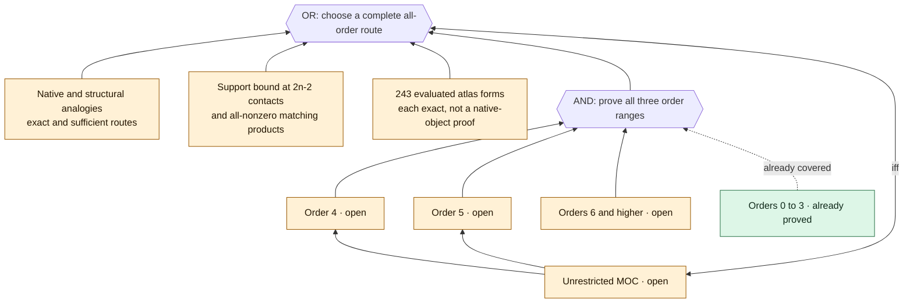
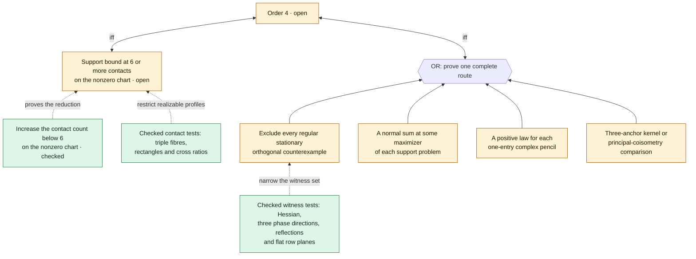
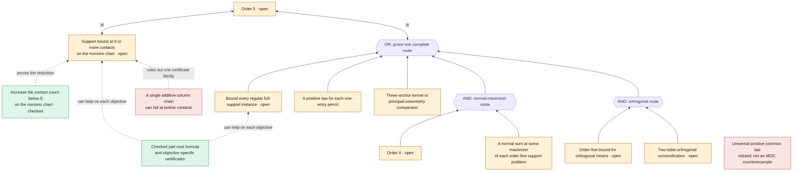
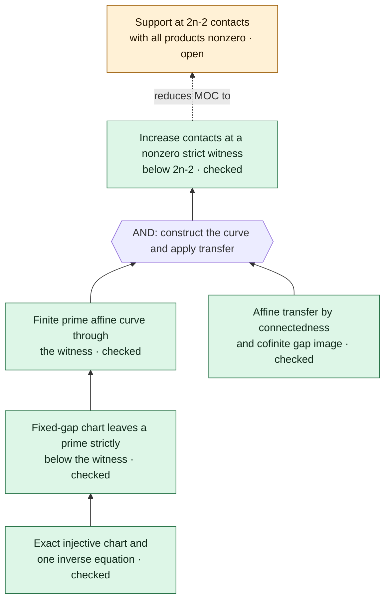

# MOC proof tree

## Overview

Read the arrows from a proof route toward its conclusion.
**Iff** labels mark checked equivalences. A plain arrow marks a checked
sufficient implication, not a proof of its premise. Dashed arrows mark
research dependencies or supporting context, not new implications. Orange nodes are open;
green nodes describe steps that Lean has proved. The diagrams group
related routes. [ProofRoutes.lean](MOC/ProofRoutes.lean) gives the full list.

## Order four: the main proof routes

## Order five: the main proof routes

## Why the contact count increases

The [Lean tree](MOC/ProofRoutes.lean) has three roots: all finite orders,
order four, and order five. An **OR** node needs one complete branch.
An **AND** node needs every child. A branch can be open even when Lean
has proved that it would be enough.

## All finite orders

- **OR: A native comparison.** The Lean list links each included
  comparison to MOC. Examples include normalized matrix pencils,
  finite determinant paths, transport between spectral multiplicities,
  and traceless spectra. The [native audit](MOC/Reformulations/NativeAudit.lean)
  records the scope and direction of each link. It also lists analogies
  that do not give a proof of MOC.
- **OR: An evaluated atlas comparison.** Each of the 243 numbered
  links uses complex evaluation on labelled finite data. This branch
  does not identify the original native objects with MOC.
- **OR: The terminal contact bound.** Exclude strict witnesses with at least
  $2n-2$ contacts and no zero matching product, in each order. This is
  [equivalent to unrestricted MOC](MOC/ProofRoutes.lean).
- **OR: An order split.** Prove order four **AND** order five **AND**
  all orders at least six. The cases of order at most three are already
  proved.

## Order four

The checked alternatives include:

- Prove the hull inclusion for real orthogonal mixers with complex
  spectra. It is enough to exclude every
  [regular stationary orthogonal witness](MOC/OrderFourIndependent.lean).
  Use the [second-order](MOC/OrderFourSecondVariation.lean),
  [reflection](MOC/OrderFourReflectionTest.lean), and
  [flat row-swap](MOC/OrderFourGivens.lean) tests on these witnesses.
- Show that every directional support maximum has a representative
  whose sum is normal.
- Prove the [common law for each one-entry complex pencil](MOC/ProofRoutes.lean),
  or the [three-anchor kernel bound](MOC/Reformulations/ThreeAnchorKernel.lean).
- Prove the support bound at six or more contacts when every matching
  product is nonzero. Lean proves the [contact transfer and equivalence](MOC/SaturatedContactReduction.lean).

## Order five

The checked alternatives include:

- Prove the hull bound for regular spectra and mixers with no zero entries.
- Prove the one-entry law separately for each pencil. One law need not
  work for different pencils.
- Prove order four **AND** show that each order-five support problem
  has a maximizer with a normal sum.
- Prove the support bound at eight or more contacts with no zero
  matching products. The checked transfer does not require full
  mixer support.
- Use [subset assignment certificates](MOC/SubsetAssignmentSupport.lean)
  on individual support objectives. The [doubleton image tests](MOC/OrderFivePairMarkers.lean)
  identify which minor data a fixed law must preserve. A universal
  positive common law is not an active branch: [Drury's Householder
  counterexample](https://doi.org/10.1016/S0024-3795(99)00173-1)
  rules out that stronger property in order five. The library now has a
  [symbolic Lean proof of this obstruction](MOC/OrderFiveCommonLawObstruction.lean).
  The [explicit pair cost](MOC/OrderFivePairCost.lean) expresses every
  directional order-five objective in these coordinates.
- Prove orthogonal order five **AND** a two-table orthogonal
  convexification for complex mixers. The library does not supply the
  convexification in order five.

Each inhabited atlas sample also gives an exact evaluated comparison at
order four and at order five. This stays at the selected order and does
not imply the corresponding native claim.

An all-order branch can also close either finite-order root. This
does not reduce an all-order goal to only two orders. A refutation of
a sufficient-only branch does not refute its parent. For an exact
equivalence, proof and refutation both transfer.

## Checked steps toward the open branches

- [Local holomorphic root cover](MOC/FiniteCurveRootCover.lean):
  separable fibres of a monic plane polynomial have complete
  local holomorphic branches. The [global gluing](MOC/FiniteCurveConnected.lean)
  proves connectedness for a punctured simple-root cover of an irreducible
  plane polynomial. The [full plane zero set](MOC/FiniteCurveClosure.lean)
  is also connected, including exceptional fibres. The curve slice
  through each witness is still a separate step.
- [Cross-ratio test](MOC/ContactCrossRatios.lean):
  one four-swap pattern at nonzero height imposes a positive real
  product of two spectral cross ratios.
- [Parity corrections](MOC/FiveParityCorrection.lean):
  these changes preserve every subset-image mass. A repair must
  still make the weights nonnegative.
- [Sparse geometry](MOC/OrderFiveSparseGeometry.lean):
  a failure with at least eight mixer zeros forces an order-four
  failure. This is a reduction, not an order-five proof on dense mixers.
- [Spectral collisions on a sparse row](MOC/SparseSpectralCollision.lean):
  a three-supported row reduces to the preceding order if two of its
  supported column labels coincide. Unequal labels are not preserved
  by the same rotation.
- [Parity repair threshold](MOC/QuaternionParitySharp.lean):
  the proposed displacement-label repair has an exact scalar feasibility
  test. This excludes that repair below its threshold, not the hull
  inclusion or other possible repairs.
- [Flat disjoint row planes](MOC/OrderFourFlatPlanes.lean):
  at a strict order-four witness, two flat disjoint signed swaps must
  have a strictly losing product. Otherwise the rotations create a
  sparse column and reduce to order three.
- [Branch values](MOC/FiniteCurveBranchValues.lean): the omitted
  nonseparable fibres of a monic irreducible plane polynomial form a
  finite set. Its regular root cover is connected.
- [Reciprocal-conjugate support](MOC/ReciprocalConjugateSupport.lean):
  a Gram inequality proves the matching bound in a specified direction
  for reciprocal-conjugate spectra, in every order. It is not a bound
  in every direction for those spectra.
- [Pair assignment relaxation](MOC/PairAssignmentObstruction.lean):
  for a separated pair-cost class, a best assignment of pairs can
  beat every assignment induced by a permutation of the labels.
  This is an obstruction to the relaxation, not to MOC.

## Transfer between branches

Lean records the reverse proof for each exact branch. Two exact
branches under the same root imply each other. Any sufficient branch
implies every exact branch under its root. An all-order branch also
implies each exact branch in orders four and five. For a one-way
branch, the proof does not infer its premise from its conclusion.
The [native audit](MOC/Reformulations/NativeAudit.lean) records which
additional special-case and restricted comparisons are not root branches.

## Latest checks on the open branches

| Gap | What Lean proves | What remains |
| --- | --- | --- |
| Fixed-gap curve | [Connected-profile transfer](MOC/ConnectedContactStep.lean) applies to supplied exact profiles on a monic irreducible plane model, even at an exceptional fibre. [Proper projection](MOC/FiniteCurveProperProjection.lean) controls limits of lifts to the affine curve. | Use the checked transfer to prove the terminal support inequality. |
| Order-four stationary maximum | [Column reflections](MOC/OrderFourColumnReflections.lean) send a column to a signed coordinate and reduce to order three. Those reflections strictly lose support at a strict witness. | Show that every remaining stationary candidate has an improving or flat direction, or certify it by a different route. |
| Order-four contact geometry | [Fibre gluing](MOC/ContactFibreGluing.lean) gives a matching-line proof when two full zero-height fibres meet under its spectral conditions. [Triangle closure](MOC/ZeroHeightTriangleClosure.lean) forces missing contacts from four specified contacts at height zero. | Cover profiles outside these patterns. |
| Quaternion corrections | The [intrinsic displacement proof](MOC/QuaternionIntrinsic.lean) gives the possible monomial types and their permutation parities. | Connect these to the local signs in the actual quaternion mixer, then prove nonnegativity of its corrected law. |
| Order-five sparse mixer | A [zero corner](MOC/OrderFiveZeroCorner.lean) forces the opposite block to be nonzero when all row and column degrees are at least three. | Treat the remaining five-edge path mask and the full-support case. |
| Order-five projected objective | [The strict Gram bound is open-stable](MOC/SpectralGramNeighborhood.lean): both spectra and the support direction can vary in a neighborhood, uniformly over all mixers. | Bound objectives outside this neighborhood. |

Further checked steps narrow the open branches:

- The [finite-affine connectedness theorem](MOC/FiniteCurveAffineConnected.lean)
  treats a prime finite affine curve whose coordinates can be recovered
  rationally from a plane model. The [primitive-coordinate theorem](MOC/FiniteCurvePrimitiveCoordinate.lean)
  proves the recovery and connectedness for any prime complex curve with
  a finite injective polynomial projection. The
  [fixed-gap chart](MOC/PolynomialContactSlice.lean) supplies a slice through each low-contact witness.
- The [near-balanced signed-Klein mixer theorem](MOC/QuaternionMixerParity.lean)
  proves the hull inclusion for every spectrum pair when its explicit
  signing, unitary, determinant, and cubic conditions hold. It is a
  mixer class, not an order-four proof. The [binary quaternion sign rule](MOC/QuaternionBinaryBasis.lean)
  verifies the signing for the concrete binary table; normalization is
  still a stated condition on that table.
- The [reflection residue](MOC/OrderFourReflectionResidue.lean) checks
  the scalar cancellation for the two signed reflection directions.
  It does not force either direction to improve support.
- The [six-contact bridge](MOC/SixContactBridge.lean) rules out a specific
  order-four violation: at height zero a contact and five active
  single-swap neighbors force all matching products onto one line.
  The theorem assumes simple spectra and nonzero matching products.

## What remains

The [contact reduction](MOC/SaturatedContactReduction.lean) now raises
the number of contacts of any strict witness with all matching products
nonzero below $2n-2$. The normalized chart has $2n-2$ parameters. Its
inverse variable and equation keep the chart open without using up a
degree of freedom. The fixed complex differences and determinant gap
leave a prime strictly below evaluation at the witness. A finite
affine curve through that point has an infinite exact profile image.
The cofinite gap image and connectedness give the next contact without
changing the mixer or losing any old contacts.
The contact strategy starts from [Zheng, preprint DOI 10.13140/RG.2.2.36790.25923](https://doi.org/10.13140/RG.2.2.36790.25923); the affine curve construction and transfer are checked here.

**Main target.** Prove the terminal support inequality at $2n-2$
contact labels. The reduction counts labels, not distinct values.
It does not prove that signed weights are nonnegative, that all terminal
profiles admit a chosen certificate, or that a stationary mixer stays
stationary as its spectra move. Six contacts are enough in order
four and eight in order five. A strict terminal violation would refute MOC.

**Certificate route.** Use the checked subset-event and nested-transport
results on individual support objectives. A covering theorem for all
terminal profiles is still open. A
[rectangle obstruction](MOC/NestedRectangleObstruction.lean) rules out
a single additive column-prefix chain for some order-five profiles
with twelve or more contacts. It does not rule out a chain in the
other orientation or a different certificate. Failure of a certificate
alone does not refute MOC. The common pair law already has an
order-five obstruction.

**Order-four backup.** Exclude the regular stationary orthogonal witnesses
using the second-order, reflection, and flat-plane tests. The
[phase Hessian reduction](MOC/PhaseHessianReduction.lean) leaves only
three free entries in the imaginary symmetric test when an
order-four orthogonal mixer has a row with no zero entries. This
does not exclude the resulting witnesses. It is a separate exact route. The one-entry law is also an exact reformulation; its five-label
bound does not supply the law.

See [Literature.md](Literature.md) for primary sources, DOIs, and the
scope of the techniques used.

The [two-outlier block comparison](MOC/PositiveTwoOutlierBlock.lean)
gives a separate route to the height-zero bound. It controls the real
part of the determinant by two positive reference planes after Schur
elimination. The bound applies in every order when the block comparison
holds. Passing from spectral data and an arbitrary mixer to those block
conditions is a separate step. For the block elimination technique, see
[Haynsworth, DOI 10.1016/0024-3795(68)90050-5](https://doi.org/10.1016/0024-3795(68)90050-5).
