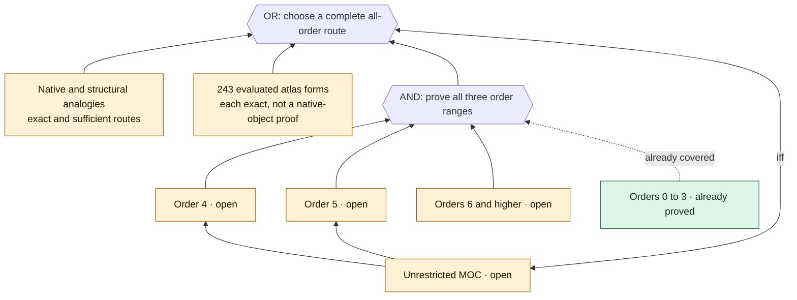
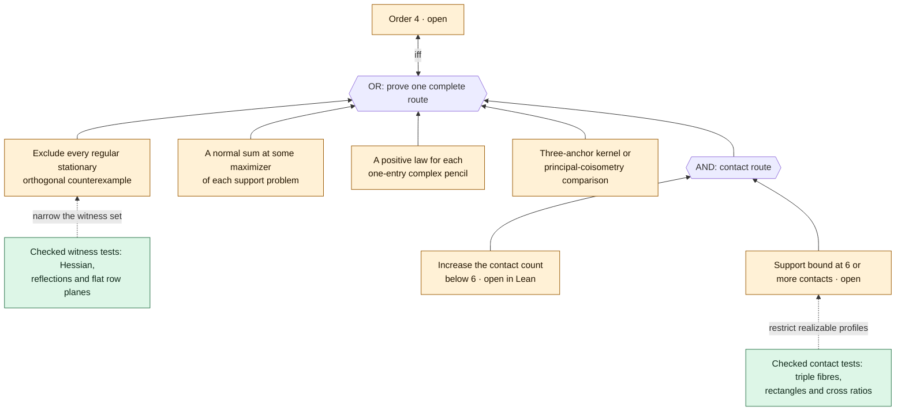
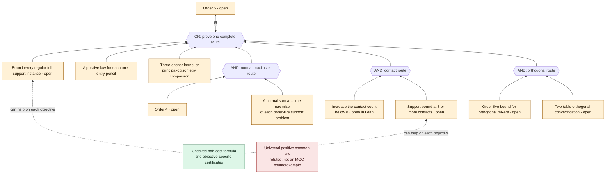
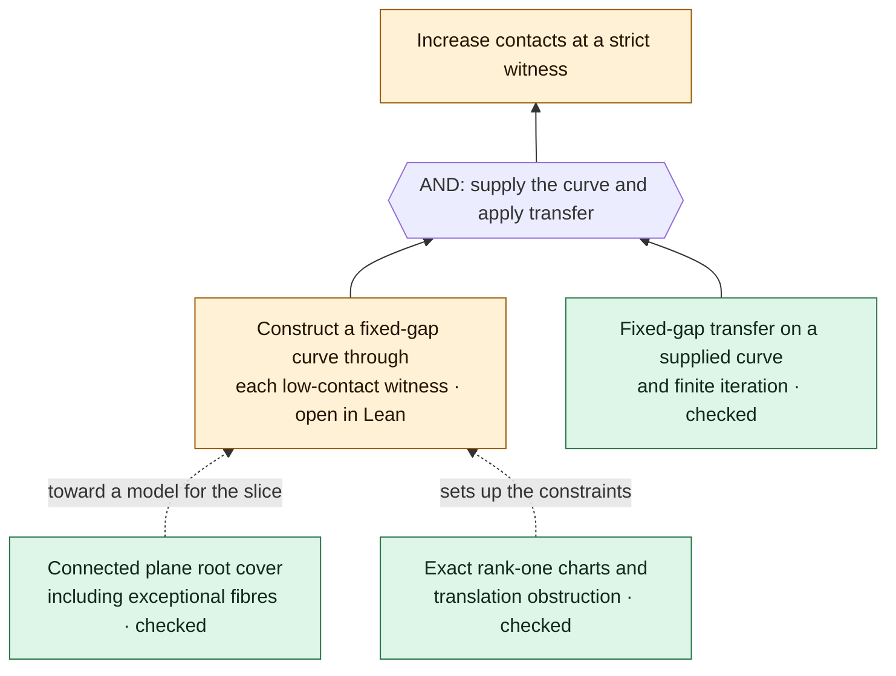

# MOC proof tree

## Overview

Read the arrows from a proof route toward its conclusion.
**Iff** labels mark checked equivalences. A plain arrow marks a checked
sufficient implication, not a proof of its premise. Dashed arrows mark
research dependencies, not proved implications. Orange nodes are open;
green nodes describe steps that Lean has proved. The diagrams group
related routes. [ProofRoutes.lean](MOC/ProofRoutes.lean) gives the full list.

## Order four: the main proof routes

## Order five: the main proof routes

## Shared contact gap

The [Lean tree](MOC/ProofRoutes.lean) has three roots: all finite orders,
order four, and order five. An **OR** node needs one complete branch.
An **AND** node needs every child. A branch can be open even when Lean
has proved that it would be enough.

## All finite orders

- **OR: A native comparison.** The Lean list links each included
  comparison to MOC. Examples include normalized matrix pencils,
  finite determinant paths, transport between spectral multiplicities,
  and traceless spectra. The [native audit](MOC/Reformulations/NativeAudit.lean)
  records the scope and direction of each link. It also lists analogies
  that do not give a proof of MOC.
- **OR: An evaluated atlas comparison.** Each of the 243 numbered
  links uses complex evaluation on labelled finite data. This branch
  does not identify the original native objects with MOC.
- **OR: An order split.** Prove order four **AND** order five **AND**
  all orders at least six. The cases of order at most three are already
  proved.

## Order four

The checked alternatives include:

- Prove the hull inclusion for real orthogonal mixers with complex
  spectra. It is enough to exclude every
  [regular stationary orthogonal witness](MOC/OrderFourIndependent.lean).
  Use the [second-order](MOC/OrderFourSecondVariation.lean),
  [reflection](MOC/OrderFourReflectionTest.lean), and
  [flat row-swap](MOC/OrderFourGivens.lean) tests on these witnesses.
- Show that every directional support maximum has a representative
  whose sum is normal.
- Prove the [common law for each one-entry complex pencil](MOC/ProofRoutes.lean),
  or the [three-anchor kernel bound](MOC/Reformulations/ThreeAnchorKernel.lean).
- Prove a one-contact transfer **AND** the support bound at six or more
  contacts. The [fixed-gap step](MOC/ContactCurveStep.lean) applies once
  the required curve exists. The construction of that curve is open in Lean.

## Order five

The checked alternatives include:

- Prove the hull bound for regular spectra and mixers with no zero entries.
- Prove the one-entry law separately for each pencil. One law need not
  work for different pencils.
- Prove order four **AND** show that each order-five support problem
  has a maximizer with a normal sum.
- Prove a one-contact transfer **AND** the support bound at eight or
  more contacts, for mixers with no zero entries.
- Use [subset assignment certificates](MOC/SubsetAssignmentSupport.lean)
  on individual support objectives. The [doubleton image tests](MOC/OrderFivePairMarkers.lean)
  identify which minor data a fixed law must preserve. A universal
  positive common law is not an active branch: [Drury's Householder
  counterexample](https://doi.org/10.1016/S0024-3795(99)00173-1)
  rules out that stronger property in order five. The library now has a
  [symbolic Lean proof of this obstruction](MOC/OrderFiveCommonLawObstruction.lean).
  The [explicit pair cost](MOC/OrderFivePairCost.lean) expresses every
  directional order-five objective in these coordinates.
- Prove orthogonal order five **AND** a two-table orthogonal
  convexification for complex mixers. The library does not supply the
  convexification in order five.

Each inhabited atlas sample also gives an exact evaluated comparison at
order four and at order five. This stays at the selected order and does
not imply the corresponding native claim.

An all-order branch can also close either finite-order root. This
does not reduce an all-order goal to only two orders. A refutation of
a sufficient-only branch does not refute its parent. For an exact
equivalence, proof and refutation both transfer.

## Checked steps toward the open branches

- [Local holomorphic root cover](MOC/FiniteCurveRootCover.lean):
  separable fibres of a monic plane polynomial have complete
  local holomorphic branches. The [global gluing](MOC/FiniteCurveConnected.lean)
  proves connectedness for a punctured simple-root cover of an irreducible
  plane polynomial. The [full plane zero set](MOC/FiniteCurveClosure.lean)
  is also connected, including exceptional fibres. The curve slice
  through each witness is still a separate step.
- [Cross-ratio test](MOC/ContactCrossRatios.lean):
  one four-swap pattern at nonzero height imposes a positive real
  product of two spectral cross ratios.
- [Parity corrections](MOC/FiveParityCorrection.lean):
  these changes preserve every subset-image mass. A repair must
  still make the weights nonnegative.
- [Sparse geometry](MOC/OrderFiveSparseGeometry.lean):
  a failure with at least eight mixer zeros forces an order-four
  failure. This is a reduction, not an order-five proof on dense mixers.
- [Spectral collisions on a sparse row](MOC/SparseSpectralCollision.lean):
  a three-supported row reduces to the preceding order if two of its
  supported column labels coincide. Unequal labels are not preserved
  by the same rotation.
- [Parity repair threshold](MOC/QuaternionParitySharp.lean):
  the proposed displacement-label repair has an exact scalar feasibility
  test. This excludes that repair below its threshold, not the hull
  inclusion or other possible repairs.
- [Flat disjoint row planes](MOC/OrderFourFlatPlanes.lean):
  at a strict order-four witness, two flat disjoint signed swaps must
  have a strictly losing product. Otherwise the rotations create a
  sparse column and reduce to order three.
- [Branch values](MOC/FiniteCurveBranchValues.lean): the omitted
  nonseparable fibres of a monic irreducible plane polynomial form a
  finite set. Its regular root cover is connected.
- [Reciprocal-conjugate support](MOC/ReciprocalConjugateSupport.lean):
  a Gram inequality proves the matching bound in a specified direction
  for reciprocal-conjugate spectra, in every order. It is not a bound
  in every direction for those spectra.
- [Pair assignment relaxation](MOC/PairAssignmentObstruction.lean):
  for a separated pair-cost class, a best assignment of pairs can
  beat every assignment induced by a permutation of the labels.
  This is an obstruction to the relaxation, not to MOC.

## Transfer between branches

Lean records the reverse proof for each exact branch. Two exact
branches under the same root imply each other. Any sufficient branch
implies every exact branch under its root. An all-order branch also
implies each exact branch in orders four and five. For a one-way
branch, the proof does not infer its premise from its conclusion.
The [native audit](MOC/Reformulations/NativeAudit.lean) records which
additional special-case and restricted comparisons are not root branches.
