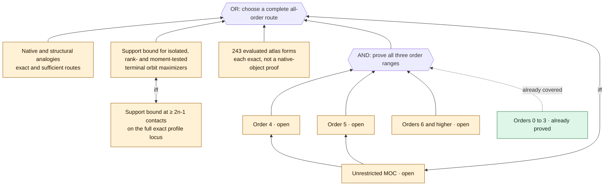
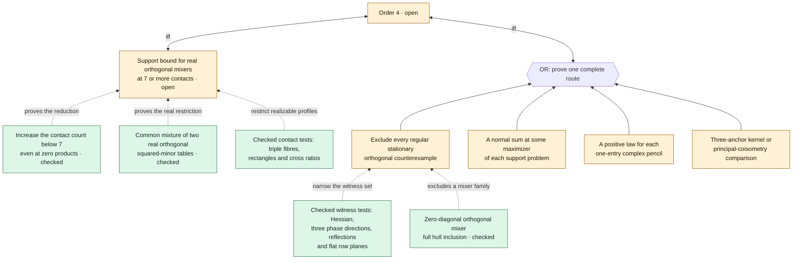
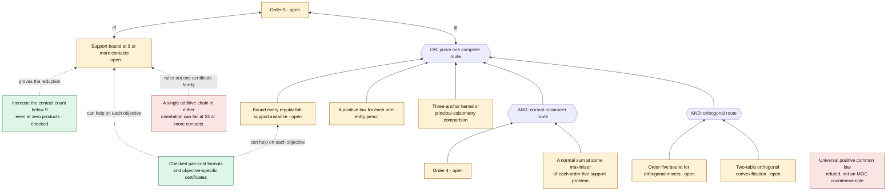
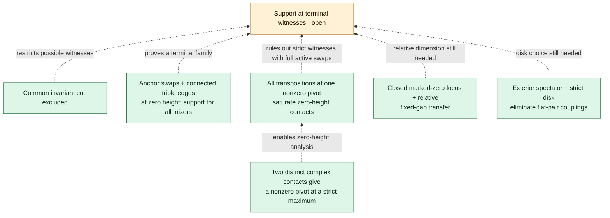

# MOC proof tree

## Overview

Read the arrows from a proof route toward its conclusion.
**Iff** labels mark checked equivalences. A plain arrow marks a checked
sufficient implication, not a proof of its premise. Dashed arrows mark
research dependencies or supporting context, not new implications. Orange nodes are open;
green nodes describe steps that Lean has proved. The diagrams group
related routes. [ProofRoutes.lean](MOC/ProofRoutes.lean) gives the full list.

## Order four: the main proof routes

## Order five: the main proof routes

## Why the contact count increases

```mermaid
flowchart BT
    TRANSFER["Increase contacts at any strict witness<br/>below 2n-1 · checked"]:::checked
    BOTH{{"AND: construct the curve and apply transfer"}}
    CUT["Pinned prime chain leaves a curve after<br/>fixed complex gap and differences · checked"]:::checked
    MODEL["Finite prime affine curve through<br/>the witness · checked"]:::checked
    STEP["Affine transfer by connectedness<br/>and cofinite gap image · checked"]:::checked
    CHART["Exact prime profile locus and<br/>dimension 2n-2 · checked"]:::checked
    TERMINAL["Support at ≥ 2n-1 contacts<br/>· open"]:::open
    BALANCE["Keep terminal contacts at a<br/>balanced orbit maximum · checked"]:::checked
    BUDGET["Use independent controlling equations<br/>rather than label count · checked"]:::checked
    RANK["At least 2n−2 independent<br/>contact differences · checked"]:::checked
    MOMENT["Centered quartic moment test<br/>at contact-preserving maxima · checked"]:::checked
    NEAR["Near-real spectra cluster at<br/>a balanced antipodal center · checked"]:::checked
    ISOLATE["Maximal contacts isolate<br/>the fixed-gap affine fibre · checked"]:::checked
    LINE["Preserve contacts on an exact affine line<br/>without fixing the gap · checked"]:::checked
    CURVE["Varying-gap compactified curve<br/>2n-1 threshold · paper proof"]:::paper
    LIMIT["Rule out both limits of normalized profiles<br/>at infinity · checked"]:::checked
    AFFCHART["Regular affine gap charts<br/>from a prime curve · checked"]:::checked
    HALFRAY["Half-plane lift and contact<br/>transfer from gap cover · checked"]:::checked
    STAR["Anchored star and rectangle at<br/>full contact rank · checked"]:::checked
    JET["Even corank and exact leading<br/>determinant coefficient · checked"]:::checked
    DESCENT["Arbitrary kernel compression reduces<br/>to smaller order · checked"]:::checked
    LOCAL["Interior leading hull gives actual<br/>local inclusion · checked"]:::checked
    TIGHT["Exclude isolated rank- and moment-tested<br/>terminal orbit maxima · open"]:::open
    OUTLIER["Height-zero bound for two imaginary<br/>outliers, arbitrary mixer · checked"]:::checked
    CHART --> CUT
    CUT --> MODEL
    MODEL --> BOTH
    STEP --> BOTH
    BOTH -. fixed-gap transfer .-> TERMINAL
    TRANSFER -. reduces MOC to .-> TERMINAL
    BALANCE -. proves refinement .-> TIGHT
    RANK -. restricts contact sets .-> TIGHT
    ISOLATE -. restricts local profile geometry .-> TIGHT
    LINE -. strengthens slot rigidity .-> TIGHT
    LINE -. affine case .-> CURVE
    LIMIT -. rules out limiting profiles .-> CURVE
    LIMIT --> HALFRAY
    HALFRAY --> TRANSFER
    AFFCHART --> HALFRAY
    STAR -. excludes a full-rank contact pattern .-> TERMINAL
    CURVE -. independent paper proof .-> TRANSFER
    NEAR --> JET
    JET --> LOCAL
    DESCENT -. handles compressed factors .-> JET
    LOCAL -. excludes interior-jet paths .-> TIGHT
    MOMENT --> NEAR
    MOMENT -. restricts spectra .-> TIGHT
    NEAR -. controls near-collinear data .-> TIGHT
    BUDGET -. excludes some contact sets .-> TERMINAL
    TERMINAL <-->|iff| TIGHT
    OUTLIER -. proves a terminal family .-> TERMINAL
    classDef paper fill:#e9e8fa,stroke:#5d4e96,color:#241c46
    classDef open fill:#fff1d6,stroke:#9a5900,color:#231500
    classDef checked fill:#ddf6e7,stroke:#287348,color:#10291a
```

The [Lean tree](MOC/ProofRoutes.lean) has three roots: all finite orders,
order four, and order five. An **OR** node needs one complete branch.
An **AND** node needs every child. A branch can be open even when Lean
has proved that it would be enough.

## All finite orders

- **OR: A native comparison.** The Lean list links each included
  comparison to MOC. Examples include normalized matrix pencils,
  finite determinant paths, transport between spectral multiplicities,
  and traceless spectra. The [native audit](MOC/Reformulations/NativeAudit.lean)
  records the scope and direction of each link. It also lists analogies
  that do not give a proof of MOC.
- **OR: An evaluated atlas comparison.** Each of the 243 numbered
  links uses complex evaluation on labelled finite data. This branch
  does not identify the original native objects with MOC.
- **OR: The terminal contact bound.** Exclude strict witnesses with at least
  $2n-1$ contacts in each order, allowing zero products. This is
  [equivalent to unrestricted MOC](MOC/AffineGapCover.lean).
  The [equivalent functional-rank target](MOC/SharpContactRank.lean)
  requires $2n-2$ independent contact-difference functions.
  The [nonzero-only criterion](MOC/SaturatedContactReduction.lean) is
  also equivalent; it remains an option when a proof uses quotients of
  matching products.
- **OR: An order split.** Prove order four **AND** order five **AND**
  all orders at least six. The cases of order at most three are already
  proved.

## Order four

The checked alternatives include:

- Prove the hull inclusion for real orthogonal mixers with complex
  spectra. It is enough to exclude every
  [regular stationary orthogonal witness](MOC/OrderFourIndependent.lean).
  Use the [second-order](MOC/OrderFourSecondVariation.lean),
  [reflection](MOC/OrderFourReflectionTest.lean), and
  [flat row-swap](MOC/OrderFourGivens.lean) tests on these witnesses.
- Show that every directional support maximum has a representative
  whose sum is normal.
- Prove the [common law for each one-entry complex pencil](MOC/ProofRoutes.lean),
  or the [three-anchor kernel bound](MOC/Reformulations/ThreeAnchorKernel.lean).
- Prove the support bound at seven or more contacts. Lean proves the
  [sharp contact transfer and equivalence](MOC/AffineGapCover.lean).

## Order five

The checked alternatives include:

- Prove the hull bound for regular spectra and mixers with no zero entries.
- Prove the one-entry law separately for each pencil. One law need not
  work for different pencils.
- Prove order four **AND** show that each order-five support problem
  has a maximizer with a normal sum.
- Prove the support bound at nine or more contacts. The checked global
  transfer does not require full mixer support or nonzero matching products.
- Use [subset assignment certificates](MOC/SubsetAssignmentSupport.lean)
  on individual support objectives. The [doubleton image tests](MOC/OrderFivePairMarkers.lean)
  identify which minor data a fixed law must preserve. A universal
  positive common law is not an active branch: [Drury's Householder
  counterexample](https://doi.org/10.1016/S0024-3795(99)00173-1)
  rules out that stronger property in order five. The library now has a
  [symbolic Lean proof of this obstruction](MOC/OrderFiveCommonLawObstruction.lean).
  The [explicit pair cost](MOC/OrderFivePairCost.lean) expresses every
  directional order-five objective in these coordinates.
- Prove orthogonal order five **AND** a two-table orthogonal
  convexification for complex mixers. The library does not supply the
  convexification in order five.

Each inhabited atlas sample also gives an exact evaluated comparison at
order four and at order five. This stays at the selected order and does
not imply the corresponding native claim.

An all-order branch can also close either finite-order root. This
does not reduce an all-order goal to only two orders. A refutation of
a sufficient-only branch does not refute its parent. For an exact
equivalence, proof and refutation both transfer.

## Checked steps toward the open branches

- [Local holomorphic root cover](MOC/FiniteCurveRootCover.lean):
  separable fibres of a monic plane polynomial have complete
  local holomorphic branches. The [global gluing](MOC/FiniteCurveConnected.lean)
  proves connectedness for a punctured simple-root cover of an irreducible
  plane polynomial. The [full plane zero set](MOC/FiniteCurveClosure.lean)
  is also connected, including exceptional fibres. The curve slice
  through each witness is still a separate step.
- [Cross-ratio test](MOC/ContactCrossRatios.lean):
  one four-swap pattern at nonzero height imposes a positive real
  product of two spectral cross ratios.
- [Parity corrections](MOC/FiveParityCorrection.lean):
  these changes preserve every subset-image mass. A repair must
  still make the weights nonnegative.
- [Sparse geometry](MOC/OrderFiveSparseGeometry.lean):
  a failure with at least eight mixer zeros forces an order-four
  failure. This is a reduction, not an order-five proof on dense mixers.
- [Spectral collisions on a sparse row](MOC/SparseSpectralCollision.lean):
  a three-supported row reduces to the preceding order if two of its
  supported column labels coincide. Unequal labels are not preserved
  by the same rotation.
- [Parity repair threshold](MOC/QuaternionParitySharp.lean):
  the proposed displacement-label repair has an exact scalar feasibility
  test. This excludes that repair below its threshold, not the hull
  inclusion or other possible repairs.
- [Flat disjoint row planes](MOC/OrderFourFlatPlanes.lean):
  at a strict order-four witness, two flat disjoint signed swaps must
  have a strictly losing product. Otherwise the rotations create a
  sparse column and reduce to order three.
- [Branch values](MOC/FiniteCurveBranchValues.lean): the omitted
  nonseparable fibres of a monic irreducible plane polynomial form a
  finite set. Its regular root cover is connected.
- [Reciprocal-conjugate support](MOC/ReciprocalConjugateSupport.lean):
  a Gram inequality proves the matching bound in a specified direction
  for reciprocal-conjugate spectra, in every order. It is not a bound
  in every direction for those spectra.
- [Pair assignment relaxation](MOC/PairAssignmentObstruction.lean):
  for a separated pair-cost class, a best assignment of pairs can
  beat every assignment induced by a permutation of the labels.
  This is an obstruction to the relaxation, not to MOC.

## Transfer between branches

Lean records the reverse proof for each exact branch. Two exact
branches under the same root imply each other. Any sufficient branch
implies every exact branch under its root. An all-order branch also
implies each exact branch in orders four and five. For a one-way
branch, the proof does not infer its premise from its conclusion.
The [native audit](MOC/Reformulations/NativeAudit.lean) records which
additional special-case and restricted comparisons are not root branches.

## Latest checks on the open branches

| Gap | What Lean proves | What remains |
| --- | --- | --- |
| Fixed-gap curve | [Connected-profile transfer](MOC/ConnectedContactStep.lean) applies to supplied exact profiles on a monic irreducible plane model, even at an exceptional fibre. [Proper projection](MOC/FiniteCurveProperProjection.lean) controls limits of lifts to the affine curve. | Use the checked transfer to prove the terminal support inequality. |
| Order-four stationary maximum | [Column reflections](MOC/OrderFourColumnReflections.lean) send a column to a signed coordinate and reduce to order three. Those reflections strictly lose support at a strict witness. | Show that every remaining stationary candidate has an improving or flat direction, or certify it by a different route. |
| Order-four contact geometry | [Fibre gluing](MOC/ContactFibreGluing.lean) gives a matching-line proof when two full zero-height fibres meet under its spectral conditions. [Triangle closure](MOC/ZeroHeightTriangleClosure.lean) forces missing contacts from four specified contacts at height zero. | Cover profiles outside these patterns. |
| Quaternion corrections | The [intrinsic displacement proof](MOC/QuaternionIntrinsic.lean) gives the possible monomial types and their permutation parities. | Connect these to the local signs in the actual quaternion mixer, then prove nonnegativity of its corrected law. |
| Order-five sparse mixer | A [zero corner](MOC/OrderFiveZeroCorner.lean) forces the opposite block to be nonzero when all row and column degrees are at least three. | Treat the remaining five-edge path mask and the full-support case. |
| Order-five projected objective | [The strict Gram bound is open-stable](MOC/SpectralGramNeighborhood.lean): both spectra and the support direction can vary in a neighborhood, uniformly over all mixers. | Bound objectives outside this neighborhood. |

Further checked steps narrow the open branches:

- The [finite-affine connectedness theorem](MOC/FiniteCurveAffineConnected.lean)
  treats a prime finite affine curve whose coordinates can be recovered
  rationally from a plane model. The [primitive-coordinate theorem](MOC/FiniteCurvePrimitiveCoordinate.lean)
  proves the recovery and connectedness for any prime complex curve with
  a finite injective polynomial projection. The
  [fixed-gap chart](MOC/PolynomialContactSlice.lean) supplies a slice through each low-contact witness.
- The [near-balanced signed-Klein mixer theorem](MOC/QuaternionMixerParity.lean)
  proves the hull inclusion for every spectrum pair when its explicit
  signing, unitary, determinant, and cubic conditions hold. It is a
  mixer class, not an order-four proof. The [binary quaternion sign rule](MOC/QuaternionBinaryBasis.lean)
  verifies the signing for the concrete binary table; normalization is
  still a stated condition on that table.
- The [reflection residue](MOC/OrderFourReflectionResidue.lean) checks
  the scalar cancellation for the two signed reflection directions.
  It does not force either direction to improve support.
- The [six-contact bridge](MOC/SixContactBridge.lean) rules out a specific
  order-four violation: at height zero a contact and five active
  single-swap neighbors force all matching products onto one line.
  The theorem assumes simple spectra and nonzero matching products.

## What remains

The [global transfer](MOC/GlobalContactSlice.lean) starts at any strict
witness, including one with zero matching products. The [exact locus
theorem](MOC/ExactProfileLocus.lean) identifies the matching profiles
with the zero locus of a prime polynomial pullback kernel. The
[dimension bounds](MOC/ProfileDimension.lean) give $2n-2$ variables
in any finite injective normalization for $n\ge 2$. Going down gives
a prime chain below the pinned point; the fixed complex differences
and gap leave a prime affine curve. Connectedness and a cofinite
coordinate image give a new contact. Iteration preserves the mixer,
direction, pivot, complex gap, and all original complex differences.
One may also pin $m$ polynomial observables and still reach at least
$2n-2-m$ contacts. For example, fixing one match value keeps it
nonzero when it was nonzero initially.
The contact strategy follows [Zheng, preprint DOI 10.13140/RG.2.2.36790.25923](https://doi.org/10.13140/RG.2.2.36790.25923);
the pinned global affine argument is proved here.

**Main target.** Prove the terminal support inequality at $2n-1$
contact labels: seven in order four and nine in order five. The
[affine gap-cover proof](MOC/AffineGapCover.lean) keeps the mixer,
direction, pivot, and old differences, while allowing the gap to vary.
The count refers to labels, not distinct product values. A strict
terminal violation would refute MOC.

**Order-four branch.** For [Zheng’s Section 5 pattern](https://doi.org/10.13140/RG.2.2.36790.25923),
[two matching-product identities](MOC/ZhengRectangleContact.lean) reduce
the number of equations from six to five at seven contacts. Lean
forces at least eight contacts and splits at zero support height.
An [independent paper argument](ZhengT85Independent.md) certifies the
zero-height paired branch by squared minors; the positive-height
unpaired branch still needs a support bound.

**Equation budget.** The [equation-saturated reduction](MOC/ContactEquationBudget.lean)
uses the number of polynomial observables that determine the old
complex differences and gap, not the number of labels. In order at
least four, a witness whose contacts lie in one three-column fibre
always gains another label, even if all six are contacts. The
alternating identity leaves at most four contact equations and one
gap equation, below the dimension threshold. This does not extend to
an arbitrary six-label set without a relation on its exact profiles.
The [sharp rank reduction](MOC/SharpContactRank.lean) gives at least
$2n-2$ independent pivot-difference functions at maximal contact
count. The same theorem file combines this rank with the balanced
moment-tested orbit maximum and fixed-gap isolation on one witness. The [subset marker test](MOC/ContactMarkerRank.lean)
identifies these linear relations with subset-image relations.
Independence here is on the entire exact profile locus, not the rank
of a differential at the witness. The same module proves that the
unrotated determinant-gap function is not in the contact span at any
strict witness; it separates the span using the witness and its conjugate.

**Joint contact and orbit route.** The [balanced terminal equivalence](MOC/BalancedContactReduction.lean)
lets us retain any terminal set and its pivot while choosing unit spectral
energy, unit direction, equal traces, equal squared-norm-weighted traces,
and a nonnormal sum at a global unitary support maximum. The ordinary
and cubic balances follow from opposite translations and common
fractional-linear spectral changes with compensated phase. Those moves
preserve the contact inequalities. The Frobenius tie-break ensures
nonnormality. Mixer stationarity applies with no contact restrictions
on the mixer. Unrestricted spectral-coordinate stationarity does not
follow, because those changes can destroy the prescribed contacts.

**Second-order test.** Let $x=(a,-b)$, $m_2=\sum_j x_j^2$,
$h_2=\sum_j |x_j|^2x_j^2$ and $q=\sum_j |x_j|^4$. On the selected
unit-energy witness, the [centered Möbius expansion](MOC/MobiusSecondOrder.lean)
gives
$$|2n h_2-m_2|\le n q-|m_2|^2/2.$$
This is compatible with contact retention: the [joint equivalence](MOC/ContactDifferenceRank.lean)
imposes the rank bound, moment bound, and unrestricted mixer maximum
on the same witness. It does not require unrestricted spectral stationarity.
The [geometric form](MOC/MobiusRigidity.lean) uses the positive angular
deficit $d=1-|m_2|$. After one rotation, the total squared imaginary
part is exactly $d/2$. The signed spectra lie within total squared
distance $(4n+3/2)d-2d^2$ of entries in $\{\pm1/\sqrt{2n}\}$.
This does not assert that the remaining spectrum is collinear.
When that squared-distance bound is less than $1/n^2$, the
[balanced antipodal theorem](MOC/MobiusAntipodalCount.lean) forces the
two sign clusters to have equally many entries. In the associated
two-value center, a matching with a mismatch has at least two zero
factors, so its matching product under an affine perturbation is
divisible by the square of the perturbation parameter.
At a nonsingular center, the [involution trace identity](MOC/AntipodalDeterminantJet.lean)
also fixes the Jacobi trace factor: commuting perturbations $V,W$
of the signed involutions $J,K$ give
$\operatorname{tr}((J+K)^{-1}(V+W))=(\operatorname{tr}(JV)+\operatorname{tr}(KW))/2$.
The [affine derivative theorem](MOC/AntipodalAffineVariation.lean)
proves the corresponding determinant derivative, with the existing
determinant as a factor. At a singular center, the [kernel coefficient theorem](MOC/AntipodalKernelJet.lean)
proves even corank and gives the first possible determinant coefficient
exactly. An [interior leading-coefficient hull](MOC/DeterminantJetNeighborhood.lean)
excludes strict violations along the actual affine path near the center.
See the [singular-jet note](AntipodalKernelJets.md) for the moving-mixer
tangent and the smaller-order comparison, with the checked and paper
steps separated.

**Isolated fibre.** The [stronger terminal equivalence](MOC/ContactFibreIsolation.lean)
requires that same profile to be isolated on the affine locus cut out
by its exact contact differences and complex gap. A strictly smaller
prime below its evaluation ideal would supply a finite curve and one
more contact, even above the count threshold. Choose a global maximum
of the contact count before rebalancing; contact retention keeps that
count maximal. The evaluation ideal is then a minimal prime and a
single polynomial excludes the other components locally
([Stacks Project, Tag 00FR](https://stacks.math.columbia.edu/tag/00FR)).
This does not imply that the equations have independent differentials
or that the fibre is globally a singleton. The [affine-line transfer](MOC/ContactAffineRigidity.lean) strengthens
the earlier [one-entry slope test](MOC/ContactPencilRigidity.lean):
every free partner slot must change an old complex contact difference,
even if the determinant gap changes as well. The
[varying-gap curve argument](VaryingGapContactTransfer.md) gives an
independent paper proof of the count using compactification. Lean
proves the stronger count by the [affine cover route](AffineGapContinuation.md),
which does not use a compact model.
The [anchored star and rectangle](AnchoredStarContact.md) is a checked
terminal-family exclusion; its full functional rank is proved on paper.
It is not a classification of terminal contacts.

**Certificate route.** Use the checked subset-event and nested-transport
results on individual support objectives. The [full flag law](MOC/FullFlagLaw.lean)
glues all nested row-set marginal laws on one flag, so one nonnegative
sum of scores across a flag certifies the objective even when the
individual scores need not be nonnegative. This is not a law for
incompatible flags. See [Lyons, DOI 10.1007/s10240-003-0016-0](https://doi.org/10.1007/s10240-003-0016-0)
for the projection-measure background. A covering theorem for all
terminal profiles is still open. [The independent-crossing obstruction](MOC/IndependentCrossingObstruction.lean)
shows that even all independently marked tests do not give a positive
common pair law for an actual unitary. The [uniform flat-reflection theorem](MOC/UniformCrossingObstruction.lean)
proves failure of the positive pair law in every order at least five.
This is a barrier for the relaxation, not a counterexample to MOC.
The [synthetic gap](DeterministicAndFractional.md) has a negative
signed mean even though it is nonnegative at each matching label.
Lean proves it is not realizable as a spectral objective. Its
synthetic contact set meets the terminal rank threshold on paper. A
[rectangle obstruction](MOC/NestedRectangleObstruction.lean) rules out
a single additive column-prefix chain for some order-five profiles
with twelve or more contacts. The
[two-outlier obstruction](MOC/TwoOutlierChainObstruction.lean) gives
simple-spectrum instances with at least 24 contacts for which neither a row-prefix
nor a column-prefix additive chain works. The same support inequality is
proved directly by the [two-outlier theorem](MOC/SpectralTwoOutlierComparison.lean).
Neither obstruction rules out multiple-chain or subset-event certificates.
The [crossed exterior transport](MOC/CrossedMinorTransport.lean) glues
two inclusion couplings through one unnormalized exterior array. It
does not require either array to have unit mass. The [matrix bridge](MOC/CrossedMinorBridge.lean)
now proves the transport for the actual squared minors of a unitary.
It preserves degree and exchanges one spectator row and one spectator
column. [The bridge note](CrossedMinorTransport.md) relates that
transport to individual objectives.
In fact, an [explicit complement-paired certificate](MOC/TwoOutlierMinorCertificate.lean)
proves the bound when the outlier heights dominate the stated
spectator products. It pairs complementary subset events before
checking signs. Failure of a certificate alone does not refute MOC.
The [subset-event obstruction test](MOC/ContactSubsetObstruction.lean)
shows that each noncontact needs a subset image that no contact shares.
At nonpositive support height, the contacts obtained from that
noncontact by one swap cannot by themselves prevent this separation.
Longer relative permutations still matter.

**Order-four backup.** Exclude the regular stationary orthogonal witnesses
using the second-order, reflection, and flat-plane tests. The
[phase Hessian reduction](MOC/PhaseHessianReduction.lean) leaves only
three free entries in the imaginary symmetric test when an
order-four orthogonal mixer has a row with no zero entries. This
does not exclude the resulting witnesses. The [dense-cross reduction](MOC/StationaryDenseCross.lean)
requires both a fully nonzero row and a fully nonzero column in a
remaining order-four stationary orthogonal witness. It uses the
[zero-diagonal theorem](MOC/FourZeroDiagonal.lean) after reindexing the
zeros into a diagonal. The [grouped pencil law](MOC/GroupedPencil.lean)
is an independent exact reformulation; reducing to two coupled
complex moments does not prove their feasibility.

**Orbit reduction.** The [complex flat-swap theorem](MOC/ComplexFlatSwap.lean)
applies to arbitrary order and to any unitary starting mixer. At a
maximizer, a tie under a signed swap makes the full phase-and-rotation
pair orbit flat. For each specified column, one can choose a maximizer
at which swapping any two nonzero entries strictly lowers support.
This does not give one minimizer simultaneously for all columns.
The [pair Rayleigh formula](MOC/PairRayleigh.lean) gives the exact
maximum over the full complex two-coordinate unitary orbit, including
a singular baseline. The proof identifies the orbit with a rank-one
perturbation and uses four cofactors of the baseline. It also gives
the exact derivative-free test for optimality in that plane: a diagonal
comparison and a zero mixed Hermitian cofactor. The ellipse interpretation
is the two-dimensional numerical range theorem
([Lakos, DOI 10.1007/s00013-023-01957-9](https://doi.org/10.1007/s00013-023-01957-9)).
The [three-slot expansion](MOC/TripleOrbit.lean) gives the corresponding
sum of three expectations when the inactive block is invertible, using
a Schur complement ([Cottle, DOI 10.1016/0024-3795(74)90066-4](https://doi.org/10.1016/0024-3795(74)90066-4)).
Comparing two tied stationary endpoints forces simultaneous cross-cofactor
equations. The [flat-pair note](FlatPairReduction.md) uses those equations
to prove a reducing-pair criterion for strictly dissipative partners.
The [complex tied-swap module](MOC/ComplexTiedSwap.lean) derives the
cofactor equations directly from optimality, even at singular sums.
A tied swap on an active triple with invertible inactive block either
reduces the pair in the Schur complement or forces a singular circle
matrix. In the noncollinear case the latter specifies a singular value
of a shifted internal cofactor. See the [scope note](ComplexTiedSwap.md)
for the covariance of inverse-entry zeros and the paper-only ambient
implications.
Optimality in a two-coordinate plane is not global optimality.

See [Literature.md](Literature.md) for primary sources, DOIs, and the
scope of the techniques used.

The [two-outlier theorem](MOC/SpectralTwoOutlierComparison.lean)
checks a terminal family in every order with at least two labels. Each spectrum has one pure
imaginary value and positive real values at its other labels. If all
matching products lie on one side of the imaginary axis, the determinant
lies on that same side for every unitary mixer. The
[inverse Gram argument](MOC/TwoOutlierInverseGram.lean) removes a basis
choice: the inverse Gram determinant at either spectral endpoint is
the reciprocal of the product of the two endpoint values. The result
does not yet test other supporting lines for these spectra.
For related Hermitian block elimination, see
[Haynsworth, DOI 10.1016/0024-3795(68)90050-5](https://doi.org/10.1016/0024-3795(68)90050-5).

## Terminal contact restrictions

The [experiment ledger](research/agenda-2026-11-25/README.md) records the
proofs and diagnostic limits separately. In the diagram, an exclusion
applies only when its stated hypotheses hold.

- [Invariant-cut exclusion](MOC/PolynomialProfileContact.lean)
- [Connected anchor criterion](MOC/AnchoredConnectedContacts.lean)
- [Zero-height saturation](MOC/ZeroHeightCycleSaturation.lean)
- [Fixed-zero profile locus](MOC/FixedZeroProfiles.lean)
- [Schur disk criterion](MOC/OrbitTargets.lean)
