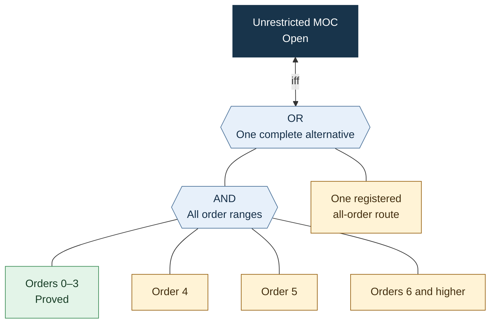
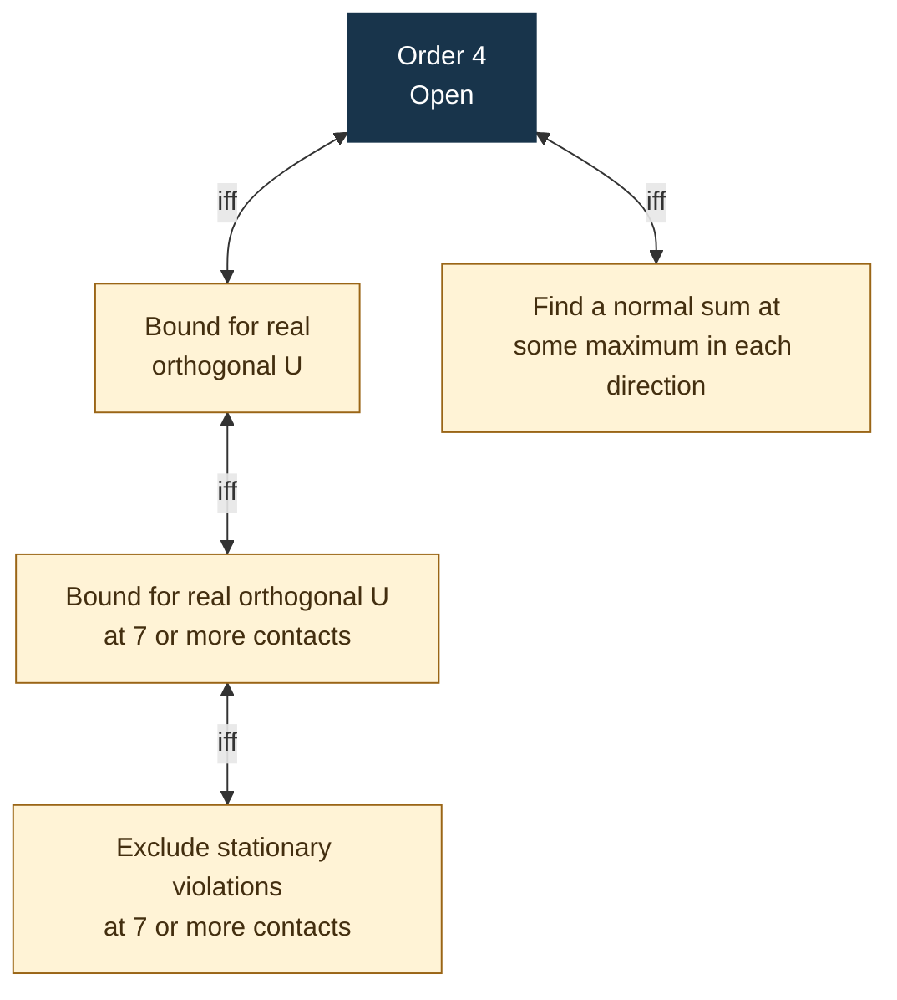
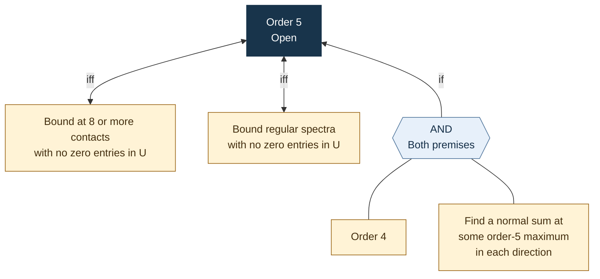

# Marcus–de Oliveira conjecture

Let $A$ and $B$ be complex normal matrices of the same finite order $n$.
A matrix $M$ is normal if $MM^*=M^*M$, where $M^*$ is the conjugate transpose.
Let $a_1,\ldots,a_n$ and $b_1,\ldots,b_n$ be the eigenvalues of $A$ and $B$,
counted with multiplicity. Let $S_n$ be the set of permutations of
$\{1,\ldots,n\}$. For each $\sigma\in S_n$, define the matching product
$P_\sigma=\prod_{j=1}^n(a_{\sigma(j)}+b_j)$.

The conjecture states that

$$
\det(A+B)\in\mathrm{conv}_{\mathbb R}\{P_\sigma\mid\sigma\in S_n\}.
$$

Membership in the real convex hull means that the determinant is a sum of
matching products with nonnegative real weights whose sum is one.
[Conjecture in Lean](Lean/MOC/Core.lean#L33)

## Proof tree

[All orders](#all-orders) · [Equivalent formulations](Docs/all-orders-proof-map.md#matrix-and-operator-formulations) · [Atlas audit](Docs/all-orders-proof-map.md#atlas-realizations-and-implications) · [Order four](#order-four) · [Order five](#order-five) · [Proved cases](#cases-proved-in-lean) · [Counterexamples](#counterexamples-to-stronger-statements)

The [proof map index](Docs/README.md) lists the general routes and
restricted results with links to their Lean sources.

The unrestricted Marcus–de Oliveira conjecture (MOC) is open in this
library. Lean proves the unrestricted result through order three.
[General goal](Lean/MOC/Claim.lean#L9) · [Orders zero through three](Lean/MOC/Small.lean#L68)

In every order $n\ge 4$, Lean determines exactly how many nonzero
entries in the change of eigenbasis guarantee one matching law for
all spectra. The largest such bound is $n+8$. At $n+9$ an explicit
unitary has no common law. A separate result proves the inclusion
whenever each row, or each column, has at most three nonzero entries.
[Exact threshold](Lean/MOC/SparseSupportThreshold.lean#L89) · [Witness at the next count](Lean/MOC/SparseSupportThreshold.lean#L72) · [Row and column cases](Docs/sparse-unitary-proof-map.md)

The certificate map gives finite integer comparisons for all orders, an
order-four enclosure within one twenty-seventh of the matching width in
each direction, and a sharp order-five support example. Lean checks the
order-five example and the counterexample to the universal disjoint-pair
certificate. Some historical modules remain outside the default target.
[Certificate statements and hypotheses](Docs/determinant-inclusion-certificates-proof-map.md) · [Source scope](Docs/all-orders-proof-map.md#scope-of-the-lean-source)

The research-attempt map records the Lean steps and remaining
implications for the fifteen research directions. The new scripts
cover the order-four wall and moment-plane tests, and extend several
reductions that apply in every order. Kernel verification is pending.
[Research attempts](Docs/research-attempts-proof-map.md)

Choose a unitary eigenbasis for each matrix. In the basis for $A$, write
$A=\mathrm{diag}(a)$ and $B=U\mathrm{diag}(b)U^*$.
Here $\mathrm{diag}(a)$ is the diagonal matrix with entries $a_i$.
The unitary matrix $U$ gives the change between the two eigenbases.
The inclusion in these coordinates is equivalent to the matrix conjecture.
[Proof](Lean/MOC/Normal.lean#L280)

Read the arrows toward the goal. An **iff** arrow gives implications in
both directions. An **if** arrow gives a sufficient condition. At an
**AND** node, all incoming conditions are required. At an **OR** node,
one complete input suffices. A yellow box marks an open statement.
The status tables identify the steps and cases that Lean proves.

### All orders

Because the base orders are proved, the order split requires proofs in
order four, order five, and every order at least six.
Use any one complete route for each order. A single route that proves
all orders suffices on its own.
[Combined route theorem](Lean/MOC/ProofRoutes.lean#L704) · [Order split](Lean/MOC/ProofRoutes.lean#L315)

A **directional bound** compares $\mathrm{Re}(\eta\det(A+B))$ with the
largest $\mathrm{Re}(\eta P_\sigma)$ for a complex direction $\eta$.
A **strict violation** occurs if the determinant projection exceeds that value.
A **contact** is a permutation that attains this largest value. Two
permutations with the same product count as two contacts. The determinant
is in the hull if and only if the bound holds in every direction.
[Directional equivalence](Lean/MOC/Support.lean#L52)

| Relation to unrestricted MOC | Open statement | Lean proof of the relation |
| --- | --- | --- |
| Iff | In orders at least four, prove the directional bound for $\eta=1$ if both eigenvalue lists sum to zero and every entry of $U$ is nonzero. | [Traceless form](Lean/MOC/Reformulations/TracelessSupport.lean#L14) |
| Iff | In each order $n$, prove the directional bound when there are at least $2n-1$ contacts. Another exact test uses at least $2n-2$ contacts and requires every matching product to be nonzero. | [General contact test](Lean/MOC/AffineGapCover.lean#L85) · [Nonzero-product test](Lean/MOC/ProofRoutes.lean#L333) |
| Iff | At the $2n-1$ threshold, exclude a strict maximum over all relative unitaries in which every nonzero mixer entry lies on an inactive permutation with negative real signed weight. | [Terminal stationary test](Lean/MOC/StationaryPivot.lean#L478) · [Signed score identity](Docs/contact-transfer-proof-map.md#complex-stationary-score) |
| Iff | For every pair of lists and every direction in orders at least four, some maximizing $U$ gives a normal sum. The maximum is over all unitary $U$ for the fixed lists. | [Normal maximizers](Lean/MOC/NormalSupportMaximum.lean#L314) |
| Iff | In each order, fix $U$ and all eigenvalues except one entry of $b$. Find one set of convex weights on at most five permutations that works for every complex value of that entry. | [One free entry](Lean/MOC/ProofRoutes.lean#L113) |
| Iff | Replace the square unitary by a rectangular matrix with at least three orthonormal rows and one extra column. Compare with products that match the shorter list to distinct positions in the longer list. | [Rectangular determinant bound](Lean/MOC/PrincipalCoisometry.lean#L248) |
| Iff | In each order $n\geq 4$, it suffices to test unitary matrices $U$ for which every nonempty set of at most $n-2$ rows has nonzero entries in at least two more columns than the number of rows. | [Support expansion](Lean/MOC/SinglePortHallExpansion.lean#L72) |
| Iff | In orders at least four, use lists $x,y$ with $x_1=0$, $x_2=1$, and $y_1=0$. For every unitary $U$ with no zero entries, place $\det(U-XUY)/\det U$ in the hull of the products $\prod_j(1-x_{\sigma(j)}y_j)$. Here $X=\mathrm{diag}(x)$ and $Y=\mathrm{diag}(y)$. | [Three fixed coordinates](Lean/MOC/Reformulations/ThreeAnchorKernel.lean#L61) |
| Iff, new Lean source | Use normal adjacency matrices of loopless complex weighted directed graphs. Keep all relative unitary positions. | [Loopless adjacency](Lean/MOC/Reformulations/LooplessAdjacency.lean#L23) |
| If, new Lean source | For each index, place the elementary symmetric coefficient of the sum in its matching hull. The weights can depend on the index. The coefficient of index $n$ is the determinant. | [Separate coefficient implication](Lean/MOC/Reformulations/SecondCoefficient.lean#L91) |
| If | Use one set of convex weights for the full polynomial $\det(A+zB)$ and the polynomials from the matchings. Evaluation at $z=1$ gives the determinant. | [Mixed determinant implication](Lean/MOC/Reformulations/NativeLinksA.lean#L237) |

| Status | Result | Lean source |
| --- | --- | --- |
| Proved | A strict violation with at most $2n-2$ contacts can gain a contact by changing the lists. The new violation keeps the same $U$, direction, and previous contacts. | [Contact transfer](Lean/MOC/VaryingGapTerminal.lean#L110) · [Proof of the continuation premise](Lean/MOC/AffineGapCover.lean#L80) |
| Partial | A counterexample of least order has no proper diagonal block split after independent row and column permutations. Each row and column of $U$ has at least three nonzero entries. Every matrix that commutes with both summands is a scalar multiple of the identity. | [Block split](Lean/MOC/Claim.lean#L51) · [Rows](Lean/MOC/SparseRow.lean#L339) · [Columns](Lean/MOC/SparseRow.lean#L346) · [Commuting matrices](Lean/MOC/ReducingCommutant.lean#L70) |
| Partial | For $\det(A+zB)$ in positive order $n$, the separate coefficient bounds hold at degrees $0$, $1$, $n-1$, and $n$. This covers every coefficient through order three. | [First](Lean/MOC/Reformulations/NativeLinksA.lean#L107) · [Penultimate](Lean/MOC/Reformulations/NativeLinksA.lean#L150) · [Endpoints](Lean/MOC/Reformulations/NativeLinksA.lean#L162) |
| Partial, new Lean source | In every order, each unitary $U$ has one probability law on permutations that gives the first three elementary coefficients for all pairs of spectra. | [Uniform coefficient law](Lean/MOC/Reformulations/SecondCoefficient.lean#L248) |
| Partial, new Lean source | The complex stationary score marginal, exchange identities, and spectral multiplier equations restrict a strict counterexample. Smaller-order inclusion also gives one law for a free eigenvalue when its column meets at most two distinct opposing eigenvalues. | [Stationary tests](Docs/all-orders-proof-map.md#stationary-support-and-spectral-exchange) · [Free eigenvalue](Lean/MOC/GroupedEigenvalueMoments.lean#L88) |
| Open | The directional bound at the contact thresholds remains to be proved in general. The order split also leaves every order at least six to prove. | [Contact endpoint](Lean/MOC/AffineGapCover.lean#L85) · [Higher orders](Lean/MOC/ProofRoutes.lean#L315) |

Two iff routes for the same goal imply each other. A sufficient route
implies every iff route for that goal. An all-order route also implies
each iff route at a fixed order. Refuting an iff route refutes its goal.
A sufficient condition can fail while the goal still holds. In Lean,
apply the selected implication to its proof to obtain `MOCIsTrue`.
Open route goals are propositions in the registry. A successful build
of the default target checks the imported implications and their axiom dependencies.
[Transfer between routes](Lean/MOC/ProofRoutes.lean#L60) · [Transfer to a fixed order](Lean/MOC/ProofRoutes.lean#L728)

The modulus bound compares $|\det(A+B)|$ with the largest $|P_\sigma|$.
A modulus bound at order $n$ implies the bound at every order $m\leq n$.
The modulus bound in all orders is equivalent to the bound for real
orthogonal changes of eigenbasis on any unbounded set of orders.
Both eigenvalue lists can still contain arbitrary complex numbers.
[Order transfer](Lean/MOC/ModulusOrderTransfer.lean#L140) · [Real orthogonal equivalence](Lean/MOC/RealOrthogonalModulus.lean#L94) · [Proof map](Docs/modulus-order-transfer-proof-map.md)

### Order four

The real orthogonal restriction applies to $U$. The eigenvalue lists
remain complex. Lean proves the restriction by expressing the squared
absolute values of all unitary minors as one finite convex combination
of the corresponding real orthogonal tables.
[Minor decomposition](Lean/MOC/FourMinorTransport.lean#L479) · [Orthogonal equivalence](Lean/MOC/FourMinorTransport.lean#L574)

| Status | Result | Lean source |
| --- | --- | --- |
| Proved | The inclusion holds if one list lies on a circle or a line, if an eigenvalue pair sums to zero, or if the complex unitary matrix $U$ has zero diagonal. | [Circle or line](Lean/MOC/HermitianByNormalFourProof.lean#L60) · [Opposite pair](Lean/MOC/FourCoincidence.lean#L360) · [Zero diagonal](Lean/MOC/OrderFourZeroDiagonalUnitary.lean#L196) |
| Proved | If every entry of the unitary change of eigenbasis $U$ has modulus $1/2$, one probability law on permutations gives the determinant for all complex spectra. These are the normalized complex Hadamard matrices of order four. | [Common law](Lean/MOC/OrderFourComplexHadamard.lean#L259) · [Inclusion](Lean/MOC/OrderFourComplexHadamard.lean#L272) · [Proof map](Docs/order-four-complex-hadamard-proof-map.md) |
| Proved | The directional bound holds for specific sets of tied permutations. The pattern labels identify those sets in the linked statements. | [T1](Lean/MOC/ZhengT1Circle.lean#L184) · [T2](Lean/MOC/FourT2Minor.lean#L338) · [T3](Lean/MOC/FourT3.lean#L25) · [T4](Lean/MOC/FourT4.lean#L30) · [T5](Lean/MOC/FourT5.lean#L26) · [T6](Lean/MOC/FourT6Support.lean#L11) · [T15](Lean/MOC/FourT15.lean#L14) · [T21](Lean/MOC/FourT21ContactCone.lean#L275) |
| Partial | It suffices to exclude strict violations at real orthogonal maximizers with at least seven contacts. For each nonzero entry $U_{ij}$, some permutation with $\sigma(j)=i$ does not attain the maximum. Lean proves these restrictions on the same witness. | [Seven-contact reduction](Lean/MOC/ZhengContactReduction.lean#L14) · [Stationary reduction](Lean/MOC/StationaryPivot.lean#L221) |
| Partial, new Lean source | Any order-four violation yields a real orthogonal witness with nonzero, distinct matching products and at least seven contacts in the canonical mixed-ray section. | [Canonical witness](Lean/MOC/FourTerminalCoverage.lean#L353) · [Contact and height tests](Docs/order-four-proof-map.md#canonical-contact-reduction) |
| Proved | A directional gap that is the fixed mixed ray with coefficient one plus a nonnegative sum of the thirteen prescribed ordinary rays gives the support bound for every order-four unitary if its normalized height lies in $[0,1/2]$. | [Canonical gap](Lean/MOC/FourCanonicalHeightSquares.lean#L22) · [Unitary support bound](Lean/MOC/FourCanonicalHeightSquares.lean#L767) |
| New Lean source | Subtract the smallest directional matching value from each projected product. In the 14-dimensional matching-function space, the cone of nonnegative costs has 34 ordinary and 48 mixed extreme rays. An ordinary ray is a subset assignment indicator. Up to relabeling, a cost outside the ordinary cone uses one mixed ray and at most 13 ordinary rays. | [Cone and cancellation](Docs/spectral-support-proof-map.md#order-four-support-costs) |
| Proved | A determinant of size $n-2$ represents the transformed spectral polynomial for $n\ge2$. In order four its quadratic form has complex rank at most four. Its real form has positive and negative indices at most four. | [Spectral determinant and rank](Docs/spectral-profile-determinant-proof-map.md) · [Tetrahedral coordinate identity](Lean/MOC/SpectralProfileDeterminant.lean#L557) |
| Partial, new Lean source | Actual spectral gaps give a singular nine-by-nine inverse pencil. For two contact families, the verified factorization and rank bound yield matching sums of squares. | [Inverse pencil and two-factor certificates](Docs/spectral-profile-determinant-proof-map.md#order-four-inverse-pencil-certificates) |
| New Lean source | The four contacts given by the identity and the three products of two disjoint transpositions force an actual spectral cost to be a sum of real matching squares. | [Klein-four contacts](Docs/order-four-klein-four-matching-squares-proof-map.md) |
| Proved reduction | For every real orthogonal matrix of order four, an explicit multiple of the permutation sign makes the matching moment positive semidefinite. For every complex unitary of order four, a cost in the real matching-function space evaluates nonnegatively if it is a sum of matching squares. The corresponding certificate for a spectral support gap gives the directional bound. | [Corrected moment](Lean/MOC/FourOrthogonalMatchingMomentTransport.lean#L12) · [Unitary evaluation](Lean/MOC/FourMatchingPhysicalPositivity.lean#L201) · [Directional bound](Lean/MOC/FourMatchingPhysicalPositivity.lean#L227) |
| Partial | Exact factor arguments supply matching squares in several canonical contact families. For one eight-contact family, the cubic height equation and a zero determinant factor imply one of three square bounds. | [Checked eight-contact factor](Lean/MOC/FourEightContactHigherFactors.lean#L48) · [Canonical contact certificates](Docs/order-four-mixed-ray-cancellation-proof-map.md#canonical-contact-certificates) |
| Partial, new Lean source | The order-four inclusion holds at a mixer where each mixed ray evaluates nonnegatively. A separate bilinear spectral chart retains the full support test. | [Signed formula and spectral chart](Docs/order-four-proof-map.md#signed-weights-and-the-bilinear-spectral-chart) |
| Partial, new Lean source | One five-parameter contact family has eight specified tied permutations. At negative signed height, an actual spectral lift is impossible if the first two ordinary weights are equal. The unequal case reduces to a sign of the spectral Hessian pencil. | [Contact family](Docs/order-four-five-parameter-contact-proof-map.md) |
| Proved | The real and imaginary parts of an exact spectral bracket profile satisfy two equations. A small integer example passes the cubic and Hessian kernel tests and fails the second equation for every candidate imaginary part. | [Lift equations](Lean/MOC/FourMatchingHessianKernel.lean#L125) · [Exact obstruction](Lean/MOC/FourMatchingHessianKernel.lean#L170) |
| Partial | For the contact pattern T34, Lean proves the bound at zero common projection. For T85, Lean excludes one branch and reduces the remaining case to at least eight contacts with positive common projection. | [T34 at zero projection](Lean/MOC/FourT34MinorBranch.lean#L145) · [T85 branch exclusion](Lean/MOC/ZhengPairedContacts.lean#L905) · [T85 reduction](Lean/MOC/ZhengPairedContacts.lean#L915) |
| Open | Prove the bound for every remaining real orthogonal case with at least seven contacts. An alternative is to show that a normal sum occurs at some maximum for every pair of lists and direction. | [Contact endpoint](Lean/MOC/ZhengContactReduction.lean#L14) · [Normal-maximizer equivalence](Lean/MOC/NormalSupportMaximum.lean#L303) |

Other exact routes include the test on stationary real orthogonal
violations with one row and one column free of zeros, the one-free-entry
law, and the rectangular test with three rows and four columns.
[Stationary row and column test](Lean/MOC/StationaryDenseCross.lean#L64) · [One free entry](Lean/MOC/ProofRoutes.lean#L113) · [Rectangular test](Lean/MOC/PrincipalCoisometry.lean#L140)

### Order five

Here **regular spectra** means that all sums $a_i+b_j$ are nonzero and
all matching products are distinct. The eight-contact test in the diagram
uses the condition on the entries of $U$. The separate eight-contact test
in the all-order table uses the condition on the matching products.
[Regular spectra](Lean/MOC/FullSupportReduction.lean#L118) · [Nonzero entries in $U$](Lean/MOC/OrderFiveContact.lean#L51) · [Nonzero matching products](Lean/MOC/SaturatedContactReduction.lean#L63)

| Status | Result | Lean source |
| --- | --- | --- |
| Proved | The all-order contact transfer increases the contact count of a strict violation below eight and keeps the same $U$. This supplies the premise in the equivalence for the eight-contact test with no zero entries in $U$. | [Transfer](Lean/MOC/VaryingGapTerminal.lean#L110) · [Continuation](Lean/MOC/AffineGapCover.lean#L80) · [Eight-contact equivalence with the step premise](Lean/MOC/OrderFiveContact.lean#L97) |
| Proved | The inclusion holds for all complex spectra throughout an open operator-norm ball of unitary matrices about the order-five Fourier matrix. It also holds if the first spectrum is real and the second has at least one real entry. | [Fourier ball](Lean/MOC/FiveFourierNeighborhood.lean#L68) · [Real eigenvalue](Lean/MOC/HermitianByNormalFourProof.lean#L100) |
| Proved | The inclusion holds for arbitrary complex spectra in order five if $U$ contains a two-by-two zero submatrix. The two factors have order three. The result does not require order four. | [Zero submatrix](Lean/MOC/SinglePortZeroCorner.lean#L143) |
| Partial | If order four holds, a counterexample in order five has at most seven zero entries in $U$. Under the same premise, order five is equivalent to the existence of normal maximizers. | [Zero count](Lean/MOC/OrderFiveSparseGeometry.lean#L189) · [Conditional equivalence](Lean/MOC/NormalSupportMaximum.lean#L270) · [Order-five implication](Lean/MOC/ProofRoutes.lean#L134) |
| Partial | Lean expresses each directional determinant value through squared absolute values of two-by-two minors. A bound on the associated pair costs certifies the desired inequality when one permutation attains the bound. | [Pair-cost formula](Lean/MOC/OrderFivePairCost.lean#L247) · [Certificate](Lean/MOC/OrderFivePairCost.lean#L284) |
| Open | Prove the general directional bound on the eight-contact test in the diagram. Another exact test uses at least nine contacts with arbitrary unitary $U$. | [Eight-contact test](Lean/MOC/OrderFiveContact.lean#L51) · [Nine-contact test at $n=5$](Lean/MOC/AffineGapCover.lean#L85) |

A further sufficient route needs **both** the bound for order-five real
orthogonal matrices and a decomposition of every unitary squared-minor
table into a convex combination of two real orthogonal tables.
The proposed route through one nonnegative permutation law for all
spectra of every fixed $U$ is refuted in order five.
[Orthogonal transfer](Lean/MOC/ProofRoutes.lean#L303) · [Refuted common-law premise](Lean/MOC/ProofRoutes.lean#L156)

Lean also records further equivalent formulations and sufficient
conditions, including routes through finite representations, matrix
polynomials, and matching problems. The branch lists give the complete
statements and the proof of each connection to its goal.
[All-order branches](Lean/MOC/ProofRoutes.lean#L695) · [Tests at each order](Docs/all-orders-proof-map.md#tests-at-each-order) · [Order-four branches](Lean/MOC/ProofRoutes.lean#L254) · [Order-five branches](Lean/MOC/ProofRoutes.lean#L289)

## Cases proved in Lean

### At most three nonzero entries per row or per column

In every finite order, the inclusion holds for all complex spectra if
each row of the unitary matrix $U$ has at most three nonzero entries.
The same conclusion holds if each column has at most three nonzero entries.
Thus any counterexample needs both a row and a column with at least four
nonzero entries. In order four, every entry of this row and this column
must be nonzero.
[Row bound](Lean/MOC/SparseUnitary.lean#L27) · [Column bound](Lean/MOC/SparseUnitary.lean#L44) · [Counterexamples](Lean/MOC/SparseUnitary.lean#L54) · [Order four](Lean/MOC/SparseUnitary.lean#L66) · [Proof map](Docs/sparse-unitary-proof-map.md)

A separate count also suffices. In order $n$, the inclusion holds if $U$
has at most $n+8$ nonzero entries in total. In order four, four zeros
in any positions suffice for all complex spectra.
[Total count](Lean/MOC/SparseSupportCardinality.lean#L58) · [Four zeros](Lean/MOC/SparseSupportCardinality.lean#L74)

Under any of these three bounds, fix $U$ once. One probability law on
permutations then gives the determinant for every pair of complex spectra.
Four zeros suffice for this stronger statement in order four. An exact
orthogonal matrix with three zeros has no such law.
[Row bound](Lean/MOC/SparseUnitaryUniversalWeights.lean#L69) · [Column bound](Lean/MOC/SparseUnitaryUniversalWeights.lean#L84) · [Total count](Lean/MOC/SparseUnitaryUniversalWeights.lean#L121) · [Four zeros](Lean/MOC/SparseUnitaryUniversalWeights.lean#L138) · [Three-zero obstruction](Lean/MOC/OrderFourThreeZeroMinorObstruction.lean#L112)

For every $n\ge 4$, $n+8$ is the exact total count that guarantees
one probability law for all spectra. To see why the next count fails,
place the order-four example beside an identity block of order $n-4$.
The resulting unitary has exactly $n+9$ nonzero entries. Any common
law would restrict to a common law on the order-four block.
[Exact threshold](Lean/MOC/SparseSupportThreshold.lean#L89) · [Counterexample at the next count](Lean/MOC/SparseSupportThreshold.lean#L72) · [Restriction to a block](Lean/MOC/UniversalWeightsBlockRestriction.lean#L15)

### Mixing blocks with one shared coordinate

Take two unitary matrices that each satisfy the inclusion for all pairs
of spectra. Extend each matrix by the identity outside its coordinate
block. If the blocks have exactly one shared coordinate, their product
also satisfies the inclusion for all pairs of spectra. This includes
two Householder reflections on such blocks in any order, by
[Drury's theorem](https://doi.org/10.1016/S0024-3795(99)00173-1).
[Composition](Lean/MOC/SinglePortComposition.lean#L132) · [Reflections](Lean/MOC/SinglePortComposition.lean#L160)

The composition extends to any finite sequence of unitary gates on
blocks that share one fixed coordinate and are pairwise disjoint away
from it. If each gate satisfies the inclusion for all spectra on its
block, their ordered product satisfies it for all spectra. Each gate
can be a rank-one unitary phase, including a Householder reflection,
or any unitary matrix of order at most three.
[Ordered composition](Lean/MOC/StarPortComposition.lean#L80) · [Rank-one phases](Lean/MOC/StarPortComposition.lean#L35) · [Small blocks](Lean/MOC/StarPortComposition.lean#L42)

In any order, take a forest whose vertices are the coordinate labels.
For each of any number of distinct edges, choose a determinant-one
unitary matrix on its two endpoints. Extend it by the identity on the
other coordinates. Multiply these matrices in any order to form $U$.
One set of nonnegative weights with sum one represents the determinant
for every pair of complex spectra at this $U$.
[Common weights](Lean/MOC/ForestGates.lean#L101) · [Inclusion](Lean/MOC/ForestGates.lean#L143) · [Ordered product](Lean/MOC/ForestGates.lean#L167)

Suppose one summand acts by a scalar on a coordinate and the other
is a scalar plus a multiple of an orthogonal projection. Delete that
coordinate. The determinant is a weighted sum of two smaller
determinants. Each term includes the eigenvalue sum for that
coordinate. The weights depend only on the projection.
[Determinant reduction](Lean/MOC/ProjectionLeafPivot.lean#L110) · [Projection and rank formulas](Docs/projection-leaf-deletion-proof-map.md)

Partition the coordinates into three sets $X$, $H$, and $Y$. The first
summand has a two-level normal block on $X\cup H$ and arbitrary
diagonal entries on $Y$. The second has a two-level normal block on
$H\cup Y$ and arbitrary diagonal entries on $X$. For fixed eigenspaces
of both blocks, one probability law on permutations gives the
determinant for every choice of the levels and diagonal entries.
The overlap $H$ can have any dimension.
[Common law](Lean/MOC/OverlappingProjectionBlocks.lean#L636) · [Inclusion](Lean/MOC/OverlappingProjectionBlocks.lean#L671) · [Proof map](Docs/projection-leaf-deletion-proof-map.md#two-overlapping-projection-blocks)

On a simple even cycle with at least four coordinates, choose a
two-by-two unitary gate on each edge. All gates except possibly two
must have squared entry moduli $1/2$. Each set of alternating edges
forms one layer of disjoint gates. For the product of the two layers,
one probability law gives all squared minor moduli and hence the
determinant for every pair of complex spectra.
[Squared minors](Lean/MOC/TwoBiasedCyclicGateLaw.lean#L240) · [Common law](Lean/MOC/TwoBiasedCyclicGateLaw.lean#L331) · [Inclusion](Lean/MOC/TwoBiasedCyclicGateLaw.lean#L357) · [Cycle and weight formula](Docs/all-orders-proof-map.md#normalization-and-least-order-counterexamples)

### A common law at small shifted rank sum

Fix the relative unitary and a scalar shift. Fix the allowed nonzero
labels in both shifted spectra. If their total number is at most
two above the matrix order, one permutation law works for every
choice of the values on those labels. The law also permits additional
zeros. The new source states this common law in orders at least two.
[Common law](Lean/MOC/RankTwoOverlap.lean#L708) · [Matrix-rank restriction](Lean/MOC/RankTwoOverlap.lean#L723)

### Common weights for all diagonal partners

Fix one list of four eigenvalues. Every normal matrix with this list
has one law that works for all diagonal partners if and only if the
four eigenvalues lie on one circle or line. For a Hermitian matrix of
order four, the law also represents all principal minors together.
Each real linear objective on those minors attains a maximum at a
diagonal permutation of the spectrum.
[Criterion and consequences](Docs/order-four-circle-or-line-common-weights-proof-map.md)

### Matrices and eigenvalues

Suppose one matrix is diagonal. In that basis, let the other matrix
be a block sum of normal weighted permutation cycles. Each cycle can
have its own scalar shift. Within each block the determinant equals
the uniform mean of the matching products, for every diagonal partner.
Combining the blocks proves the convex-hull inclusion in every order.
[Uniform mean](Lean/MOC/WeightedPermutationCycle.lean#L148) · [Block theorem](Lean/MOC/WeightedPermutationCycle.lean#L191) · [Proof map](Docs/weighted-permutation-cycles-proof-map.md)

- The inclusion holds in any order if $A+B$ is singular or if $A$ and $B$
  have a common unitary eigenbasis.
  [Singular sum](Lean/MOC/Singular.lean#L417) · [Common eigenbasis](Lean/MOC/Normal.lean#L240)
- The inclusion holds in any order if each eigenvalue list lies on a
  circle or a line. The choice of circle or line can differ between the
  lists. This includes two real lists, lists on parallel lines, and
  lists that each have at most three distinct values.
  [Circles and lines](Lean/MOC/TwoSpectralCircles.lean#L153) · [Real eigenvalues](Lean/MOC/Hermitian.lean#L53) · [Parallel lines](Lean/MOC/Collinear.lean#L62) · [Three distinct values](Lean/MOC/TwoSpectralCircles.lean#L161)
- Let $C$ and $D$ each be a circle or a line. The inclusion holds in
  any order if all $a_i$ lie in $C$ and all $-b_j$ lie in $C\cup D$.
  [Proof](Lean/MOC/TwoCircleCover.lean#L10)
- Let the coordinate sets $S$ and $T$ cover the basis. Let $A$ have a
  normal block on $S$ and be diagonal elsewhere. Let $B$ have a normal
  block on $T$ and be diagonal elsewhere. The inclusion holds in any
  order under two conditions. One generalized circle contains the
  spectrum of $A$ on $S$ and the negatives of the entries of $B$ on
  $S\setminus T$. The other contains the negative spectrum of $B$ on
  $T$ and the entries of $A$ on $T\setminus S$. A generalized circle
  can be a circle, a point circle, or a line.
  [Overlapping circle blocks](Lean/MOC/OverlappingCircleBlocks.lean#L83) · [Proof map](Docs/overlapping-circle-blocks-proof-map.md)
- Suppose all $a_i$ lie on one circle or line $C$. The inclusion holds
  in any order if at most four entries $-b_j$, counted with multiplicity,
  lie outside $C$. It also holds if the entries outside $C$ take at most
  three distinct values.
  [Four entries](Lean/MOC/HermitianByNormalFourProof.lean#L78) · [Three distinct values](Lean/MOC/HermitianByNormalGeneral.lean#L90)
- The inclusion holds in any order if either list has at most two
  distinct values. Fix the relative unitary and a partition of the
  second list into two groups. One set of nonnegative matching weights
  with sum one works for all complex group values and all first lists.
  The inclusion also holds if deleting one entry from the second list
  leaves at most two distinct values, or if the first list is constant
  except at up to two positions.
  [Common law](Lean/MOC/TwoValues.lean#L272) · [Two distinct values in the second list](Lean/MOC/TwoValues.lean#L335) · [Two distinct values in the first list](Lean/MOC/TwoValues.lean#L349) · [One deletion](Lean/MOC/ThreeValues.lean#L14) · [Two exceptions](Lean/MOC/TwoExceptions.lean#L247)
- Partition one spectrum into three fixed groups with the last group
  of size one. For a fixed mixer, one law works for all three group
  values and every opposing spectrum.
  [Common law for three values](Docs/three-spectral-values-with-one-singleton-proof-map.md)
- Let the first list equal a scalar `α` outside a row set `E`. In
  the second list, set aside one entry. Require that each remaining
  entry `b` has `α + b ≠ 0` and that its shifted reciprocal
  `1 / (α + b)` lies in one segment with distinct nonzero endpoints.
  If each endpoint occurs at least `|E|` times, one law works for all
  allowed first lists and all values of the entry set aside.
  [Reciprocal segment proof](Docs/three-spectral-values-with-one-singleton-proof-map.md#shifted-reciprocals-in-a-segment)
- Under the stated assignment-sum genericity condition, a sufficiently
  small complex spectral parameter gives inclusion uniformly over
  all mixers in the fixed order.
  [Small-spectrum theorem](Docs/small-spectral-perturbation-proof-map.md)
- Fix any two complex lists $a,b$ of the same finite length, each with
  pairwise distinct entries. There is a dense open set of centers
  $z\in\mathbb C$ such that for each center some $r>0$ works for all
  unitary changes of eigenbasis and all $|t|<r$. The two spectra
  are $a$ and $(z+t b_j)_j$.
  [Affine perturbation theorem](Lean/MOC/ReciprocalSpectralPerturbation.lean#L233) · [Proof map](Docs/small-spectral-perturbation-proof-map.md)
- In order four, the inclusion holds if either list lies on a circle or
  a line. This includes a Hermitian matrix with an arbitrary normal
  partner and the case where either list has a repeated value.
  [Circle or line](Lean/MOC/HermitianByNormalFourProof.lean#L60) · [Hermitian matrix](Lean/MOC/HermitianByNormalFourProof.lean#L55) · [Repeated value](Lean/MOC/TwoExceptions.lean#L287)
- In order four, the inclusion holds if any $a_i+b_j=0$. This includes
  a list paired with its negation. In any order, an opposite pair suffices
  if the sum of its two eigenvalue multiplicities is at least $n-2$.
  [Order four](Lean/MOC/FourCoincidence.lean#L360) · [Negated list](Lean/MOC/FourNegativeCopy.lean#L147) · [Multiplicity bound](Lean/MOC/OppositePair.lean#L25)
- One fixed pair of complex lists of length four satisfies the inclusion
  for every unitary. A weighted-minor inequality certifies two of the
  nine hull edges. One of those edges has no certificate made only of
  nonnegative coefficients on ordinary minor indicators.
  [Spectra and proof](Docs/order-four-weighted-minor-center-proof-map.md)
- For an order-four support cost in the symmetric six-contact family,
  the spectral equations force one of three bounds on the minor
  coefficients. Each bound gives the directional determinant inequality
  for every unitary. The proof covers all seven free ordinary coefficients.
  [Family and proof](Docs/order-four-symmetric-six-contact-proof-map.md)
- For every real $t$, the lists $(t+i,-t+i,1,2+i)$ and
  $(-1+i,-2-2i,2-i,1+2i)$ satisfy the inclusion for every unitary.
  The proof uses 89 exact parameter cells.
  [Parameter family](Docs/order-four-real-parameter-spectra-proof-map.md)
- In order five, the inclusion holds if the first list is real and at
  least one entry of the second list is real.
  [Proof](Lean/MOC/HermitianByNormalFourProof.lean#L100)
- Let $I$ be the identity matrix. The inclusion holds in any order if
  the ranks of $A+tI$ and $B-tI$ sum to at most $n+2$ for some complex $t$.
  [Proof](Lean/MOC/RankTwoOverlap.lean#L481)
- Start with lists of length $d$. Add $m$ copies of $c$ to the first list
  and $m$ copies of $-c$ to the second. The inclusion holds for every
  unitary of order $d+m$ if $d\le m+2+r+s$, where $r$ and $s$ are the
  original multiplicities of $c$ and $-c$, respectively. If the original
  inclusion holds for every unitary and $d\le r+s+3$, the inclusion holds
  for every $m$.
  [Rank condition](Lean/MOC/MarkedPadding.lean#L21) · [Extension from a known case](Lean/MOC/MarkedPadding.lean#L60)

### Change of eigenbasis

- The inclusion holds if independent row and column permutations put
  $U$ into diagonal blocks of order at most three.
  [Proof](Lean/MOC/ExtendedCases.lean#L91)
- Start with two diagonal blocks that each satisfy the inclusion for all
  eigenvalue lists. Apply a two-by-two unitary matrix of determinant one
  to one row from each block. The resulting matrix also satisfies the
  inclusion for all eigenvalue lists.
  [Proof](Lean/MOC/OneBridge.lean#L307)
- The inclusion holds if independent row and column permutations make
  all entries of $U$ below the first subdiagonal zero.
  [Proof](Lean/MOC/SparseRow.lean#L311)
- Let $v$ be a unit column vector and $z$ a complex number of modulus
  one. The inclusion holds if $U=I+(z-1)vv^*$. It also holds if $U-I$
  is zero outside one principal block of order at most three.
  [Rank-one change](Lean/MOC/HouseholderSupport.lean#L360) · [Principal block](Lean/MOC/IdentityPadding.lean#L52)
- In order four, the inclusion holds if a row or column of $U$ has at
  most two nonzero entries. It also holds if all four diagonal entries
  of $U$ are zero.
  [Sparse row](Lean/MOC/SparseRow.lean#L339) · [Sparse column](Lean/MOC/SparseRow.lean#L346) · [Zero diagonal](Lean/MOC/OrderFourZeroDiagonalUnitary.lean#L196)
- In order five, the inclusion holds for all unitary matrices sufficiently
  close to the discrete Fourier matrix in operator norm.
  It also holds for each unitary with zero diagonal and off-diagonal
  entries of absolute value $1/2$.
  [Fourier ball](Lean/MOC/FiveFourierNeighborhood.lean#L68) · [Zero diagonal and equal magnitudes](Lean/MOC/ConferenceFive.lean#L260)
- If $U$ is the tensor product of two order-two unitaries, one
  probability law on at most ten permutations works for all pairs of spectra.
  [Common law](Lean/MOC/TwoByTwoTensorPermutationLaw.lean#L437) · [Tensor-product proof map](Docs/two-by-two-tensor-mixer-proof-map.md)
- A specified rational orthogonal matrix of order six has a closed
  operator-norm ball of radius $1/23083105288$. Every unitary in this
  ball satisfies the inclusion when the second spectrum is constant
  on each of three specified pairs. The first spectrum is arbitrary.
  [Mixer ball](Docs/six-dimensional-mixer-ball-proof-map.md)

### Determinant and matching products

- The inclusion holds if all matching products lie on one line in the
  complex plane. It also holds if each product has the form
  $P_\sigma=c+\sum_j f(j,\sigma(j))$ for a fixed $c$ and a fixed function $f$.
  [Collinear products](Lean/MOC/CollinearKernelSupport.lean#L190) · [Sum over matched pairs](Lean/MOC/Weights.lean#L185)
- Fix $a$, $b$, and $U$, with all entries of $U$ nonzero. The inclusion
  holds for the lists $(a_i-z)$ and $(b_j)$ for every complex $z$ of
  sufficiently large modulus. The lower bound can depend on $a$, $b$, and $U$.
  [Proof](Lean/MOC/ExtendedCases.lean#L428)
- Fix complex eigenvalue lists $a,b$. For each permutation $p$, form
  the sum $s_p=\sum_j a_{p(j)}b_j$. If the sums are distinct and no
  three lie on one real affine line, a single $R>0$ gives inclusion for
  $(a_i+z)_i$ and $b$ for every $|z|>R$ and every unitary change of
  eigenbasis. For every fixed $a$ with distinct entries, the partners
  $b$ satisfying this condition form an open dense subset of
  $\mathbb C^n$.
  [Uniform exterior shift](Lean/MOC/UniformExteriorShift.lean#L67) · [Open dense partners](Lean/MOC/GenericExteriorShift.lean#L155) · [Proof map](Docs/free-eigenvalue-and-exterior-shifts-proof-map.md#generic-assignment-sums)
- Fix a real spectrum and a complex partner spectrum. The exterior
  shift bound gives inclusion for every mixer outside an explicit
  radius computed from the two lists and a triangle gap of the
  partner spectrum.
  [Exterior shifts](Docs/free-eigenvalue-and-exterior-shifts-proof-map.md#exterior-shifts)
- Fix a complex direction $\eta$. The inclusion holds at a maximum of
  $\mathrm{Re}(\eta\det(A+B))$ over relative unitaries if the sum
  at that maximum is normal and has the largest Frobenius norm among
  all maximizing sums. The Frobenius norm is the square root of the sum
  of the squared absolute values of the entries. In order four, a normal
  sum at a nonzero maximum is sufficient.
  [Norm condition](Lean/MOC/NormalOrbit.lean#L408) · [Order four](Lean/MOC/NormalSupportMaximum.lean#L198)

## Other proved reductions

- In orders four and five, fixed parabola and hyperbola tests give
  equivalent forms of the conjecture for that order. In order four,
  a cross-ratio inequality characterizes which lists with distinct
  entries can be transformed onto a prescribed ellipse.
  [Conic tests and ellipse criterion](Docs/conic-spectral-reductions-proof-map.md)
- Suppose the smaller-order conjecture holds. Choose a row of $U$.
  The inclusion follows if the partner eigenvalues on its nonzero
  columns lie on one circle or line through the negative of the
  corresponding first eigenvalue. The written reduction allows
  repeated values.
  [Proof map](Docs/spectral-support-proof-map.md#deletion-and-padding-tests)
- Apply the same map $f(z)=(\alpha z+\beta)/(\gamma z+\delta)$ to
  $a_i$ and $-b_j$. If $\alpha\delta-\beta\gamma\ne0$ and the denominators
  are nonzero on both lists, the inclusion for the lists $(f(a_i))$ and
  $(-f(-b_j))$ is equivalent to the original inclusion with the same $U$.
  [Proof](Lean/MOC/ProjectiveTransport.lean#L61)
- For fixed $a$ and $b$, a singular sum is possible for some $U$ if and
  only if the convex hulls of the lists $(a_i,|a_i|^2)$ and
  $(-b_j,|b_j|^2)$ intersect.
  [Proof](Lean/MOC/Singular.lean#L496)
- Join matching products when their permutations differ by a
  transposition. If a closed walk avoids a point and has nonzero
  winding about it, some unitary gives that point as its determinant
  value. This result includes repeated eigenvalues.
  [Transposition winding](Docs/transposition-winding-proof-map.md)
- For independent standard complex Gaussian eigenvalues, Lean source
  gives the matching triangle probability and the lower tail of a
  fixed matching product. The exponential containment estimate still
  requires the bound on the Haar determinant second moment.
  [Gaussian ensemble proof map](Docs/gaussian-spectra-and-haar-mixers-proof-map.md)

## Counterexamples to stronger statements

- On four coordinates, an alternating cycle with three biased
  unitary gates and one fair gate can fail to have one set of
  probability weights for every pair of spectra. Thus the
  two-gate allowance for the common law is sharp.
  [Gate product](Lean/MOC/BiasedCyclicGateObstruction.lean#L154) · [Failure of common weights](Lean/MOC/BiasedCyclicGateObstruction.lean#L242)
- For one pair of order-four eigenvalue lists, the largest real part of a
  matching product is five. Append any complex scalars $c,d$ with
  $c+d\ne0$. Some enlarged matching product has real part greater than
  five after division by $c+d$. Thus no choice of one scalar block
  preserves this supporting line.
  [Original maximum](Lean/MOC/DuplicateAnchorObstruction.lean#L104) · [Duplicate labels](Lean/MOC/DuplicateAnchorObstruction.lean#L112) · [Arbitrary scalars](Lean/MOC/ScalarAnchorObstruction.lean#L851) · [Proof map](Docs/order-four-scalar-padding-proof-map.md)

- In order four, a real orthogonal $U$ and two complex spectra give a
  characteristic polynomial outside the convex hull of the matching
  characteristic polynomials. Each coefficient of the example is in its
  own matching hull. [Exact arithmetic certificate](Docs/all-orders-proof-map.md#counterexample-to-the-common-characteristic-polynomial-law)

- In order five, let $U=I-2vv^*$ with $v=(1,1,1,1,1)^{\mathsf T}/\sqrt{5}$.
  For this $U$, every pair of lists satisfies the determinant inclusion.
  There is no one set of nonnegative weights with sum one that represents
  the determinant for all pairs of lists.
  [Inclusion](Lean/MOC/OrderFiveCommonLawObstruction.lean#L38) · [Failure of common weights](Lean/MOC/OrderFiveCommonLawObstruction.lean#L163)
- In order five, the assignment bound with disjoint-pair transport
  constraints need not reach the largest matching score. For the lists
  $(2,2,1,1,1)$ and $(0,0,-1,-1,-1)$ in the real direction, every
  matching product is zero and every bound from these constraints is at
  least $4/45$.
  [Refuted certificate test](Lean/MOC/OrderFiveDisjointPairObstruction.lean#L122) · [Pair-cost proof map](Docs/order-five-proof-map.md#squared-minors-and-permutation-weights)
- In order four, some pairs of lists have nonzero and distinct matching
  products, with eight permutations that attain the directional maximum.
  The eight permutations have no common nonempty proper subset of the
  index set that they all map onto itself.
  [Proof](Lean/MOC/ContactCountObstruction.lean#L48)
- The partner list $(0,1,1+i,2i)$ forms a convex quadrilateral. Every
  dense row with a regular pole gives a nonnormal reciprocal
  compression.
  [Pole compression obstruction](Docs/spectral-support-proof-map.md#deletion-and-padding-tests)

## Paper proofs and exact certificates

The proof maps include the following results with their hypotheses.
The new Lean source in this update awaits compilation. The cases in
this table use paper arguments or exact arithmetic certificates.

| Result | Scope |
| --- | --- |
| [Smaller overlap reduction](Docs/all-orders-proof-map.md#finite-overlap-compression) | The paper reduction uses square order at most $3k^2-k$ for two frames with $k$ columns. At overlap three the bound is 24, compared with 33 in the existing Lean source. Restricted overlap-three cases have a separate direct proof. |
| [Spectral and mixer families](Docs/all-orders-proof-map.md#paper-cases-in-any-order) | A uniformly small summand under a general-position condition, a common law for a normal diagonal-plus-rank-one matrix, and a one-port block factorization. |
| [Order-four support cases](Docs/order-four-proof-map.md#paper-support-bounds-and-exact-examples) | A global maximizer with a zero entry, specified high-contact patterns, and an open set of complex spectra that needs a weighted minor certificate. |
| [Exact order-five families](Docs/order-five-proof-map.md#exact-spectral-and-mixer-cases) | An open set of mixers for all real first lists and complex partners, two free complex partner entries at fixed starting spectra, and a complex spectral neighborhood beyond the ordinary minor cone. |
