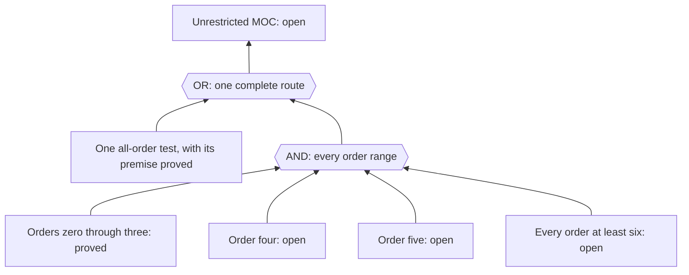

# Marcus–de Oliveira conjecture

This repository records Lean proofs and paper arguments about determinants
of sums of complex normal matrices. The unrestricted conjecture remains
open in this library. The tables below state the main theorems.
The [proof map index](Docs/README.md) links to the arguments and proof routes.

Let $n$ be a nonnegative integer. A complex matrix $A$ is **normal** if
$AA^*=A^*A$, where $A^*$ is its conjugate transpose. Let $A,B$ be normal
matrices of order $n$. List their eigenvalues as $a_1,\ldots,a_n$ and
$b_1,\ldots,b_n$, with multiplicity. Let $S_n$ be the permutations of
the $n$ labels. For $\sigma\in S_n$, define the **matching product**

$$
P_\sigma=\prod_{j=1}^n(a_{\sigma(j)}+b_j).
$$

The Marcus–de Oliveira conjecture in order $n$, written $\mathrm{MOC}_n$,
states that every such pair satisfies

$$
\det(A+B)\in\mathrm{conv}_{\mathbb R}\{P_\sigma:\sigma\in S_n\}.
$$

Here $\mathrm{conv}_{\mathbb R}$ is the real convex hull. Membership means
that $\det(A+B)=\sum_\sigma w_\sigma P_\sigma$ for real weights
$w_\sigma\ge0$ with $\sum_\sigma w_\sigma=1$. Write
$\mathrm{MOC}$ for $\forall n\ge0,\ \mathrm{MOC}_n$.
[Lean statement](Lean/MOC/Core.lean#L33) · [All-order goal](Lean/MOC/Claim.lean#L9)

Choose unitary eigenbases and set
$D=\det(\mathrm{diag}(a)+U\mathrm{diag}(b)U^*)$.
The **mixer** $U$ is the unitary change between the eigenbases.
The notation $\mathrm{diag}(a)$ means the diagonal matrix with entries
$a_i$. Write $I$ for the identity matrix of the required order.
The spectral inclusion for $D$ is equivalent to the matrix conjecture.
[Spectral equivalence](Lean/MOC/Normal.lean#L280)

For a direction $\eta\in\mathbb C$, set
$H=\max_\sigma\mathrm{Re}(\eta P_\sigma)$.
A **directional bound** is $\mathrm{Re}(\eta D)\le H$.
A **contact** is a permutation that attains $H$. Count permutations
even when their products coincide. The **support gap** at $\sigma$ is
$H-\mathrm{Re}(\eta P_\sigma)$.

## Proof tree



A reduction proves an implication. Its open premise still needs a proof.
A restricted case proves inclusion under its stated hypotheses.
[Combined route theorem](Lean/MOC/ProofRoutes.lean#L679)

“Lean Checked?” concerns the linked statement and its imports.
**Yes** means that Lake validated a current cached build.
**No** means that no current passing build is recorded. **Partial** means that
a row has both checked and unchecked sources. **Paper only** means that
the full claim has a paper argument. A checked reduction can have an
open premise. The tables use the current build record.
A changed source or import invalidates its earlier check record.
See the [check-status rules](Docs/README.md#lean-check-status).

## Main spectral theorems

Each row quantifies over all normal pairs in its stated class.
The conclusion is the determinant inclusion, unless the row states a
different conclusion. The order is arbitrary unless the row restricts it.
Spectra can repeat.

| Theorem | Hypotheses and conclusion | Lean statement | Lean Checked? |
| --- | --- | --- | --- |
| Small orders | $0\le n\le3$. No further hypotheses. | [Small orders](Lean/MOC/Small.lean#L68) | Yes |
| Determinant modulus | $\lvert D\rvert\le\max_\sigma\lvert P_\sigma\rvert$ in every order. | [Drury bound](Lean/MOC/DeterminantModulusBound.lean#L141) | Yes |
| Singular sum | $A+B$ is singular. | [Singular sum](Lean/MOC/Singular.lean#L417) | Yes |
| Common eigenbasis | The matrices have a common unitary eigenbasis. | [Common eigenbasis](Lean/MOC/Normal.lean#L240) | Yes |
| Two circles or lines | Each spectrum lies on a circle or a line. The two sets can differ. This includes two Hermitian matrices and two spectra with at most three distinct values each. | [Circle or line case](Lean/MOC/TwoSpectralCircles.lean#L153) · [Hermitian case](Lean/MOC/Hermitian.lean#L53) · [Parallel lines](Lean/MOC/Collinear.lean#L62) · [Three values each](Lean/MOC/TwoSpectralCircles.lean#L161) | Yes |
| Two-circle cover | For circles or lines $C_1,C_2$, all $a_i$ lie in $C_1$ and all $-b_j$ lie in $C_1\cup C_2$. | [Cover theorem](Lean/MOC/TwoCircleCover.lean#L10) | No |
| Four omitted labels | One circle or line contains every $a_i$ and all but at most four entries of $-b$. Count entries with multiplicity. | [Four labels](Lean/MOC/HermitianByNormalFourProof.lean#L82) | No |
| Three omitted values | One circle or line contains every $a_i$. The entries of $-b$ outside it take at most three distinct values. | [Three values](Lean/MOC/HermitianByNormalGeneral.lean#L90) | No |
| Small multiplicities | Either spectrum has at most two values; or deleting one entry leaves at most two values; or one list is constant outside at most two positions. | [Two values](Lean/MOC/TwoValues.lean#L348) · [One deletion](Lean/MOC/ThreeValues.lean#L14) · [Two exceptions](Lean/MOC/TwoExceptions.lean#L247) | Partial (2/3) |
| Shifted rank sum | For some $t\in\mathbb C$, $\mathrm{rank}(A+tI)+\mathrm{rank}(B-tI)\le n+2$. | [Rank sum](Lean/MOC/RankTwoOverlap.lean#L724) | No |
| Opposite scalar padding | Start with lists of length $d$. Append $m$ copies of $c$ and $m$ copies of $-c$. Let $r,s$ be their original multiplicities. Inclusion holds for every enlarged mixer if $d\le m+2+r+s$. If the original pair satisfies inclusion for every mixer and $d\le r+s+3$, every $m$ is allowed. | [Rank condition](Lean/MOC/MarkedPadding.lean#L21) · [Extension](Lean/MOC/MarkedPadding.lean#L60) | Yes |
| Opposite pair with multiplicity | Some $a_i+b_j=0$. The multiplicities of these two eigenvalues sum to at least $n-2$. | [Multiplicity bound](Lean/MOC/OppositePair.lean#L25) | Yes |
| Shifted normal product | $(A-cI)(B-dI)$ is normal for some independent $c,d\in\mathbb C$. Singular matrices are allowed. The case $c=d=0$ covers a normal product $AB$. | [Shifted product](Lean/MOC/NormalProductInclusion.lean#L251) | No |
| Normal relative product | $A$ is invertible and $A^{-1}B$ is normal. | [Relative product](Lean/MOC/NormalProductInclusion.lean#L292) | No |
| Quadratic rank-one family | Let $H=\mathrm{diag}(d)+sww^*$, with real $d$, complex $w$, and $s\in\{-1,1\}$. Inclusion holds for $H^2+cH+eI$ and every complex diagonal partner, for all $c,e\in\mathbb C$. | [Quadratic inclusion](Lean/MOC/QuadraticHermitianRankOneInclusion.lean#L178) | Yes |
| A spectrum and its negative | Let $b=-a$. Inclusion holds if $U-E$ has rank at most two for some complex diagonal $E$. In odd order it also holds if nonzero $d_i$ satisfy $d_iU_{ij}=d_jU_{ji}$ whenever $a_i\ne a_j$. | [Rank condition](Lean/MOC/NegativeCopyInclusion.lean#L116) · [Odd-order symmetry](Lean/MOC/NegativeCopyInclusion.lean#L60) | Yes |
| Weighted permutation cycles | In the basis where one matrix is diagonal, the other is a block sum of normal weighted permutation cycles. Each block can have its own scalar shift. | [Block theorem](Lean/MOC/WeightedPermutationCycle.lean#L191) | Yes |

The [spectral maps](Docs/README.md#spectral-and-mixer-cases) give the proofs.
The [quadratic map](Docs/quadratic-rank-one-perturbations-proof-map.md)
also proves normality and a rank bound for every real $s$.

## Common permutation weights

A **common law** fixes the weights before the stated spectral values
vary. Each row specifies which data stay fixed. The notation
$v^{\mathsf T}$ means the transpose of a real column vector $v$.

| Fixed data | Values allowed to vary and conclusion | Lean statement | Lean Checked? |
| --- | --- | --- | --- |
| A mixer and two fixed groups in one spectrum | One law works for both complex group values and every opposing spectrum. | [Two-group law](Lean/MOC/TwoValues.lean#L285) | Yes |
| A mixer and three fixed groups, one a singleton | One law works for all three complex group values and every opposing spectrum. | [Three-group law](Lean/MOC/ThreeValues.lean#L51) | No |
| A mixer and shifted supports of total size at most $n+2$, with $n\ge2$ | One law works for all values on the allowed labels. Additional zeros are allowed. | [Shifted-support law](Lean/MOC/RankTwoOverlap.lean#L709) | No |
| A unitary eigenbasis of $\mathrm{diag}(d)+vv^{\mathsf T}$ | Let $d,v$ be real, with $v_i\ge0$. Require distinct update eigenvalues. One law works for every pair of complex spectra at this mixer. Repeated entries of $d$ and zero entries of $v$ are allowed. | [Cauchy eigenbasis law](Lean/MOC/HermitianRankOneCauchyWeights.lean#L137) | Yes |
| A normal matrix of order four with spectrum on one circle or line | One law works for every complex diagonal partner. For Hermitian matrices it gives all principal minors together. Every real linear objective on those minors has a diagonal permutation maximizer. | [Common law](Lean/MOC/FourCircleLineCommonWeights.lean#L92) · [Principal minors](Lean/MOC/FourCircleLineCommonWeights.lean#L767) · [Maximum](Lean/MOC/FourCircleLineCommonWeights.lean#L835) | No |
| A partition of coordinates into $X,H,Y$ and fixed orthogonal projections on $X\cup H$ and $H\cup Y$ | The first matrix is a scalar plus a multiple of its projection on $X\cup H$, and is diagonal on $Y$. The second has this form on $H\cup Y$, and is diagonal on $X$. One law works for all complex levels and private diagonal entries. The overlap $H$ has arbitrary dimension. | [Overlapping-block law](Lean/MOC/OverlappingProjectionBlocks.lean#L636) | Yes |

See the maps for [Cauchy eigenbases](Docs/cauchy-eigenbasis-permutation-laws-proof-map.md),
[three groups](Docs/three-spectral-values-with-one-singleton-proof-map.md),
and [projection blocks](Docs/projection-leaf-deletion-proof-map.md).

## Mixer theorems

Each row gives inclusion for every pair of complex spectra, except where
it states a spectral restriction. The **operator norm** is the Euclidean
operator norm. A **generalized circle** is a circle, a point circle, or
a straight line.

| Mixer or construction | Hypotheses and conclusion | Lean statement | Lean Checked? |
| --- | --- | --- | --- |
| Sparse rows or columns | Every row has at most three nonzero entries, or every column has at most three. One common law works for all spectra. | [Inclusion](Lean/MOC/SparseUnitary.lean#L27) · [Row law](Lean/MOC/SparseUnitaryUniversalWeights.lean#L69) · [Column law](Lean/MOC/SparseUnitaryUniversalWeights.lean#L84) | No |
| Small total support | There are at most $n+8$ nonzero entries. One common law works for all spectra. In order four, four zeros in any positions suffice. | [Total support](Lean/MOC/SparseUnitaryUniversalWeights.lean#L121) · [Four zeros](Lean/MOC/SparseUnitaryUniversalWeights.lean#L138) | No |
| Rank-one unitary phase | $U=I+(z-1)vv^*$, with $v$ a unit vector and $\lvert z\rvert=1$. This includes a Householder reflection. | [Rank-one phase](Lean/MOC/HouseholderSupport.lean#L360) | Yes |
| Small diagonal blocks | Independent row and column permutations give diagonal blocks of orders at most three. This includes a mixer that differs from the identity only on one principal block of order at most three. | [Block theorem](Lean/MOC/ExtendedCases.lean#L91) · [Principal block](Lean/MOC/IdentityPadding.lean#L52) | Yes |
| One shared coordinate | Two unitary blocks share exactly one coordinate. Inclusion for all spectra at each factor gives inclusion for their product. | [Composition](Lean/MOC/SinglePortComposition.lean#L132) | No |
| Recursive block joins | Start with identities, unitaries of orders at most three, the order-four zero-diagonal or complex Hadamard mixers, two-by-two tensor mixers, or mixers in the order-five Fourier ball. Apply any finite sequence of joins at one shared coordinate. That coordinate can change at each step. | [Construction and theorem](Lean/MOC/UnitaryBlockTree.lean#L121) | No |
| Staircase zeros | In positive order, use indices $0,\ldots,n-1$. Choose steps in $\{0,1,2\}$ with sum $n-1$. At each prefix sum $k$, require $U_{ij}=0$ for $i>k$, $j<k$. This includes upper Hessenberg unitaries. | [Staircase theorem](Lean/MOC/StaircaseZeroCorners.lean#L91) | No |
| Gates on a forest | Apply determinant-one two-coordinate unitary gates on distinct forest edges, in any order. One law works for all spectra. | [Forest law](Lean/MOC/ForestGates.lean#L167) | No |
| Two layers on an even cycle | The cycle has at least four coordinates. All gates except at most two have squared entry moduli $1/2$. One law works for all spectra. | [Cycle law](Lean/MOC/TwoBiasedCyclicGateLaw.lean#L331) | No |
| Opposite pair sums on a cycle | Each first-layer spectral pair has sum $c$ and each second-layer pair has sum $-c$. Gate probabilities and phases are arbitrary. | [Spectral cycle theorem](Lean/MOC/CyclicAntipodalSpectra.lean#L149) | No |
| Tensor product | $U$ is the tensor product of two order-two unitaries. A common law on at most ten permutations works for all spectra. | [Tensor law](Lean/MOC/TwoByTwoTensorPermutationLaw.lean#L437) | Yes |
| Overlapping circle blocks | Let $S,T$ cover the coordinates. The normal matrices $A,B$ act on these respective blocks and are diagonal elsewhere. One generalized circle contains the spectrum of $A$ on $S$ and $-B_{jj}$ for $j\in S\setminus T$. Another contains the negative spectrum of $B$ on $T$ and $A_{ii}$ for $i\in T\setminus S$. | [Block theorem](Lean/MOC/OverlappingCircleBlocks.lean#L83) | No |
| Forest bridges between spectral blocks | Start with unitary diagonal blocks. In each block, choose at most four row labels. One generalized circle contains every second-spectrum value and the negatives of the first-spectrum values outside those rows. Apply determinant-one two-row gates between chosen rows. The joined block pairs are distinct edges of a forest. | [Forest bridge theorem](Lean/MOC/FourOutlierForestBridges.lean#L76) | No |

The [sparse mixer map](Docs/sparse-unitary-proof-map.md) lists the base
mixers for recursive joins. The
[overlapping-circle map](Docs/overlapping-circle-blocks-proof-map.md)
defines the block conditions and spectral signs.

## Order four

The full statement $\mathrm{MOC}_4$ remains open in this library.
A **cost profile** is a real function on the 24 permutations. A ray
consists of the nonnegative multiples of one such function. A
**subset-image indicator** is one when a permutation sends a specified
subset onto another specified subset, and zero otherwise. These
indicators span the real matching-function space. A **matching square**
is the square of a function in this space. The maps define the ordinary
and mixed rays used in the certificates below.

| Result | Hypotheses and conclusion | Lean statement | Lean Checked? |
| --- | --- | --- | --- |
| Circle or line | Either spectrum lies on a circle or a line. The other spectrum and mixer are arbitrary. | [Inclusion](Lean/MOC/HermitianByNormalFourProof.lean#L64) | No |
| Opposite pair | Some $a_i+b_j=0$. All other values and the mixer are arbitrary. | [Inclusion](Lean/MOC/FourCoincidence.lean#L360) | Yes |
| Zero diagonal | Every diagonal entry of $U$ is zero. | [Inclusion](Lean/MOC/OrderFourZeroDiagonalUnitary.lean#L196) | Yes |
| Complex Hadamard mixer | Every entry of $U$ has modulus $1/2$. One law works for all spectra. | [Common law](Lean/MOC/OrderFourComplexHadamard.lean#L259) | Yes |
| Real-parameter family | For every real $t$, take $a=(t+i,-t+i,1,2+i)$ and $b=(-1+i,-2-2i,2-i,1+2i)$. Inclusion holds for every unitary. | [Parameter theorem](Lean/MOC/FourRealParameterCells.lean#L142) | No |
| Weighted-minor center | The explicit complex lists in the linked map satisfy inclusion for every unitary. Nine edge certificates prove the result. | [Center theorem](Lean/MOC/FourWeightedMinorCenter.lean#L471) · [Spectra](Docs/order-four-weighted-minor-center-proof-map.md) | Yes |
| Eight six-contact support statements | For each specified pattern, the source states the directional determinant bound for every unitary. Additional contacts and repeated eigenvalues are allowed. | [Exact contact sets and check status](Docs/order-four-six-contact-support-proof-map.md) | Partial (6/8) |
| Two real minor tables | Every complex unitary squared-minor table is a convex combination of two real orthogonal tables. Both real matrices have first row $(\lvert U_{1j}\rvert)_j$. | [Fixed-row theorem](Lean/MOC/FourMinorTransport.lean#L582) · [Hull equality](Lean/MOC/FourMinorTransport.lean#L602) | Yes |
| Support-cost cone | The cone of nonnegative matching functions has 34 ordinary and 48 mixed extreme rays. Relabeling and cancellation give an ordinary sum or one mixed ray with at most thirteen ordinary coefficients. | [Classification](Lean/MOC/FourSupportConeClassification.lean#L827) · [Cancellation](Lean/MOC/FourMixedRayCancellation.lean#L515) | Partial (1/2) |
| Matching squares give support | If an actual spectral support gap is a sum of matching squares, the directional determinant bound holds for every complex unitary. | [Square evaluation](Lean/MOC/FourMatchingPhysicalPositivity.lean#L201) · [Support bound](Lean/MOC/FourMatchingPhysicalPositivity.lean#L227) | No |
| Four-function square certificate | Let $r_i$ be ordinary ray $i$ and $m$ the canonical mixed ray. Real $a,b,e$ with $a>0$, $ab>1$, and $(a+1)(b+1)\le e(ab-1)$ give a matching-square certificate for $m+a r_7+b r_{13}+e r_{31}$. | [Square certificate](Lean/MOC/FourMatchingGramBudget.lean#L172) | Yes |
| Canonical support interval | The spectral gap is the fixed mixed ray plus a nonnegative sum of the thirteen specified ordinary rays. At normalized height in $[0,1/2]$, it is a sum of matching squares and gives the directional bound for every unitary. | [Squares](Lean/MOC/FourCanonicalHeightSquares.lean#L719) · [Bound](Lean/MOC/FourCanonicalHeightSquares.lean#L767) | No |
| Klein-four contacts | The identity and the three products of disjoint transpositions attain the largest projection. The source gives matching squares. | [Certificate](Lean/MOC/FourKleinSpectralSquares.lean#L259) | No |
| Symmetric six-contact family | The actual spectral gap has the seven ordinary terms and mixed term specified in the source, with nonnegative coefficients. The source gives the support bound. | [Support statement](Lean/MOC/FourSymmetricSixContactCertificate.lean#L411) | No |

The [order-four map](Docs/order-four-proof-map.md) gives the contact tests,
spectral equations, and conditional certificates.

## Order five and order six

The full statement $\mathrm{MOC}_5$ remains open in this library.

| Order | Hypotheses and conclusion | Lean statement | Lean Checked? |
| --- | --- | --- | --- |
| Five | Every unitary in some open operator-norm ball about the normalized Fourier matrix has a common law for all spectra. | [Fourier neighborhood](Lean/MOC/FiveFourierNeighborhood.lean#L68) | Yes |
| Five | A two-by-two zero submatrix of $U$ gives inclusion for all spectra. The proof uses two factors of order three. | [Zero rectangle](Lean/MOC/SinglePortZeroCorner.lean#L242) | No |
| Five | Zero diagonal and off-diagonal magnitudes $1/2$ give inclusion for all spectra. | [Equal magnitudes](Lean/MOC/ConferenceFive.lean#L260) | Yes |
| Five | One real spectrum and at least one real entry in the other spectrum give inclusion. | [Real entry theorem](Lean/MOC/HermitianByNormalFourProof.lean#L104) | No |
| Six | The source gives a closed mixer ball of radius $1/23083105288$ about a specified rational orthogonal matrix. The first spectrum is arbitrary. The second is constant on each of three specified pairs. | [Ball statement](Lean/MOC/SixDimensionalMixerBall.lean#L1499) | No |

The [order-five map](Docs/order-five-proof-map.md#exact-spectral-and-mixer-cases)
also gives paper theorems for an explicit open mixer ball, two free
complex entries in every order at least five, and a complex spectral
neighborhood. The [order-six map](Docs/six-dimensional-mixer-ball-proof-map.md)
gives the ball certificate and its verification limit.

## Spectral perturbations and determinant identities

Each row states the data that stay fixed and the values that vary.

| Result | Quantifiers and conclusion | Lean statement | Lean Checked? |
| --- | --- | --- | --- |
| Small spectral parameter | Fix nonzero $a_i$ and a complex list $b$. The sums $\sum_j b_j/a_{\sigma(j)}$ are distinct, with no three collinear. Some $r>0$ gives inclusion for $a,tb$ for every $U$ and every complex $\lvert t\rvert<r$. | [Uniform perturbation](Lean/MOC/SmallSpectralPerturbation.lean#L757) | No |
| Generic affine centers | Fix lists $a,b$ with distinct entries. On a dense open set of centers $z$, some $r>0$ gives inclusion for $a,(z+tb_j)_j$ for every $U$ and $\lvert t\rvert<r$. | [Affine perturbation](Lean/MOC/ReciprocalSpectralPerturbation.lean#L233) | No |
| Uniform large shifts | If the assignment sums $\sum_j a_{\sigma(j)}b_j$ are distinct with no three collinear, some $R>0$ gives inclusion for $(a_i+z)_i,b$ for every $U$ and $\lvert z\rvert>R$. For fixed distinct $a$, these partners form an open dense set. | [Uniform shift](Lean/MOC/UniformExteriorShift.lean#L67) · [Generic partners](Lean/MOC/GenericExteriorShift.lean#L97) | Partial (1/2) |
| Large shifts with one real spectrum | Fix a real first spectrum and any complex second spectrum. One radius gives inclusion for every mixer and every complex shift outside that radius. The radius follows from a positive triangle gap of the second spectrum. | [Uniform real-spectrum radius](Lean/MOC/HermitianExteriorShift.lean#L1188) | No |
| Fixed-mixer large shifts | Fix $a,b,U$, with every entry of $U$ nonzero. Inclusion holds for $(a_i-z)_i,b$ for all sufficiently large $\lvert z\rvert$. The radius can depend on $U$. | [Fixed-mixer theorem](Lean/MOC/ExtendedCases.lean#L428) | Yes |
| Collinear matching products | All $P_\sigma$ lie on one real affine line in the complex plane. Then inclusion holds. | [Hull inclusion](Lean/MOC/CollinearKernelSupport.lean#L190) | Yes |
| Normal maximizing sum | Fix spectra and a direction. At a directional maximum, the sum is normal and has the largest Frobenius norm among the maximizing sums. Inclusion holds at this mixer. The Frobenius norm is the square root of the sum of squared entry moduli. | [Maximum theorem](Lean/MOC/NormalOrbit.lean#L408) | Yes |
| Fractional-linear transport | Apply $f(z)=(\alpha z+\beta)/(\gamma z+\delta)$ to $a$ and $-b$. Require $\alpha\delta-\beta\gamma\ne0$ and no pole on either list. Inclusion for $f(a),-f(-b)$ is equivalent to the original inclusion at the same $U$. | [Transport](Lean/MOC/ProjectiveTransport.lean#L61) | Yes |
| Transposition winding | A closed walk of matching products uses transposition edges, avoids a point, and has nonzero winding about it. Some unitary attains that point as its determinant. Repeated eigenvalues are allowed. | [Attainment statement](Lean/MOC/TranspositionWinding.lean#L681) | No |
| Spectral profile determinant | For $n\ge2$, the transformed spectral polynomial is a determinant of order $n-2$. In order four its complex quadratic form has rank at most four. Its real positive and negative indices are at most four. | [Determinant](Lean/MOC/SpectralProfileDeterminant.lean#L347) · [Rank and indices](Lean/MOC/SpectralProfileDeterminant.lean#L437) | Yes |
| First three elementary coefficients | Fix $U$. One law gives the first three coefficients of $\det(I+x(A+B))$ for every pair of spectra. Here $x$ is the polynomial variable. | [Coefficient law](Lean/MOC/Reformulations/SecondCoefficient.lean#L248) | Yes |
| Balanced matrix evaluations | In positive order, two complex functions on permutations differ by a constant if their signed determinant evaluations agree on every complex matrix with zero row and column sums. | [Recovery theorem](Lean/MOC/BalancedMatchingProbes.lean#L203) | Yes |
| Nested subset law | Fix a unitary and nested column sets that increase one label at a time. One permutation law gives the squared-minor distribution at every set in the chain. | [Full-flag law](Lean/MOC/FullFlagLaw.lean#L209) | Yes |
| Forced eigenvalue multiplicity | Let $m_a(c)$ count entries of $a$ equal to $c$. For $z\in\mathbb C$ and an integer $k\ge0$, every mixer gives eigenvalue $z$ in the sum with algebraic multiplicity at least $k+1$ exactly when some $c$ has $m_a(c)+m_b(z-c)>n+k$. | [Multiplicity criterion](Lean/MOC/ForcedSpectralMultiplicity.lean#L171) | No |
| Singularity criterion | For fixed lists $a,b$, some mixer gives a singular sum exactly when the real convex hulls of $(a_i,\lvert a_i\rvert^2)$ and $(-b_j,\lvert b_j\rvert^2)$ intersect. | [Moment-hull criterion](Lean/MOC/Singular.lean#L496) | Yes |
| Gaussian spectra | Independent standard complex Gaussian eigenvalues give the stated matching-triangle probability and product lower-tail bounds. The containment estimate also assumes measurability and the stated determinant second-moment bound. | [Triangle bound](Lean/MOC/GaussianHaarContainment.lean#L635) · [Product tail](Lean/MOC/GaussianHaarContainment.lean#L1159) · [Conditional containment](Lean/MOC/GaussianHaarContainment.lean#L1197) | Yes |

## Equivalent tests and proved reductions

Each named test below includes all the hypotheses and quantifiers in
its row. A subscript gives the matrix order.
$C_m$ is the rectangular test with $m$ orthonormal rows and $m+1$
columns. It compares the compressed determinant with the products over
all injections of row labels into column labels. $N_n$ states that,
for every pair of spectra and direction, some maximizing mixer gives
a normal sum. $O_n$ is inclusion for every real orthogonal mixer of
order $n$ and all complex spectra.

| Test or premise | Exact relation | Lean statement | Lean Checked? |
| --- | --- | --- | --- |
| All matrix orders | $\mathrm{MOC}\Longleftrightarrow\bigl(\mathrm{MOC}_4\land\mathrm{MOC}_5\land\forall n\ge6,\ \mathrm{MOC}_n\bigr)$ | [Order split](Lean/MOC/ConjectureOrderSplit.lean#L6) | Yes |
| Rectangular compression | $\mathrm{MOC}_{n+1}\Longleftrightarrow C_n$ for every $n\ge0$ | [One-order reduction](Lean/MOC/PrincipalCoisometry.lean#L150) | Yes |
| Normal maximizers | $\bigl((\forall m<n,\ \mathrm{MOC}_m)\land N_n\bigr)\Longrightarrow\mathrm{MOC}_n$ | [Induction theorem](Lean/MOC/NormalSupportMaximum.lean#L270) | No |
| Real orthogonal mixers in order four | $\mathrm{MOC}_4\Longleftrightarrow O_4$ | [Orthogonal equivalence](Lean/MOC/FourMinorTransport.lean#L645) | Yes |
| At least $2n-1$ contacts in every direction | $\mathrm{MOC}_n\Longleftrightarrow \text{terminal-contact test}_n$ | [Terminal contact test](Lean/MOC/AffineGapCover.lean#L85) | Yes |
| One free partner eigenvalue, with one law for its whole affine polynomial | $\mathrm{MOC}_n\Longleftrightarrow \text{one-free-entry law}_n$ | [Free-entry equivalence](Lean/MOC/FreeEntryEquivalence.lean#L19) | Yes |
| Equal second elementary spectral coefficients | $\mathrm{MOC}_n\Longleftrightarrow \text{equal-second-coefficient test}_n$ | [Second coefficient](Lean/MOC/EqualSpectralCoefficients.lean#L91) | Yes |
| Equal first and second elementary spectral coefficients | $\mathrm{MOC}_n\Longleftrightarrow \text{equal-first-and-second-coefficient test}_n$ | [Both coefficients](Lean/MOC/EqualSpectralCoefficients.lean#L428) | Yes |
| Distinct first spectrum on the specified fixed parabola | $\mathrm{MOC}_n\Longleftrightarrow \text{parabola test}_n$ for $n=4,5$ | [Order four](Lean/MOC/ConicSpectralReductions.lean#L330) · [Order five](Lean/MOC/ConicSpectralReductions.lean#L1348) | Yes |
| Distinct first spectrum on the specified fixed hyperbola | $\mathrm{MOC}_n\Longleftrightarrow \text{hyperbola test}_n$ for $n=4,5$ | [Order four](Lean/MOC/ConicSpectralReductions.lean#L390) · [Order five](Lean/MOC/ConicSpectralReductions.lean#L1369) | Yes |

The [all-order map](Docs/all-orders-proof-map.md) gives the complete
public route list. The [contact map](Docs/contact-transfer-proof-map.md)
explains each threshold. A checked equivalence verifies the relation;
its two sides can remain open.

## Paper theorems

These full arguments remain outside Lean. The table separates each paper
conclusion from the available Lean result. A checked subcase or reduction
does not check the full paper theorem.

A frame is a matrix with orthonormal columns. Its overlap $k$ is the
common number of columns in the two compressed matrices. A principal
minor uses the same set of row and column labels.

| Theorem | Scope and conclusion | Argument and current Lean scope | Lean Checked? |
| --- | --- | --- | --- |
| Normal diagonal plus rank one | A normal matrix differs from a diagonal matrix by rank at most one in the partner basis. One law gives every principal minor and works for all complex diagonal partners. | [Paper argument](Docs/all-orders-proof-map.md#the-common-law-for-a-normal-rank-one-perturbation-of-a-complex-diagonal). Lean proves a [simple Hermitian rank-one subcase](Lean/MOC/HermitianRankOneCauchyWeights.lean#L137). The general normal case and repeated-spectrum extension remain outside Lean. | Paper only |
| Strict rank-one laws | A real diagonal matrix has distinct entries and every entry of the rank-one vector is nonzero. For each nonzero real update coefficient, a common principal-minor law has positive mass on every permutation. This persists on an open set of Hermitian matrices. | [Strict laws and stability](Docs/all-orders-proof-map.md#strict-positivity-of-a-single-law). The available [nonnegative law](Lean/MOC/HermitianRankOneCauchyWeights.lean#L137) does not establish strict positivity or the open neighborhood. | Paper only |
| Smaller frame reduction | For every positive overlap $k$, square orders through $3k^2-k$ suffice for the scalar frame inclusion. At $k=3$ this is order 24. | [Paper argument](Docs/all-orders-proof-map.md#finite-overlap-compression). The [Lean reduction](Lean/MOC/FiniteFrameLabels.lean#L501) requires orders through $4k^2-k$, which gives order 33 at $k=3$. | Paper only |
| Symmetric cube mixer | The symmetric cube of any determinant-one unitary of order two satisfies inclusion for all complex spectra in order four. | [Paper certificate](Docs/order-four-symmetric-cube-mixer-proof-map.md). Lean checks the [reduction to real rotations](Lean/MOC/BinaryCubicMixerReduction.lean#L152). The scalar spectral certificate remains outside Lean. | Paper only |
| Order-four open spectral set | Each entry of the two weighted-minor center lists can vary by less than $10^{-17}$ in complex modulus. Inclusion holds for every unitary. | [Paper argument and center](Docs/order-four-proof-map.md#an-open-set-of-spectra-with-a-uniform-proof). The [Lean statement](Lean/MOC/FourWeightedMinorCenter.lean#L471) covers the center. It does not include the radius. | Paper only |
| Order-five open spectral set | Each complex spectral entry can vary by at most $5\cdot10^{-16}$ from the specified center. Inclusion holds for every unitary. | [Center, radius, and paper certificate](Docs/order-five-proof-map.md#exact-spectral-and-mixer-cases). The uniform spectral neighborhood has no Lean statement. | Paper only |
| Order-five open mixer ball | Each unitary at operator-norm distance less than $1/167772160$ from the specified rational orthogonal matrix has a common law for each real first list and all complex second lists. | [Center and paper certificate](Docs/order-five-proof-map.md#exact-verification). The [Lean Fourier neighborhood](Lean/MOC/FiveFourierNeighborhood.lean#L68) has a different center and no specified radius. | Paper only |

## Open all-order targets

The full inclusion remains open for each class below. The maps record
the proved subclasses and reductions.

- Each spectrum has at most one nonreal eigenvalue, with multiplicity.
- The mixer is a product of two arbitrary Householder reflections.
- The mixer is the discrete Fourier matrix in arbitrary order.
- For fixed spectra, one exterior-shift radius works for every mixer
  without a genericity hypothesis.
- Every row of the mixer has at most four nonzero entries.
- Some $a_i+b_j=0$, without a multiplicity restriction.
- The spectra of $A$ and $-B$ lie on the same two parallel lines.
- $A,B,A+B$ are normal, without a maximality hypothesis.
- In a fixed basis, $A$ is normal and differs from a complex diagonal
  matrix by rank at most two; its partner is arbitrary complex diagonal.

## Computational counterexample search

The [emergent-dimension search engine](search/README.md) searches variable-size spectral/unitary graphs without an order parameter or order sweep. It uses a numerical support oracle for discovery and Gaussian-integer arithmetic for exact directional witness verification.

## Check the Lean source

Use the version in [lean-toolchain](lean-toolchain): Lean 4.19.0.
The [Lake configuration](lakefile.toml) pins mathlib. From the repository
root, fetch the dependency cache and check a selected module:

```sh
taskset -c 0-3 timeout 15m lake exe cache get
LEAN_NUM_THREADS=2 taskset -c 0-3 timeout 15m lake build +MOC.Small:olean
```

Use `LEAN_NUM_THREADS=2 taskset -c 0-3 timeout 60m lake build` for the
complete default target. These commands use four CPU cores. A command
that reaches its time limit leaves the check incomplete.
The default target imports the documented modules. The complete build
has not passed. Some source files
are retained without a passing build. A source file alone is not a
checked theorem.

The latest refactor uses declaration-local resource limits and finite
heartbeat limits for certificate proofs. It replaces several proof-search
branches with explicit cases. Named algebra lemmas separate rational
identities from the contact-capacity proofs. The polynomial normalizer
uses Boolean comparisons and reuses the input term count during merges.
The build stopped before completion. Revised proofs without a current
passing build remain unchecked. The latest completed axiom audit covers
142 modules. Later builds still need a combined axiom audit.
The full T34 polynomial certificate reached the limit of 12 gibibytes
of memory. That check remains incomplete, and its status is **No**.

The [default target](Lean/MOC.lean#L506) audits the safe imported
declarations. Its allowed axioms are propositional extensionality
(`propext`), classical choice (`Classical.choice`), and quotient soundness
(`Quot.sound`). The audit for the complete library remains pending with
the complete build.
